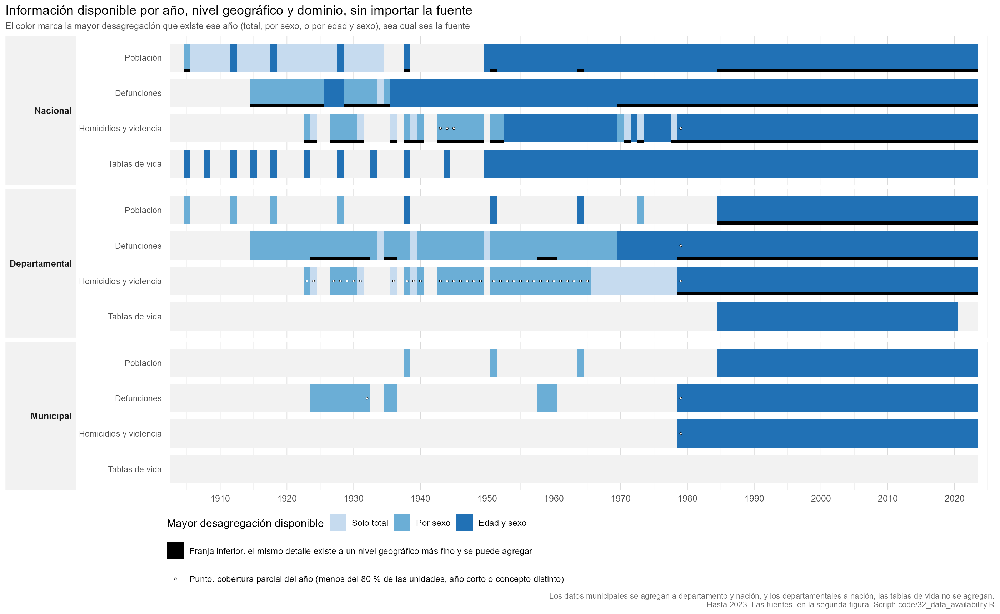
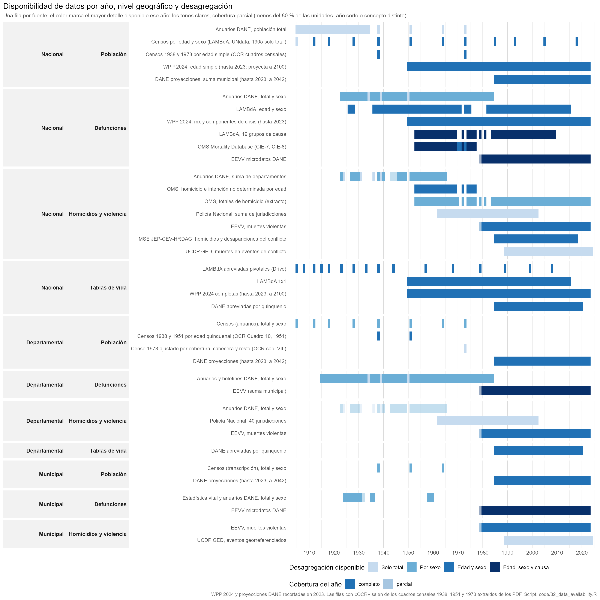
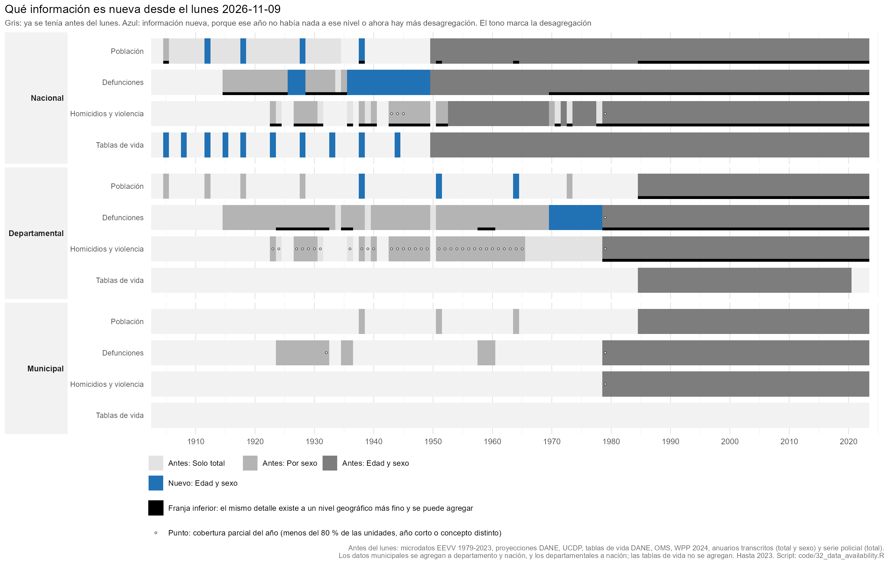
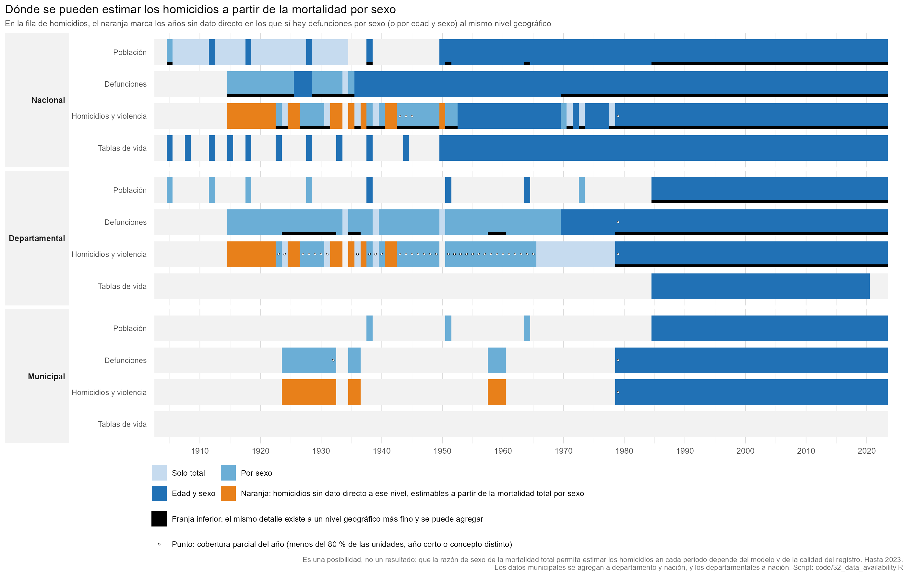

# Inventario de datos de mortalidad: Colombia, niveles nacional, departamental y municipal

Estado al 2026-11-12 (versión anterior: 2026-11-10). Rutas relativas a la raíz del proyecto
(`C:\Users\kikep\gits\colombia_homicidios`). `data_input/` contiene insumos originales o transcritos;
`data_inter/` productos intermedios de los scripts; `output/tables/` las series finales.

El inventario existe también como datos: el registro de fuentes y el catálogo de archivos de
`documents/inventory/`, que `code/32b_data_catalog.R` cruza con el disco (tamaño, fecha, sha256, si
está en git) y escribe en `output/tables/data_catalog.csv` y `data_catalog_files.csv`. La sección 8
lo describe, junto con los documentos fuente.

## Novedades desde la versión del 2026-11-10

Estado del 2026-11-12. Si un archivo está o no en git lo dice la columna `en_git` de
`output/tables/data_catalog_files.csv`; aquí no se repite porque cambia con cada commit.

| Qué entra | Archivos | Estado |
|---|---|---|
| **Censo de 1964, resumen general**: edad quinquenal por sexo y zona para 27 unidades (cuadro 7) y edad simple nacional por sexo y zona (cuadro 9) | `data_input/dane_pdfs/censos/1964/LD_771_1964.pdf`; `census_tables/census1964_dept_age5_sex_zone.csv`, `census1964_single_age_sex_zone.csv` | extraído y validado (hist/23) |
| **DANE, *Registro de defunciones en Colombia, 1970-1978*** (1987, 472 páginas): defunciones por edad y sexo, nacional y por sección del país, 1970-1978; 150 causas por edad y sexo, nacional, 1973-1978; menores de cinco años por sección; total nacional 1915-1984 | `data_input/dane_pdfs/vitales/LD_8789_1970_1978_EJ_3.pdf`; `dane_defunciones_1970_1978_cuadro01 … cuadro11*.csv` (seis tablas: 1, 2, 3, 6, 10 y 11) | extraído y verificado por identidades (`code/historical/25_dane_defunciones_1970_1978.R`) |
| **Hijos nacidos vivos y sobrevivientes, censo de 1973** (cuadros 21 y 21A) | `census_tables/census1973_children_ever_born_age.csv`, `…_units.csv` | versionado; lo usa el script 43 |
| **UN IGME 2024**: mortalidad infantil, de 1 a 4 y de menores de cinco años por sexo, 1950-2024, con los puntos de cada fuente | `data_input/reference/unigme2024_colombia_sdmx.csv` | scripts 41-43 |
| **Tablas de vida del National Research Council (1982)**, 1950-1975 cada cinco años, por sexo | `data_input/reference/nrc1982_colombia_lifetables.csv` | script 44 |
| **OMS, grupos de causa por edad y sexo** (externas, violentas, mal definidas), 1953-1977 | `data_input/reference/who_causes_age_colombia_1953-1977.csv` | script 40 |
| Coeficientes de Trussell y tablas modelo Coale-Demeny para el método de Brass | `data_input/reference/trussell_child_mortality_coefficients.csv`, `coale_demeny_child_q_by_level.csv` | script 43 |
| WPP 2024, población al 1 de enero por edad simple y sexo, 1950-2024 | `data_input/reference/wpp2024_colombia_pop_1jan_single_age_1950-2024.csv` | versionado; scripts 37-39 |
| Productos de los scripts 34 a 44: contraste con WPP, completitud comparada, reconstrucción poblacional, componentes de la mortalidad, mortalidad en la niñez (sección 5) | `output/tables/` | scripts 34 a 44 |
| **Carpeta `data_input/dane_pdfs/`**: 49 PDF de la biblioteca digital del DANE (907 MB). Anuarios de 1915 a 1931 y de 1968-1969, once boletines mensuales de 1977 a 2005, *Nacimientos registrados 1973-1984*, estimaciones departamentales de mortalidad infantil 1981-1993, mortalidad materna 1992-1996, la muestra de avance del censo de 1973, Estudios postcensales 7 y 8 y el estudio CIMED-ERED 1971-1974, entre otros | `data_input/dane_pdfs/*.pdf` | catalogados con su dirección de origen; sin extraer. Ocho son documentos que citaban las transcripciones; tres duplican PDF de `historical/` |
| **Series postcensales e intercensales del DANE** (`data_input/dane_pdfs/censos/`): proyecciones de población por área, sexo y edad simple, nacionales 1950-2017 y 2018-2070 y departamentales 1985-2050 (cuatro libros); y *Conciliación censal 1985-2005: estimación de la mortalidad* (2007, 299 páginas), con tablas de mortalidad por sexo, nacionales y departamentales, de 1985, 1993 y 2005 y de los quinquenios 1985-2005, e0 y mortalidad infantil en los censos de 1951 a 2005 y factores de ajuste de las defunciones de 2005 | `PPED-AreaSexoEdadNac-*.xlsx`, `DCD-area-sexo-edad-proypoblacion-dep-*.xlsx`, `PPED-AreaSexoEdadDep-2018-2050_VP.xlsx`, `5Mortalidad85_05.pdf` | catalogados el 2026-11-12. De la conciliación se extrajeron las tablas 3.3, 3.13 y 3.14 y los anexos 1, 2 y 3 (`data_input/historical/dane_conciliacion_1985_2005_*.csv`, scripts hist/31a-c); las proyecciones siguen sin extraer ni usar. No cambian la figura 0.1: la población nacional por edad y sexo desde 1950 ya la daba WPP, y la departamental desde 1985 sale de los municipios de DANEpop |
| Registro de fuentes, catálogo de archivos y lista de documentos fuente con su dirección de origen (sección 8) | `documents/inventory/`, `output/tables/data_catalog*.csv` | nuevo en esta versión |

## 0. Vista rápida: qué información hay y de qué fuentes

Son dos figuras. La primera dice qué información existe cada año, sin importar quién la produjo; la
segunda, de qué fuentes sale y cómo se traslapan.

### 0.1 Información disponible

Una fila por nivel geográfico (nacional, departamental, municipal) y dominio (población,
defunciones, homicidios y violencia, tablas de vida). El color es la mayor desagregación que
existe ese año, de cualquier fuente: solo total, por sexo, o edad y sexo, de modo que cambia con la
estratificación de los datos y no con la fuente. La causa de muerte no es un estrato de la figura:
la que interesa es la violenta, y tiene su propia fila. Tampoco figura la mortalidad en la niñez
(sección 2.4). Una fila en gris es un hueco: no hay nada a ese nivel.

Un nivel más fino cuenta para los superiores: los datos municipales se agregan a departamento y a
nación, y los departamentales a nación (las tablas de vida no se agregan). Si la información de un
año está disponible a un nivel, se colorea, venga de donde venga; no importa si el nivel superior la
tiene publicada o sale de sumar el inferior. Hay dos marcas:

- **Franja negra inferior**: el mismo detalle existe también a un nivel geográfico más fino, así
  que se puede agregar (por ejemplo, las defunciones nacionales y departamentales por edad y sexo
  de 1979-2023 salen también de los microdatos municipales).
- **Punto**: cobertura parcial del año. Es menos del 80 % de las unidades con dato (los
  homicidios departamentales de los anuarios nunca pasan de 20 de 27 departamentos), un año corto
  (EEVV 1979) o un concepto distinto (1943-1945, "muertes violentas accidentales"). El color no
  cambia con la cobertura.

Si una fuente en curso de extracción mejorara la información, se dibujaría un contorno naranja;
hoy no hay ninguna. Las series proyectadas (WPP 2024, a 2100; DANE, a 2042) se recortan en 2023.

Una precisión sobre las defunciones nacionales de 1915-1922: el total nacional lo publica DANE
(cuadro 1 del *Registro de defunciones 1970-1978*, 1915-1984, solo total) y ya está extraído; el
sexo de esos años solo se obtiene sumando la serie departamental (94 % de las unidades con dato).
Esa suma coincide con el total publicado en 1915-1919 y lo supera en un 5 % en 1920-1922 (4.243,
5.143 y 5.173 defunciones de más).

### 0.2 Fuentes

Una fila por fuente, agrupadas por nivel y dominio, de modo que se ven los traslapes entre fuentes
con distinto detalle. El color es el detalle de esa fuente ese año y el punto marca la cobertura
parcial, como arriba. Las filas marcadas "OCR" son los cuadros de los
censos 1938, 1951, 1964 y 1973 extraídos de los PDF (edad simple nacional 1938, 1964 y 1973; edad
quinquenal por departamento 1938, 1951 y 1964; población ajustada por cobertura 1973 por
departamento), en `data_input/historical/census_tables/`. Esta figura no incluye las fuentes de
causa de muerte (LAMBdA por 19 causas) ni las de mortalidad en la niñez, que están catalogadas en
`documents/inventory/archivos.csv`.

### 0.3 Qué información es nueva desde el lunes 9 de noviembre

La misma figura 0.1, con gris para lo que ya se tenía antes del lunes y azul para lo nuevo: un año de
un nivel y dominio es nuevo si antes no había nada a ese nivel o si ahora hay más desagregación.
Antes del lunes se tenían los microdatos EEVV 1979-2023, las proyecciones DANE, UCDP, las tablas de
vida DANE, la Base de Mortalidad de la OMS (defunciones y homicidios por edad y sexo, 1953-1977), WPP 2024 (en la carpeta compartida desde agosto de 2024), las transcripciones de los anuarios
(`col_gap_analysis_*`) y la serie de la Policía. Estos dos últimos grupos están en la carpeta
compartida desde antes y se verificaron contra los archivos: los `col_gap_analysis_*` traen solo
total, hombres y mujeres (sin edad) y el libro de la Policía es una sola hoja de totales anuales por
jurisdicción; las EEVV empiezan en 1979. Por eso no cuentan como nuevos ni las defunciones
departamentales de 1915-1922, ni los homicidios departamentales de 1966-1978, ni la población
departamental de 1905-1928 y 1973, ni las defunciones municipales de 1924, ni el total nacional de
1915-1922 que publica el *Registro de defunciones* (con sexo ya existía sumando los departamentos).

Lo nuevo es información con edad que antes no había, y aparece en 43 de las 818 combinaciones de
nivel, dominio y año con información:

| Nivel | Dominio | Años nuevos | Qué llegó |
|---|---|---|---|
| Nacional | Población | 4 (1912, 1918, 1928, 1938) | edad y sexo de los censos (LAMBdA) |
| Nacional | Defunciones | 17 (1926-1928 y 1936-1949) | edad y sexo (LAMBdA) |
| Nacional | Tablas de vida | 10 (1905-1944, años pivotales) | tablas abreviadas de LAMBdA |
| Departamental | Defunciones | 9 (1970-1978) | edad y sexo por sección del país (*Registro de defunciones*, cuadros 10 y 11) |
| Departamental | Población | 3 (1938, 1951, 1964) | edad quinquenal por departamento (tablas censales extraídas de los PDF) |

Las proyecciones DANE nacionales (1950-2070) y departamentales (1985-2050) llegadas el 2026-11-12 no añaden años ni detalle a esta figura. Nada es nuevo a nivel municipal, ni en los homicidios (la OMS ya daba la edad y el sexo de 1953 a
1977). Las defunciones nacionales por edad y sexo de 1953 a 1977 ya estaban en la OMS, y WPP 2024
ya cubría 1950-2023, de modo que ninguna de las dos cuenta. LAMBdA sí cuenta como nueva. Es una
comparación por fuente: marca si la información existe y con qué detalle, no distingue correcciones
dentro de una transcripción.

### 0.4 Dónde se pueden estimar los homicidios con la mortalidad por sexo

La misma figura 0.1, con naranja en la fila de homicidios en los años sin dato directo a ese nivel
en los que sí hay defunciones por sexo (o por edad y sexo) al mismo nivel geográfico, que es lo que
necesita estimar los homicidios a partir de la razón de sexo de la mortalidad total. Son años en que
hoy no hay ninguna fuente de homicidios:

- **Nacional** (17 años): 1915-1922, 1925-1926, 1932-1933, 1935, 1937, 1941-1942 y 1950.
- **Departamental** (16 años): 1915-1922, 1925-1926, 1932-1933, 1935, 1937 y 1941-1942.
- **Municipal** (14 años): 1924-1932, 1935-1936 y 1958-1960.

Es una posibilidad, no un resultado: que la razón de sexo permita estimar los homicidios en cada
periodo depende del modelo y de la calidad del registro, y no se ha validado aquí. No incluye los
años en que hay homicidios con cobertura parcial (los puntos de la figura), que también podrían
completarse. La retroproyección departamental de homicidios 1915-2019 en curso en la rama
`claude/homicide-mortality-modeling-c3a2c6` trabaja sobre este mismo problema.

Las cuatro figuras las produce `code/32_data_availability.R`. La tabla de la segunda, con una fila por
serie y año, el detalle, la bandera de parcialidad, la proporción de unidades con dato, el estado
(disponible o en extracción) y el archivo de origen, es `output/tables/data_availability.csv`. La de
la primera, con una fila por nivel, dominio y año, el detalle, el detalle antes del lunes, si es nuevo desde el lunes, si los homicidios son estimables (naranja de 0.4), si es parcial, si el dato viene de sumar un nivel más fino (`agregado`) y si el mismo detalle existe a un nivel más fino (`agregable`),
y la fuente que da ese detalle, es `output/tables/data_availability_information.csv`. Para las
series transcritas (anuarios) los años y la cobertura se calculan de los csv; las demás se declaran
con su rango conocido.

Lo que la figura muestra de un vistazo:

- **Edad por debajo del nivel nacional**: en defunciones solo existía desde 1979 (EEVV); el
  *Registro de defunciones 1970-1978* la lleva a 1970 por sección del país (cuadro 11). En
  población está en los censos 1938, 1951 y 1964 y en las proyecciones DANE desde 1985.
- **Homicidios departamentales 1966-1978** dependen de una sola fuente, la Policía Nacional, que
  es solo total.
- **Municipal antes de 1979**: 14 años de defunciones (1924-1960) y tres censos (1938, 1951,
  1964), todo sin edad. Para 1958-1960 la fila "DANE Estadística vital (OCR)" es la lectura
  verificada de la publicación original (defunciones totales y de menores de un año por sexo,
  bautizos, matrimonios), que sustituye a la transcripción para esos tres años.
- **Antes de 1923**: defunciones solo en la serie departamental (total y sexo desde 1915, que
  agregada da el total nacional de 1915-1922), sin homicidios; población en los censos 1905-1918,
  los totales anuales de los anuarios y las tablas pivotales de LAMBdA.

## 1. Resumen: qué hay, por nivel y tipo

| Nivel | Defunciones todas las causas | Homicidios / muertes violentas | Población | Tablas de vida y mortalidad en la niñez |
|---|---|---|---|---|
| **Nacional** | Total 1915-1984 (cuadro 1 del *Registro de defunciones*); totales por sexo 1923-1984 (anuarios DANE); por edad y sexo 1926-2015 (LAMBdA), 1953-1977 con causa (OMS), 1979-2023 (EEVV microdatos); por edad y sexo 1970-1978 y con 150 causas 1973-1978 (*Registro de defunciones*, cuadros 3 y 6); WPP 2024 1950-2100 por edad simple, con componente de crisis separado | 1923-1965 (anuarios); 1953-1977 por edad (OMS A148/A149); 1962-2002 (Policía, suma de deptos); 1979-2023 por edad (EEVV); MSE JEP-CEV-HRDAG 1985-2018 por edad quinquenal; UCDP GED 1989-2024 | Censos 1905-2018; edad simple × sexo en los censos 1938, 1964 y 1973 (`census_tables`); anuarios 1905-1985; WPP 1950-2100 (población a mitad de año y al 1 de enero, fecundidad por edad simple); DANE 1985-2042 | LAMBdA 1x1 1950-2015 y abreviadas pivotales 1905-2008 (en Drive); NRC 1982, 1950-1975 cada cinco años; WPP 2024 completas 1950-2100; DANE 1985-2020. Niñez: UN IGME 1950-2024 por sexo; hijos nacidos vivos y sobrevivientes por edad de la madre y zona, censo 1973 |
| **Departamental** | Totales (y sexo cuando existe) 1915-1984 en tres particiones territoriales (v06); versión previa v01 1923-1984; por sexo 1970-1984 y por edad y sexo 1970-1978, con menores de cinco años (*Registro de defunciones*, cuadros 2, 10 y 11); 1979-2023 agregables desde EEVV municipal | 1923-1965 (anuarios, v02, 27 deptos); 1962-2002 Policía Nacional (40 jurisdicciones); 1979-2023 EEVV | Censos 1905, 1912, 1918, 1928, 1938, 1951, 1964, 1973 (v03); edad quinquenal × sexo en 1938, 1951 y 1964 (este también por zona) y población ajustada por cobertura 1973 (`census_tables`); DANE 1985-2042 | DANE abreviadas departamentales 1985-2020. Niñez: hijos nacidos vivos y sobrevivientes por zona, sin edad de la madre, censo 1973 |
| **Municipal** | Totales por sexo en 14 años: 1924-1932, 1935-1936, 1958-1960 (v03, 850 municipios); 1958-1960 verificados contra los totales departamentales, con bautizos y defunciones de menores de un año por sexo (`dane_vitales_1958_1960`, 828-872 unidades); versión previa v01 1925-1960 (13 años); 1979-2023 por edad, sexo y causa (EEVV) | 1979-2023 EEVV (dx_v); estimaciones ajustadas 1985-2017 (`data_inter`) | Censos 1938, 1951, 1964 (v03, 881 municipios); DANE 1985-2042 por sexo y edad | ninguna (tasas por municipio 1985-2017 en `data_inter`) |

Huecos principales:

- **Municipal 1961-1978**: no hay defunciones municipales. Antes de 1979 nunca hay detalle por edad ni causa a nivel municipal.
- **Departamental por edad antes de 1979**: en defunciones las series 1915-1984 son totales, con sexo parcial; el *Registro de defunciones 1970-1978* (cuadro 11) dará edad y sexo por sección para esos nueve años, y antes de 1970 sigue sin haber nada. En población, los censos 1938, 1951 y 1964 tienen edad quinquenal por departamento (`census_tables`); 1973 no (su resumen solo trae edad a nivel nacional).
- **Homicidios departamentales 1966-1978**: solo la fuente policial (1962-2002) cubre ese tramo; los anuarios paran en 1965 y EEVV empieza en 1979.
- **Nacional sin causa en 1970, 1971, 1973 y 1978**: OMS no tiene causas esos años (1970 solo en lista B) y EEVV no tiene 1978. Interpolados en los scripts 30 y 40. El cuadro 6 del *Registro de defunciones* (ya extraído) cubre 1973 y 1978; 1971 queda sin causa. Los scripts 30 y 40 todavía no lo usan.
- **Censos 1985-2018 sin ajuste de omisión por edad**: las conciliaciones DANE dan omisión total (1985 ~11 %, 1993 ~11,7 %, 2005 ~3,7 %, 2018 ~8,5 %) pero no se ha incorporado el perfil por edad y sexo.

## 2. Nivel nacional

### 2.1 Defunciones, todas las causas

| Archivo | Años | Detalle | Fuente | Notas | Scripts |
|---|---|---|---|---|---|
| `data_input/historical/col_gap_analysis_1920_1985_national_deaths_clean_v03.csv` | 1923-1984 (62 años con dato, 59 con sexo) | total, hombres, mujeres | Anuarios estadísticos DANE, suma de departamentos | Separador `;`. 1950 sin sexo. La caída de 1965 (178.372) a 1970 (134.895) es subregistro y cobertura, no mortalidad | hist/21; 22 (total del anuario) |
| `data_input/historical/lambda_Col_Deathsm.txt`, `lambda_Col_Deathsf.txt` | 1926-2015, 76 años (saltos antes de 1936, 1973 y 1982) | grupos de edad LAMBdA × sexo | LAMBdA (Palloni et al.), defunciones registradas | Coinciden con los anuarios año a año. Usadas para 1938-1952, 1971 y 1973 | 21, 22, 23, 25, 28 |
| `data_input/historical/lambda_Col_Cause19_Deathsm.txt`, `…Deathsf.txt` | 1953-2009 (50 años) | 19 grupos de causa × edad × sexo, CIE-7 a CIE-10 | LAMBdA | Incluye causas externas; no explotado todavía | ninguno |
| `data_input/who_mdb/morticd07.zip`, `morticd08.zip` (+ `mort_pop.zip`, `mort_availability.zip`, `mort_documentation.zip`) | Colombia 1953-1977 | lista A (CIE-7/8) × edad × sexo | WHO Mortality Database | Sin causas en 1970, 1971, 1973. Extractos en `data_input/reference/who_deaths_age_colombia_1953-1977.csv` y `data_inter/who_deaths_age_1953-1977.rds` | 21 |
| `data_input/reference/who_causes_age_colombia_1953-1977.csv` | 1953-1977 (sin 1971 ni 1973) | 16 grupos de causa de la lista A (todas, externas A138-A150, mal definidas A136-A137) × edad × sexo; 1970 en lista B (6 grupos) | WHO Mortality Database, extracto del script 40 | Reparte las defunciones registradas en natural, otras externas y violenta. | 40 (produce) |
| `data_input/dane_pdfs/vitales/LD_8789_1970_1978_EJ_3.pdf` (22 MB, no versionado) | 1970-1978; totales 1915-1984 | cuadro 1: total nacional 1915-1984; cuadro 3: zona × sexo × edad, 1970-1978; cuadro 6: edad × sexo × 150 causas de la lista A, 1973-1978; sin extraer: cuadros 4 (estado civil) y 5 (certificación médica) | DANE (1987), *Registro de defunciones en Colombia, 1970-1978* | Extraído a `data_input/historical/dane_defunciones_1970_1978_cuadro01_nacional_1915_1984.csv`, `…cuadro03_nacional_zona_edad.csv` y `…cuadro06_causas_edad_1973_1978.csv`; las celdas se ataron por identidades contables y quedan 112 inconsistencias del impreso, listadas en `dane_defunciones_1970_1978_support/`. Es además la fuente citada de las defunciones departamentales 1970-1984 de la v06. | hist/25 (produce) |
| `data_input/micro/Defun1979.txt` … `Defun2023.txt` (45 archivos) | 1979-2023 | microdatos: municipio, sexo, edad, causa | DANE EEVV | 1978 no existe; 1979 corto (110.400 vs 125.925 del anuario). Diccionarios en `documents/metadata/` | 01, 02 → `data_inter/micro_1979_2023.rds`, `deaths_munic_1979-2023.rds`, `deaths_munic_age_1979-2023.rds` |
| `data_input/reference/wpp2024_colombia_mx_pop_single_age_1950_2100.rds` | 1950-2100 | mx y población, edad simple × sexo | UN WPP 2024 | Referencia de nivel adoptada (script 27) | 22-30 |
| `data_input/251208_MortalityCrises.zip` (803 MB, no público) → `data_input/reference/wpp2024_crises_colombia_{mx1_conflicts, mx1_crises, mx1_disasters, mx1_famine, mx1_covid, lt1_crises_free, events, country, cdr}.csv` | 1950-2023 | mx por edad simple y sexo, por tipo de crisis | UN Population Division, insumos de WPP 2024 | mx_total = mx_crises_free + mx_crises. Conflicto en Colombia ~53 k muertes 1985-2018 (UCDP/PRIO/PITF) y La Violencia 12 k/año 1950-56 (Valentino 2004) | 26 (extrae), 27 |
| `data_inter/deaths_age_annual_1938-2023.rds` | 1938-2023 | edad quinquenal × sexo | Ensamble LAMBdA (1938-52, 1971, 1973) + OMS + EEVV | Serie registrada de insumo al DDM y a la completitud | 22 → 23, 25, 27, 28 |

### 2.2 Homicidios y muertes violentas

| Archivo | Años | Detalle | Fuente | Notas | Scripts |
|---|---|---|---|---|---|
| `data_input/historical/archive_v01_v02/homicides_national_v02.csv` | 1923-1965 | total, hombres, mujeres, nº de deptos con dato | Anuarios DANE (suma departamental) | 1943-1945 usan el concepto "muertes violentas accidentales", no homicidio puro | ninguno (archivado; sustituido por col_gap_analysis) |
| `data_input/reference/who_violent_age_colombia_1953-1977.csv`, `data_inter/who_violent_age_1953-1977.rds` | 1953-1977 (sin 1970, 1971, 1973) | homicidio e intención no determinada × edad × sexo | WHO MDB (A149 en CIE-7; A148 + A149 en CIE-8) | Edad desconocida redistribuida | 21 → 30 |
| `data_inter/who_homicide_colombia.rds`, `who_all_cause_colombia.rds` | 1953-2023 (65 años con dato) | totales anuales | WHO MDB, extracto sin script productor | Convertir a csv bajo `data_input/reference/who/` antes de publicar | hist/20, hist/22 |
| `data_input/conflict/mse_documented_dept_1985-2018.csv`, `mse_regional_age5_1985-2018.csv` | 1985-2018 | víctimas documentadas por departamento y año (media de 10 réplicas de verdata) y media de los sorteos MSE por región natural, sexo y edad | JEP-CEV-HRDAG vía el repositorio `colombia_bereavement_pdr` (Drive) | cachés de 51; el MSE no se publica por departamento: el departamental es la media regional por la participación documentada | 51 |
| `data_input/conflict/mse_national_age5_1985-2018.rds`, `data_inter/conflict_mse_age5_1985-2018.rds` | 1985-2018 (desapariciones hasta 2016) | homicidios y desapariciones del conflicto, edad quinquenal 0-4 … 95+, sexo | JEP-CEV-HRDAG, estimación por sistemas múltiples | 617 k homicidios, 127 k desapariciones. La edad desconocida está volcada en 0-4 y en 85-89 (hasta 1988), 90-94 (1989-93) y 95+ (1994-2000); se trata como desconocida y se redistribuye en 5-84 | 21, 23, 27 |
| `data_input/ucdp/GEDEvent_v25_1.csv`, `GEDEvent_v25_01_25_12.csv` (270 MB, no versionado) | 1989-2024 | eventos georreferenciados con muertes estimadas | UCDP GED v25.1 | Solo comparación | hist/22 |
| `data_input/historical/Homicidio 1962-2002 por depto de Policía_v1.xlsx` (hoja `Tabla_ancha`) | 1962-2002 | 40 jurisdicciones policiales × año | Policía Nacional | Suma nacional derivable; concepto policial distinto del médico-legal | ninguno aún |

### 2.3 Población

| Archivo | Años | Detalle | Fuente | Scripts |
|---|---|---|---|---|
| `data_input/historical/col_gap_analysis_1920_1985_national_population_clean_v02.csv` | 1905-1985 (34 años con dato) | total | Anuarios DANE y censos | hist/21 |
| `data_input/historical/lambda_Col_Popm.txt`, `lambda_Col_Popf.txt` | censos 1912, 1918, 1928, 1938, 1951, 1964, 1973, 1985, 1993, 2005 | edad × sexo | LAMBdA | 21, 22 |
| `data_input/census_raw/undata_t22`, `undata_t44`; `data_input/reference/undata_census_colombia.csv`, `undata_foreign_born_colombia.csv` | censos 1951-2018 | edad × sexo, población enumerada | UNdata (Demographic Yearbook) | 21 → `data_inter/census_pop_age.rds` → 22-24 |
| `data_input/reference/wpp2024_colombia_mx_pop_single_age_1950_2100.rds` | 1950-2100 | edad simple × sexo | WPP 2024 | 22-30 |
| `data_input/reference/wpp2024_colombia_pop_single_age_1950-2023.csv`, `wpp2024_colombia_fertility_age1.csv`, `wpp2024_colombia_lt_complete_1950-2100.csv` | 1950-2023 (población), 1950-2100 (fecundidad, tablas de vida) | edad simple × sexo; ASFR por edad simple; tablas de vida completas | WPP 2024 (csv completos en Drive, `gits_drive/wpp_2024`) | 31 (produce); 33-44 |
| `data_input/reference/wpp2024_colombia_pop_1jan_single_age_1950-2024.csv` | 1950-2024 | población al 1 de enero, edad simple × sexo | WPP 2024 | 37 (produce); 38, 39 |
| `data_input/historical/census_tables/census1938_single_age_sex.csv`, `census1973_single_age_sex.csv` | censos 1938 y 1973 | edad simple (0-98, 99+) × sexo; 1938 con fila indígena; 1973 población censada sin ajuste | DANE, resúmenes censales (OCR / transcripción validada, hist/23) | hist/23 (produce); sin uso aún |
| `data_input/historical/census_tables/census1964_single_age_sex_zone.csv` | censo 1964 | edad simple (0-98, 99+) × sexo × zona (total, cabecera, resto); población censada 17.484.508 | DANE, resumen general de 1964, cuadro 9 (OCR validado, hist/23). | hist/23 (produce); sin uso aún |
| `data_input/dane_pdfs/censos/PPED-AreaSexoEdadNac-1950-2017.xlsx`, `PPED-AreaSexoEdadNac-2018-2070.xlsx` | 1950-2070 | área (cabecera, resto, total) × sexo × edad simple (0-100) | DANE, retroproyecciones y proyecciones nacionales (nuevo el 2026-11-12) | sin uso aún; sirve para contrastar con WPP 2024 antes de 1985 |
| `data_input/dane_pdfs/censos/DCD-area-sexo-edad-proypoblacion-dep-1985-1992.xlsx`, `…-1993-2004.xlsx`, `…-2005-2017_VP.xlsx`, `PPED-AreaSexoEdadDep-2018-2050_VP.xlsx` | 1985-2050 | área × sexo × edad simple, 33 unidades | DANE, proyecciones departamentales (nuevo el 2026-11-12) | sin uso aún; control de la suma de DANEpop y años 2043-2050 que DANEpop no trae |
| `data_input/migration/undesa_pd_2020_ims_stock_by_age_sex_and_destination.xlsx`, `undesa_pd_2024_ims_stock_by_sex_destination_and_origin.xlsx` | 1990-2024 | stock de emigrantes colombianos por edad y sexo | UN DESA | 21 → `data_inter/emigrant_stock_age_1990-2024.rds` → 22, 23 |

### 2.4 Mortalidad en la niñez

| Archivo | Años | Detalle | Fuente | Notas | Scripts |
|---|---|---|---|---|---|
| `data_input/reference/unigme2024_colombia_sdmx.csv` | 1950-2024 | tasa de mortalidad infantil y de menores de cinco años desde 1950, de 1 a 4 desde 1954, neonatal desde 1953; total y por sexo; 713 estimaciones (serie `UN_IGME`) y 1.008 puntos de fuente: registro (520), DHS (323), censos (80), WFS (51), otras (34) | UN IGME, ronda 2024; API SDMX de UNICEF, descarga del 2026-11-11 | Bloque de menores de cinco años de la serie ajustada (script 42). Trae también la serie indirecta del censo de 1973, que sirve de cotejo al script 43. | 41, 42, 43 |
| `data_input/historical/census_tables/census1973_children_ever_born_age.csv` | censo 1973 | mujeres de 15 años y más por hijos nacidos vivos y sobrevivientes, por edad quinquenal (15-19 … 45-49, 50+) y zona; incluye las que no informan y las sin hijos | DANE, resumen nacional de 1973, cuadro 21 (transcripción validada, hist/23) | 18,5 % no informa el número de hijos (40 % a los 15-19): corrección de El-Badry. Da el 5q0 hacia 1959-1972 por Brass-Trussell, nacional y por zona | hist/23 (produce); 43 |
| `data_input/reference/trussell_child_mortality_coefficients.csv`, `coale_demeny_child_q_by_level.csv` | | coeficientes de k(i) y t(i) (Manual X, tablas 47 y 48) y q(1) … q(20) por nivel de las tablas modelo Coale-Demeny, cuatro familias | paquete R `u5mr` 0.1.1 (archivado en CRAN) | | 43 |

### 2.5 Tablas de vida y tasas de referencia

| Archivo | Años | Detalle | Fuente | Scripts |
|---|---|---|---|---|
| `data_input/reference/nrc1982_colombia_lifetables.csv` | 1950, 1955, 1960, 1965, 1970, 1975 | l(x) por sexo en las edades 0, 1, 2, 3, 4, 5, 10, …, 80, y e(0) | National Research Council (1982), *Levels and Recent Trends in Fertility and Mortality in Colombia*, apéndice F; leído a ojo del lector en línea y verificado contra Q(x) impreso. Estimación independiente de WPP para el tramo sin ajuste propio (1950-1969). | 44 (produce) |
| `data_input/historical/lambda_Col_mltper_1x1.txt`, `lambda_Col_fltper_1x1.txt` | 1950-2015 | 1x1: mx, qx, lx, Lx, Tx, ex | LAMBdA | 25, 28 |
| `I:/My Drive/gits_drive/colombia_bereavement_pdr/data_input/life_tables_lambda.csv` (fuera del repo) | pivotales 1905, 1912, 1918, 1928, 1938, 1944, 1957 … 2008 | abreviadas × sexo | LAMBdA | 29 |
| `data_input/dane_pdfs/censos/5Mortalidad85_05.pdf` | 1985, 1993, 2005; quinquenios 1985-2005; e0 en 1951-2005 | tablas de mortalidad por sexo, nacionales y departamentales (anexos 1 y 3); e0 por sexo (tabla 3.14) y mortalidad infantil 1962-1993 por varias fuentes (tabla 3.13) | DANE, Conciliación censal 1985-2005 (2007); nuevo el 2026-11-12 | extraído (hist/31a-c) en `data_input/historical/dane_conciliacion_1985_2005_*.csv`: tablas de vida completas por sexo y edad de 1985, 1993 y 2005 (anexo 1, 3.168 filas; faltan Santander 1985 y Sucre 2005, que el PDF no trae) y de los quinquenios 1985-2005 (anexo 3, 4.320 filas), e0 y mortalidad infantil por quinquenio y unidad (anexo 2), e0 en los censos (3.14), mortalidad infantil por fuente 1962-1992 (3.13) y factores de ajuste de las defunciones de 2005 (3.3). Nacional y 29 unidades, con «Grupo Amazonia» (Amazonas, Guainía, Guaviare, Vaupés y Vichada) como una sola. Verificadas por las identidades de la tabla de vida; correcciones e inconsistencias del impreso en `dane_conciliacion_1985_2005_support/`. Origen de las tablas que recoge Estudios postcensales n.º 8 |
| `data_input/lifetables/tablas_utf8.txt`, `data_input/reference/dane_lifetables_nmx_1985_2020.csv` | 1985-2020 | nmx abreviadas, nacional y departamental | DANE, proyecciones 2005-2020 | 24, 25, 28 |

## 3. Nivel departamental

| Archivo | Años | Unidades | Detalle | Fuente y notas | Scripts |
|---|---|---|---|---|---|
| `data_input/historical/col_gap_analysis_1920_1985_department_deaths_clean_v06.csv` | 1915-1984 | 34 deptos (15-32 con dato por año) | total, hombres, mujeres; banderas `data_flag_dane` (111 celdas) y `data_flag_collaborator` (222) con nota y página; `source_new` (anuarios y boletines BOL_xxx); intendencias y comisarías existentes por año | Separador `;`. Anuarios y boletines DANE; desde 1960 en parte sumado del municipal v03. Nota típica: "Existe subregistro por problemas de cobertura" | ninguno (20 y 21 usan la variante aggregated) |
| `data_input/historical/dane_vitales_1958_1960_departamental.csv` (+ suma por departamento de `…_municipal.csv`) | 1958-1960 | 16 deptos (Meta desde 1960) + intendencias y comisarías agrupadas; sumando el municipal, también cada intendencia y comisaría publicada | población a mitad de año, matrimonios, bautizos, defunciones y defunciones de menores de un año (cuadro departamental, solo totales); por sexo sumando el archivo municipal, que cuadra con el cuadro en todos los deptos salvo Cundinamarca 1960 (38 defunciones) | DANE, "Estadística vital 1958 a 1960"; transcrito del PDF y verificado (cada columna suma el total publicado) | hist/24; 32 |
| `…_v06_territories_aggregated.csv` | 1915-1984 | 25 unidades (intendencias y comisarías sumadas al depto de origen) | ídem | Partición estable en el tiempo; su suma coincide con `national_deaths_v03` salvo en 1926, 1931, 1932, 1934 (nacional menor) y 1956-1961 (Bogotá en fila propia y dentro de Cundinamarca) | hist/20, hist/21 |
| `…_v06_territories_split.csv` | 1915-1984 | 33 unidades (territorios nacionales separados) | ídem | Mismo contenido con otra partición; totales algo menores por territorios sin dato | ninguno |
| `data_input/historical/archive_v01_v02/deaths_department_v01.csv` | 1923-1984 | 34 deptos | total, hombres, mujeres | Versión anterior (2026-10-13) de la misma transcripción; sustituida por v06 | ninguno (archivado; sustituido por col_gap_analysis) |
| `data_input/historical/col_gap_analysis_1920_1985_department_homicides_clean_v02.csv` | 1923-1924, 1927-1931, 1936, 1938-1940, 1943-1949, 1951-1965 (33 años) | 27 deptos (10-20 con dato) | total, hombres, mujeres, `known_data_problem` | Anuarios DANE. 1943-45 "muertes violentas accidentales" (4-7 veces más altas); "Department did not send data" frecuente | hist/20, hist/21 |
| `data_input/historical/archive_v01_v02/homicides_department_v02.csv` | 1923-1965 | 27 deptos | total, hombres, mujeres, `source_column`, `concept_flag` | Versión anterior de la misma serie | ninguno (archivado; sustituido por col_gap_analysis) |
| `data_input/historical/Homicidio 1962-2002 por depto de Policía_v1.xlsx` | 1962-2002 | 40 jurisdicciones (deptos y metropolitanas) | total anual, formato ancho | Policía Nacional. Falta documentar la publicación de origen | ninguno en `main`; lo usa la retroproyección departamental de homicidios 1915-2019, en curso en la rama `claude/homicide-mortality-modeling-c3a2c6` |
| `data_input/historical/col_gap_analysis_1920_1985_department_population_clean_v03.csv` | censos 1905, 1912, 1918, 1928, 1938, 1951, 1964, 1973 | 20-31 deptos según censo | total, hombres, mujeres (sexo desde BOL_194) | Separador `;`. Anuarios DANE | hist/20, hist/21 |
| `data_input/historical/archive_v01_v02/population_department_v01.csv` | censos 1938, 1951, 1964 | 34 deptos | total, sexo, nº de municipios | Versión anterior | ninguno (archivado; sustituido por col_gap_analysis) |
| `data_input/historical/census_tables/census1951_dept_age5_sex_1938_1951.csv` | censos 1938 y 1951 | 15 deptos, 3 intendencias, 7 comisarías (Vichada sin 1951) | edad quinquenal (<1, 1-4, …, 95+) × sexo | Cuadro 10 del resumen censal de 1951 (OCR tesseract reconciliado por identidades, hist/23) | hist/23 (produce); ninguno aún |
| `data_input/historical/census_tables/census1964_dept_age5_sex_zone.csv` | censo 1964 | 17 deptos, Bogotá D.E., 4 intendencias, 5 comisarías y el total del país | edad quinquenal (<1, 1-4, …, 80-84, 85+) × sexo × zona (total, cabecera, resto) | Cuadro 7 del resumen general de 1964 (OCR de cinco pasadas reconciliado por seis identidades por fila, hist/23). División territorial de 1964: Meta ya es departamento, La Guajira intendencia; no existen Cesar, Quindío, Risaralda ni Sucre. | hist/23 (produce); ninguno aún |
| `data_input/historical/census_tables/census1973_children_ever_born_units.csv` | censo 1973 | 23 deptos, Bogotá D.E., 4 intendencias, 4 comisarías | mujeres de 15 años y más por hijos nacidos vivos y sobrevivientes, por zona, sin edad de la madre | Cuadro 21A del resumen de 1973 (hist/23). Solo permite un índice de nivel (proporción de hijos fallecidos), no una estimación de 5q0 por departamento | hist/23 (produce); 43 |
| `data_input/dane_pdfs/vitales/LD_8789_1970_1978_EJ_3.pdf` (no versionado) | 1970-1978; totales 1970-1984 | secciones del país | cuadro 2: total y sexo 1970-1984; cuadro 10: menores de cinco años por edad y sexo; cuadro 11: grupos de edad × sexo, 1970-1978; sin extraer: cuadros 7 (zona y sexo), 8 y 9 | DANE (1987), *Registro de defunciones en Colombia, 1970-1978*. Extraído a `dane_defunciones_1970_1978_cuadro02_secciones_sexo_1970_1984.csv`, `…cuadro10_menores5_secciones.csv` y `…cuadro11_secciones_edad.csv` (22 departamentos, Bogotá D.E. e intendencias y comisarías juntas). Primera fuente de defunciones por edad por debajo del nivel nacional antes de 1979. | hist/25 (produce) |
| `data_input/historical/census_tables/census1973_adjusted_population_units.csv` | censo 1973 | 23 deptos, Bogotá D.E., 4 intendencias, 4 comisarías | población ajustada por cobertura por zona (total, cabecera, resto) y componente (hogares particulares, colectivos, áreas indígenas) | Capítulo VIII del resumen censal de 1973 (transcripción validada contra el Cuadro VIII.20, hist/23); omisión nacional 9,8 % | hist/23 (produce); ninguno aún |
| `data_input/micro/Defun*.txt` → `data_inter/deaths_munic_1979-2023.rds` | 1979-2023 | 33 deptos (sumando municipios con DIVIPOLA) | sexo, edad, causa violenta / no violenta | DANE EEVV | 02 → 03-19 |
| `data_input/DANEpop/*.xlsx` | 1985-2042 | 33 deptos (suma municipal) | área, sexo, edad simple | DANE: retroproyecciones 1985-2017 y proyecciones 2018-2042 | 01 → `data_inter/pop_munic_1985-2017.rds` |
| `data_input/lifetables/tablas_utf8.txt` | 1985-2020 por quinquenios | 33 deptos | tablas abreviadas por sexo | DANE | 24, 25 |
| `data_inter/completeness_deptos.rds`, `completeness_ggb.rds` | 1985-2017 | deptos | completitud estimada (GGB) | productos propios | 05-12 |
| `output/tables/completeness_empirical_dept_1985-2023.csv` | 1985-2023 | 33 deptos y grupo amazónico | completitud empírica (Adair y Lopez 2018) por sexo, año, modelo, variante y fuente de 5q0 | producto propio; no requiere población cerrada, pero depende del 5q0 departamental (DANE 2007 duplica o triplica el nivel de la ENDS en Chocó, Cauca, Nariño y la Amazonía) | 33 |
| `data_input/dane_pdfs/censos/1938/LB_800_1938.pdf`, `dane_pdfs/censos/1951/LB_811_1951_V_1.pdf` (12 MB, no versionados) | censos 1938 y 1951 | Norte de Santander (1938) y Huila (1951) | tomos departamentales de los censos | DANE; no explotados. Los demás documentos fuente están en la sección 8 | ninguno |

## 4. Nivel municipal

| Archivo | Años | Unidades | Detalle | Fuente y notas | Scripts |
|---|---|---|---|---|---|
| `data_input/historical/dane_vitales_1958_1960_municipal.csv` | 1958-1960 | 828-872 municipios, intendencias y comisarías por año (2.534 filas; 2.518 con código DIVIPOLA); 1959 sin comisarías y 1960 sin Putumayo, como en la fuente | matrimonios; bautizos, defunciones de menores de un año y defunciones totales, cada una hombres/mujeres/total; `nodata_in_source` (celdas "..." de la fuente), `flag` (unidades cuyas columnas no cuadran) | DANE, "Estadística vital 1958 a 1960" (1962), leída del PDF `LD_558_1958_1960_EJ_2.pdf` (texto + dos pasadas OCR + transcripción previa, celda a celda; H + M = T y suma = TOTAL de la unidad = cuadro departamental). 674 de 700 columnas-unidad verificadas; las 26 restantes son inconsistencias del impreso o columnas con celdas "...". Corrige cinco municipio-años de la transcripción previa (Risaralda 1958, San Sebastián de Buenavista e Istmina 1959, Pinchote 1959, La Vega 1960). Soporte en `vitales_1958_1960_support/` | hist/24; 32 |
| `data_input/historical/col_gap_analysis_1920_1985_municipal_deaths_clean_v03.csv` | 1924-1932, 1935-1936, 1958-1960 (14 años) | 850 municipios en 31 deptos (552-799 con dato por año) | total, hombres, mujeres, `dane_code` (4,5 % sin código), `known_data_problem` | Estadística vital y anuarios DANE. Cobertura parcial del año frecuente ("only 4 of 12 months reported"). Para 1958-1960 preferir `dane_vitales_1958_1960_municipal.csv` (misma fuente, verificada) | hist/20, hist/21 |
| `data_input/historical/archive_v01_v02/deaths_municipal_v01.csv` | 1925-1960 (13 años) | 1.148 municipios | total, hombres, mujeres, dane_code, año de creación | Versión anterior; problemas de codificación en los nombres | ninguno (archivado; sustituido por col_gap_analysis) |
| `data_input/historical/col_gap_analysis_1920_1985_municipal_population_clean_v03.csv` | censos 1938, 1951, 1964 | 881 municipios (766-847 con dato) | total, hombres, mujeres, dane_code (5,6 % sin código) | Censos DANE | hist/20, hist/21 |
| `data_input/historical/archive_v01_v02/population_municipal_v01.csv` | censos 1938, 1951, 1964 | 904 municipios | total, sexo | Versión anterior | ninguno (archivado; sustituido por col_gap_analysis) |
| `data_input/micro/Defun*.txt` → `data_inter/deaths_munic_1979-2023.rds`, `deaths_munic_age_1979-2023.rds` | 1979-2023 | ~1.120 municipios (DIVIPOLA 2026) | sexo, edad quinquenal, dx total y dx_v (violenta) | DANE EEVV; códigos en `data_input/reference/DIVIPOLA-_Códigos_municipios_20260307.csv` | 02 → 03-19, 30 |
| `data_input/DANEpop/DCD-…-Mun-1985-1994.xlsx`, `…1995-2004.xlsx`, `…2005-2017_VP.xlsx`, `PPED-AreaSexoEdadMun-2018-2042_VP.xlsx` | 1985-2042 | todos los municipios | área, sexo, edad simple | DANE | 01 → `data_inter/pop_munic_1985-2017.rds` |
| `data_inter/asdr_munic_1985-2017.rds`, `homicide_cdr_munic_1985-2017.rds`, `homicide_estimates_1985-2017_excs.rds`, `excess_deaths_munic.rds`, `sex_ratios_munic_1985-2017.rds` | 1985-2017 | municipios | tasas, homicidios ajustados, excesos, razones de sexo | productos propios del módulo municipal | 03-19 |

## 5. Series finales producidas (nacional)

| Archivo | Años | Contenido | Script |
|---|---|---|---|
| `output/tables/completeness_ddm_conflict.csv`, `completeness_ddm_conflict_annual.csv` | ventanas intercensales 1938-2018 | completitud GGB-SEG con migración y corrección por conflicto, por sexo | 23 |
| `output/tables/deaths_expected_wpp_mse_1950-2023.csv` | 1950-2023 | defunciones esperadas: WPP 2024 con su conflicto sustituido por el ajuste MSE en 1985-2018; registradas; completitud; por sexo y edad quinquenal | 27 |
| `output/tables/lifetables_compared.csv`, `lifetables_compared_summary.csv` | 8 periodos entre 1950 y 2019 | tablas abreviadas: registradas, WPP, WPP sin conflicto + MSE, LAMBdA, DANE | 28 |
| `output/tables/mx_extended_1905-2023.csv`, `lifetables_extended_summary.csv` | 1905-2023 | mx abreviadas por sexo: LAMBdA reescalado y suavizado 1905-1949, serie propia 1950-2023 | 29 |
| `output/tables/deaths_by_cause_sex_age_1953-2023.csv` | 1953-2023 | defunciones violentas (registradas y ajustadas) y no violentas, tasas, bandera de calidad (MSE / escalado / interpolado) | 30 |
| `output/tables/completeness_empirical_national_1979-2023.csv` | 1979-2023 | completitud empírica de Adair y Lopez (2018), anual, por sexo y ambos sexos; modelos 1 (con completitud de menores de 5) y 2; con todas las defunciones y sin violentas; defunciones esperadas | 33 |
| `output/tables/completeness_empirical_dept_1985-2023.csv`, `completeness_empirical_validation_2014.csv` | 1985-2023 | lo mismo por departamento (33 más el grupo amazónico), con dos fuentes de 5q0 departamental (DANE escalada a WPP; DANE anclada en 2014 a la ENDS 2015); comparación con la tabla 6 del artículo | 33 |
| `output/tables/ours_vs_wpp_annual.csv`, `e0_gap_decomposition.csv` | 1950-2023 | e0, 45q15 y defunciones de la serie propia frente a WPP 2024; descomposición por edad de la brecha en e0 | 34, 35 |
| `output/tables/census_correction_factors.csv`, `completeness_ddm_census_corrected.csv`, `completeness_compared_annual.csv` | censos 1938-2018; 1950-2023 | factores de corrección de los censos por edad y sexo; DDM sobre censos corregidos; completitud anual según DDM, método empírico y la implícita en WPP | 36 |
| `output/tables/wpp_net_migration_age_sex_1950-2023.csv`, `reconstruction_scenarios_pop_1950-2024.csv`, `reconstruction_census_check.csv` | 1950-2024 | migración neta implícita en WPP por edad simple y sexo; población proyectada por cohorte-componente en varios escenarios y su cotejo con los censos | 37 |
| `output/tables/reconstruction_parameters.csv`, `reconstruction_completeness_annual.csv`, `reconstruction_census_fit.csv` | 1950-2023 | estimación de la reconstrucción: parámetros (previa y posterior), completitud anual con intervalo, ajuste a los censos | 38 |
| `output/tables/reconstruction_population_1jan_1950-2024.csv`, `reconstruction_population_totals.csv`, `reconstruction_population_parameters.csv`, `reconstruction_mortality_summary.csv` | 1950-2024 | población propia al 1 de enero por edad simple y sexo (con la de WPP al lado), totales con intervalo, parámetros, y e0 y defunciones propias frente a WPP | 39 |
| `output/tables/deaths_components_registered_1950-2023.csv` | 1950-2023 | defunciones registradas en tres componentes (natural, otras externas, violenta) y mal definidas, por sexo y edad, con la fuente de las proporciones. | 40 |
| `output/tables/igme_child_mortality_1950-2023.csv` | 1950-2023 | 5q0, 1q0 y 4q1 de UN IGME por sexo, con intervalo, convertidas a m0 y 4m1; 1950-1953 con WPP escalado. | 41 |
| `output/tables/mortality_adjusted_components_1950-2023.csv`, `mortality_adjusted_old_age_model.csv`, `mortality_adjusted_summary.csv` | 1950-2023 | mortalidad ajustada componente a componente (menores de cinco de UN IGME; natural 5-79 con completitud empírica y suavizado; 65 y más con modelo relacional; violenta con el faltante del conflicto), con e0, 5q0, 45q15, e60 y e80 por serie; crisis: pisos de la Policía y de La Violencia y Armero 1985, de `crisis_deaths_1950-2023.csv`. | 42, 47 |
| `output/tables/dept_mortality_adjusted_components_1985-2023.csv`, `dept_mortality_adjusted_summary.csv`, `dept_completeness_applied_1985-2023.csv`, `dept_vs_national_adjusted_deaths.csv` | 1985-2023 | el mismo ajuste por departamento (29 unidades, Amazonía agrupada), con población DANE; completitud departamental calibrada a la serie nacional; MSE departamental de 51; e0 frente al registro y a las tablas DANE | 50 |
| `output/tables/mse_departments_1985-2018.csv` | 1985-2018 | muertes del conflicto por departamento, sexo y edad quinquenal: MSE regional por participación documentada, exceso sobre las violentas EEVV y desapariciones, calibrados a la serie nacional | 51 |
| `output/tables/child_mortality_brass_census1973.csv`, `child_mortality_census1973_departments.csv` | hacia 1959-1972 | 5q0 por Brass-Trussell con el censo de 1973, nacional y por zona, cuatro familias y dos variantes de paridad, con UN IGME y WPP en la fecha de referencia; índice de nivel por departamento y zona. | 43 |
| `output/tables/nrc1982_vs_series.csv` | 1950-1975 | e0, 5q0, 45q15 y e80 de las tablas NRC 1982 frente a las demás series. | 44 |
| `output/tables/data_availability.csv`, `data_catalog.csv`, `data_catalog_files.csv` | | el inventario como datos: disponibilidad por serie y año; catálogo de insumos y documentos fuente; un registro por archivo con tamaño, fecha y sha256 (sección 8) | 32, 32b |

## 6. Observaciones para usar los archivos nuevos

- Los csv `col_gap_analysis_*` mezclan separadores: `department_deaths_v06` (tres variantes), `department_population_v03`, `national_deaths_v03` y `national_population_v02` usan `;` (leer con `read_csv2` o `delim = ";"`); los demás usan `,`.
- Hay dos generaciones de la misma transcripción: v01/v02 (2026-10-13) y `col_gap_analysis_*` (2026-11-09). Las nuevas añaden 1915-1922 en deptos, sexo para 1923-1949 a nivel nacional, fuente y banderas de calidad por celda con página de origen, y tres particiones territoriales; corrigen además errores de transcripción (Valle del Cauca 1979: 4.818 → 14.818; Santander 1947: 6.091 → 11.499), por lo que el total nacional de 1979 pasa de 125.925 a 135.925. Los scripts `code/historical/20-21` y el bloque de anuario de `code/22` ya leen las nuevas; las v01/v02 están en `data_input/historical/archive_v01_v02/` y no las lee ningún script.
- La serie departamental 1915-1984 tiene entre 15 y 32 departamentos con dato por año; el total nacional de `national_deaths_v03` depende de qué departamentos reportan, así que los cambios de nivel (por ejemplo 1965 a 1970) son en parte cambios de cobertura.
- Ninguna fuente de defunciones anterior a 1979 tiene edad por debajo del nivel nacional. Toda estimación subnacional por edad antes de 1979 tendría que apoyarse en patrones nacionales (LAMBdA, OMS) aplicados a totales departamentales o municipales; como denominadores por edad existen los censos 1938 y 1951 por departamento (`census_tables`).
- La fuente policial (1962-2002) es la única con homicidios departamentales entre 1966 y 1978. Se solapa con los anuarios (1962-65) y con EEVV (1979-2002), lo que permite calibrar la diferencia de concepto.
- La completitud empírica (33) es la tercera estimación nacional junto al DDM (23) y a WPP sin conflicto + MSE (27). Reproduce el 87 % de Adair y Lopez para 2014 (modelo 2, ambos sexos) y da 79-81 % en 1979, 86-88 % en 1985-1995 y 87-91 % desde 2000; sin las defunciones violentas baja 3-5 puntos en 1985-2000, porque el modelo lee la tasa bruta registrada como señal de registro y los homicidios la inflan. El pico de 2021 (96 %) es el exceso de mortalidad por covid leído de la misma manera. A nivel departamental la comparación con la tabla 6 del artículo da una desviación cuadrática media de 6 puntos (modelo 2) con el 5q0 anclado a la ENDS y de 23 con el 5q0 DANE sin anclar; Bogotá sale más alto por ocurrencia frente a residencia. Figuras en `figures/04_completeness/completeness_empirical_*.png`.
- La rama `claude/homicide-mortality-modeling-c3a2c6` tiene otro script con el número 40 (`40_homicide_backcast_dept.R`), igual que `40_deaths_three_components.R` de la rama principal: habrá que renumerar uno de los dos al integrar.
- El *Registro de defunciones 1970-1978* y la serie departamental v06 no son independientes: la v06 ya toma de él los totales por sección de 1970-1984 (90 celdas de `source_new`). Lo que añade la extracción es la edad, la causa y los menores de cinco años, y el total nacional publicado de 1915-1984, que corrige a la serie nacional `national_deaths_v03` (suma de los departamentos con dato) en 1926 (94.026 frente a 102.840), 1931 (99.819 frente a 104.827), 1932 (86.360 frente a 104.264) y 1934 (85.638 frente a 126.051), años en que la suma omite departamentos. La diferencia con la suma de la v06 en 1960 (183.102 frente a 195.677) es Bogotá contada dos veces.
- El censo de 1964 no trae hijos nacidos vivos ni ajuste por cobertura; su cuadro 14 (lugar de nacimiento por residencia, sexo y grupo de edad amplio) ya está extraído a `census1964_birthplace_by_residence.csv` y da la matriz de migración de toda la vida; el cuadro 13 queda sin extraer.
- El inventario anterior de variables y lagunas, de marzo de 2026, está en `documents/datos_mortalidad_colombia_03_2026.xlsx`; este documento lo actualiza con los archivos incorporados desde entonces.

## 7. Información adicional que podría complementar lo disponible

Ordenada por el vacío que cierra (sección 0 y "Huecos principales"). "Esfuerzo" se refiere a
incorporarla al proyecto; "por verificar" marca lo que conviene confirmar en la fuente antes de
contar con ello.

Respecto de la versión anterior: el resumen de población del censo de 1964 ya está en el proyecto y
extraído, así que sale de la lista; las defunciones departamentales por edad y la causa de 1973 y
1978 las cubre ahora el *Registro de defunciones 1970-1978*, ya extraído, y lo que queda abierto
en esas filas es lo anterior a 1970.

| Vacío | Fuente candidata | Qué aportaría | Nivel | Esfuerzo |
|---|---|---|---|---|
| Nacimientos anuales antes de 1950, necesarios para cualquier reconstrucción poblacional 1900-1950 (proyección inversa) y para la fecundidad histórica | Anuarios estadísticos DANE (nacimientos registrados por departamento, desde ~1915) y publicaciones de Estadísticas Vitales; microdatos EEVV de nacimientos 1979-2023 (DANE); WPP 2024 ya aporta nacimientos y tasas por edad desde 1950 (script 31) | serie anual de nacimientos 1915-2023; corrige el hueco de insumos para el modelo de reconstrucción | nacional y departamental | medio: transcripción de los mismos anuarios ya consultados para las defunciones. Ya están en el proyecto, sin extraer, los anuarios de 1915 y 1925-1931 y *Nacimientos registrados 1973-1984* (`data_input/dane_pdfs/`) |
| Población por departamento y edad en 1973, 1985, 1993 y 2005; hijos nacidos vivos y sobrevivientes por edad de la madre y departamento | IPUMS International, muestras censales de Colombia 1964, 1973, 1985, 1993, 2005 (10 %, con departamento y municipios grandes) | pirámides departamentales en los censos que faltan (1973 no trae edad por departamento en su resumen); 5q0 departamental por Brass hacia 1960-1972, que el cuadro 21A no permite; mortalidad adulta por orfandad y fecundidad por hijos propios | departamental (municipal parcial) | bajo: registro gratuito y extracto |
| Omisión censal por edad y sexo 1985-2018 | DANE, *Conciliación censal 1985-2005* y conciliación del CNPV 2018 (tablas de omisión por edad y sexo); informes de evaluación de cobertura | perfil de omisión por edad para corregir las pirámides censales que alimentan el DDM | nacional y departamental | bajo: lectura de tablas publicadas |
| Defunciones por edad a nivel departamental antes de 1970 (1970-1978: *Registro de defunciones*, ya extraído) | Anuarios Generales de Estadística 1950-1969 (cuadros de defunciones por grupos de edad y departamento, por verificar en los PDF de la biblioteca DANE listados en la sección 8.3) | completitud departamental por edad en los periodos intercensales 1951-1964 y 1964-1973, para los que ya hay censos por edad y departamento en 1951 y 1964 | departamental | medio-alto: transcripción |
| Defunciones municipales 1961-1978 | DANE, publicaciones anuales de *Estadísticas Vitales* de los años 60 y 70 (defunciones por municipio, por verificar) | cierra el único tramo sin dato municipal | municipal | alto: transcripción |
| Homicidios con concepto médico-legal y policial después de 2002 | Instituto Nacional de Medicina Legal, *Forensis* y datos abiertos (homicidios por municipio, 2000-2023); Policía Nacional, SIEDCO datos abiertos (homicidios por municipio, ~2003-2024) | tres mediciones independientes del homicidio (EEVV, Medicina Legal, Policía) por municipio y año; calibración del concepto policial de la serie 1962-2002 | municipal | bajo: descargas públicas |
| Víctimas del conflicto por debajo del nivel nacional | CNMH, Observatorio de Memoria y Conflicto (casos por municipio 1958-2018); Registro Único de Víctimas (homicidio y desaparición por municipio y año, 1985-2024); estimaciones MSE JEP-CEV-HRDAG publicadas por departamento y periodo | corrección por conflicto departamental y municipal en la completitud 1985-2018, hoy solo nacional | departamental y municipal | bajo-medio: descargas públicas; el MSE departamental hay que extraerlo de los anexos |
| Mortalidad por causa en 1971 y contraste 1953-2009 (1973 y 1978: cuadro 6 del *Registro de defunciones*, ya extraído) | LAMBdA, 19 grupos de causa (ya en el repositorio, sin usar) | causa × edad × sexo para los años sin OMS ni microdatos y cotejo de la serie violenta de OMS, del *Registro* y de EEVV | nacional | bajo |
| Documentos fuente de las transcripciones que no están en el proyecto | Biblioteca digital del DANE: 6 anuarios (1934-1952 y Bogotá) y 8 boletines mensuales citados en `source_new` que faltan (los otros 8 ya están en `data_input/dane_pdfs/`), con su dirección en `documents/inventory/archivos.csv` (sección 8.3) | poder verificar una celda contra el impreso sin depender de la biblioteca en línea, y buscar en ellos los cuadros por edad y por municipio que las transcripciones no recogieron | departamental y municipal | bajo: descarga de 14 PDF |
| Origen de la serie policial de homicidios 1962-2002 | Policía Nacional, *Revista Criminalidad* (por verificar) o quien entregó el xlsx | cita y definición del concepto policial, necesarias para publicar la serie y para calibrarla contra los anuarios y EEVV | departamental | bajo: consulta |
| Tabulaciones por causa independientes de los microdatos 1979-2023 | WHO Mortality Database, CIE-9 y CIE-10 (`morticd09`, `morticd10`); UN Demographic Yearbook (defunciones por edad y sexo, desde los años 50) | cotejo externo de EEVV y de la edad en 1950-1952 | nacional | bajo |
| Denominadores departamentales 2015-2023 con la inmigración venezolana | Migración Colombia (stock por departamento), CNPV 2018 (nacidos en el extranjero por departamento), DANE GEIH | población departamental corregida por inmigración reciente; la emigración ya está (UN DESA) | departamental | bajo-medio |
| Estructura por edad departamental antes de 1938 | Publicaciones de los censos de 1918 y 1928 (grupos de edad amplios por departamento, por verificar) | pirámides departamentales tempranas para las proyecciones hacia atrás | departamental | medio: OCR de PDF antiguos |

Lo que ninguna de estas fuentes cierra: edad a nivel municipal antes de 1979 y causa de muerte
antes de 1953 (salvo la distinción homicidio / otras de los anuarios).

## 8. El inventario como datos y los documentos fuente

### 8.1 Catálogo

Este documento es la lectura; lo que se mantiene son dos tablas escritas a mano y un script que las
cruza con el disco.

| Archivo | Contenido | Quién lo escribe |
|---|---|---|
| `documents/inventory/fuentes.csv` | 36 fuentes: institución, título, año de publicación cuando consta en el documento, tipo, dirección, acceso y notas | a mano |
| `documents/inventory/archivos.csv` | 137 entradas, una por archivo o grupo de archivos de insumo (`patron`, con `*` como comodín): tipo (dato original, extracto, transcripción, documento fuente, soporte de extracción, literatura, documentación), fuente, nivel, dominio, años, detalle, uso (en uso, sin uso, en extracción, archivado, referencia, no descargado), scripts que lo producen o leen y, para los documentos, la dirección del original | a mano |
| `output/tables/data_catalog.csv` | las 137 entradas con la institución y el título de su fuente y lo que hay en disco: si existe, número de archivos, bytes, fecha y si está en git | `code/32b_data_catalog.R` |
| `output/tables/data_catalog_files.csv` | un registro por archivo físico (675 archivos, 3,61 GB) con bytes, fecha de modificación, si está en git y sha256 | `code/32b_data_catalog.R` |
| `output/tables/data_availability_information.csv`, `figures/inventory/data_availability_information.png` | información disponible por nivel, dominio y año, sin importar la fuente (sección 0.1) | `code/32_data_availability.R` |
| `output/tables/data_availability.csv`, `figures/inventory/data_availability.png` | disponibilidad por serie y año (sección 0.2) | `code/32_data_availability.R` |

Para mantenerlo mientras siguen entrando datos: al llegar un archivo nuevo se corre
`code/32b_data_catalog.R`, que lista los archivos de `data_input/`, `literature/` y
`documents/metadata/` que ninguna entrada cubre y las entradas que no encuentran su archivo; se añade
la fila a `archivos.csv` (y a `fuentes.csv` si la fuente es nueva) y se vuelve a correr. Las series
nuevas se declaran además en `code/32_data_availability.R` para que entren en la figura. El sha256
solo se recalcula para los archivos cuyo tamaño o fecha cambian. Desde un worktree de git, que no
tiene los insumos no versionados, se apunta a la copia principal con la variable de entorno
`COL_PROJECT_ROOT`.

### 8.2 Documentos fuente en el proyecto

Hay 66 documentos fuente en el proyecto (966 MB) y 54 de ellos (962 MB) están solo en el disco
local: `.gitignore` excluye los PDF de `data_input/historical/` y la carpeta `literature/`, y los
de `data_input/dane_pdfs/` tampoco están en git. Su sha256 está en `data_catalog_files.csv`. Los del
DANE se pueden volver a bajar de la biblioteca digital
(`https://biblioteca.dane.gov.co/media/libros/<nombre>.PDF`; las direcciones respondían el
2026-11-11, también las de los 41 PDF de `dane_pdfs/`). Los diccionarios de los microdatos
(`documents/metadata/`, 11 archivos) y la lista 105 sí están versionados.

Los PDF del DANE están todos en `data_input/dane_pdfs/`, por serie (`censos/`, `anuarios/`,
`vitales/`, `boletines/`, `estudios/`), y los scripts leen de ahí; las copias que había en
`data_input/historical/` se eliminaron el 2026-11-12 tras comprobar que eran idénticas.

| Archivo | Documento | MB | Extraído | Sin extraer |
|---|---|---|---|---|
| `data_input/dane_pdfs/censos/1938/LD_771_1938_V_1.pdf` | Censo general de población de 1938, resumen general del país | 7,3 | cuadro 28, edad simple por sexo (hist/23) | bloques de estado civil; cuadro 29 (departamentos por grandes grupos de edad) |
| `data_input/dane_pdfs/censos/1938/LB_800_1938.pdf` | Censo de 1938, tomo de Norte de Santander | 6,7 | nada | todo |
| `data_input/dane_pdfs/censos/1951/LD_771_1951.pdf` | Censo de población de 1951, resumen | 8,0 | cuadro 10, edad quinquenal por sexo y unidad, 1938 y 1951 (hist/23) | cuadros 11 (edad por zona y departamento), 12 y 15 (lugar de nacimiento) |
| `data_input/dane_pdfs/censos/1951/LB_771_1951_V_2.pdf` | Censo de edificios y viviendas de 1951 | 4,0 | nada (no es población) | |
| `data_input/dane_pdfs/censos/1951/LB_811_1951_V_1.pdf` | Censo de 1951, tomo de Huila | 6,1 | nada | todo |
| `data_input/dane_pdfs/censos/1964/LD_771_1964.pdf` | XIII Censo nacional de población (1964), resumen general (1967) | 6,0 | cuadros 7 y 9, edad por sexo y zona, por unidad y nacional (hist/23) | cuadro 14 extraído también (lugar de nacimiento por residencia); sin extraer: cuadros 13, 1, 10-11 y 18-22 |
| `data_input/dane_pdfs/censos/1964/LB_771_1964_V_2.pdf` | Censo de edificios y viviendas de 1964 | 7,7 | nada (no es población) | |
| `data_input/dane_pdfs/censos/1973/LB_771_1973.pdf` | XIV Censo nacional de población (1973), resumen nacional | 14,3 | cuadro 2 nacional, capítulo VIII por unidad, cuadros 21 y 21A (hist/23) | cuadro 2 por zona; capítulo VIII municipal; cuadros 1A y 4A |
| `data_input/dane_pdfs/vitales/LD_558_1958_1960_EJ_2.pdf` | Estadística vital 1958 a 1960 (1962) | 8,1 | cuadros departamental y municipales completos (hist/24) | |
| `data_input/dane_pdfs/vitales/LD_8789_1970_1978_EJ_3.pdf` | Registro de defunciones en Colombia, 1970-1978 (1987) | 22,3 | cuadros 1, 2, 3, 6, 10 y 11 (hist/25) | cuadros 4, 5, 7, 8 y 9 |
| `data_input/reference/LAMBdA_documentation.pdf` | documentación metodológica de LAMBdA | 17,5 | referencia | |
| `data_input/who_mdb/doc/WHO_Mortality_Database_Documentation.pdf` | documentación de la base de mortalidad de la OMS | 1,1 | referencia | |
| `literature/adair_lopez.pdf` | Adair y Lopez (2018), método empírico de completitud | 2,3 | referencia del script 33 | |
| `literature/1397gargiulo.pdf` | Gargiulo (2026), flujo de trabajo de la estimación por sistemas múltiples | 1,5 | referencia | |
| `literature/WPP2024_Methodology-Report_Final.pdf` | informe metodológico de WPP 2024 | 2,9 | referencia | |

Documentos nuevos de `data_input/dane_pdfs/` con contenido sobre mortalidad o población, todavía sin
extraer:

| Archivo | Documento | Páginas | Qué puede aportar |
|---|---|---|---|
| `LD_8757_1973_1984_EJ_3.pdf` | *Nacimientos registrados 1973-1984*, Series estadísticas | 137 | nacimientos registrados por año y sexo según secciones del país (1976-1984), ocurridos y registrados; primera fuente de nacimientos por sección antes de los microdatos |
| `LB_10353_1985_1993.pdf` | *Estimaciones departamentales de la mortalidad infantil 1985-1993*, con perspectivas 1995-2005 | 21 | tasas de mortalidad infantil por departamento 1981-1993; alternativa al 5q0 departamental del script 33 |
| `LB_10525_1992-1996.pdf` | *La mortalidad materna en Colombia, 1992-1996* | 108 | mortalidad materna por departamento y municipio |
| `LD_1007_1973_EJ_4.pdf` | *La población en Colombia*, muestra de avance del censo de 1973 | 422 | resumen por departamentos y capitales; posible fuente de la edad por departamento que el resumen nacional de 1973 no trae (por revisar) |
| `5Mortalidad85_05.pdf` (en `dane_pdfs/censos/`) | *Conciliación censal 1985-2005. Colombia. Estimación de la mortalidad 1985-2005* (2007) | 299 | tablas de mortalidad 1985, 1993, 2005 y quinquenales, nacionales y departamentales; e0 en los censos 1951-2005; factores de ajuste de las defunciones de 2005. Extraídos los cuadros 3.3, 3.13, 3.14 y los anexos 1, 2 y 3 (hist/31a-c); sin extraer el anexo 4 (omisión de defunciones) |
| `estudios_postcensales_07.pdf`, `estudios_postcensales_08.pdf` | Estudios postcensales n.º 7 (2009) y n.º 8 (2008) | 300 y 12 | niveles y escenarios de mortalidad de las proyecciones 1985-2005; el n.º 8 es el documento de las tablas abreviadas 1985-2020 (el PDF local tiene 12 páginas con texto: comprobar que esté completo) |
| `LD_773_1971_1974_V_2_EJ_4.pdf` | Población y hechos vitales en las áreas del estudio CIMED-ERED, tomo 2 | 181 | hechos vitales de una encuesta por muestreo 1971-1974 |
| `LD_70106_1968_1969_EJ_3.pdf` | *Anuario demográfico* 1968-1969 | 178 | citado en 22 celdas de las defunciones departamentales |
| `LD_70104_1915.pdf`, `LD_70104_1924_1926.pdf` … `LD_70104_1931_EJ_2.pdf` | anuarios estadísticos de 1915 y de 1925 a 1931 | 190 a 528 | defunciones y nacimientos por departamento que sustentan la serie v06 |

Los once boletines mensuales de 1977 a 2005 y los demás documentos de la carpeta (población estimada
a 1968 por municipios, series para polos de desarrollo 1965-1972, anuario municipal de Cúcuta,
atlas sociodemográfico, viajeros internacionales, anuarios de 1918 a 1924 sobre otros temas) están
catalogados, pero falta registrar qué cuadro demográfico motivó la descarga de cada uno.

Tres fuentes no tienen documento local: las tablas del NRC (1982) se leyeron del lector en línea de
la editorial, las tablas de vida del DANE 1985-2020 están solo como texto extraído del PDF
(`lifetables/tablas_utf8.txt`) y del xlsx policial no consta la publicación de origen.

### 8.3 Documentos citados por las transcripciones

Las series `col_gap_analysis_*` las transcribieron colaboradores desde los anuarios y boletines del
DANE. La columna `source_new` de las defunciones y de la población departamentales nombra 22
documentos de la biblioteca digital. Ocho ya están en `data_input/dane_pdfs/` y catorce siguen sin
descargar; todos tienen su dirección en `archivos.csv`.

- **En el proyecto** (8 anuarios): `LD_70104_1924_1926`, `LD_70104_1925`, `LD_70104_1927`,
  `LD_70104_1928`, `LD_70104_1929`, `LD_70104_1930_EJ_2`, `LD_70104_1931_EJ_2` y
  `LD_70106_1968_1969_EJ_3`.
- **Sin descargar, anuarios** (6): `LD_70104_1934`, `LD_70104_1937_EJ_2`, `LD_70104_1943_EJ_2`,
  `LD_70104_1944_EJ_2`, `LD_70104_1951_1952_EJ_2` (llena 1950, año sin anuario) y
  `LR_70123_1970_1971_EJ_2` (Bogotá 1956-1961).
- **Sin descargar, boletín mensual de estadística** (8): `BOL_30_1930-30` (defunciones
  departamentales 1915-1926, 129 celdas), `BOL_134_1962-63`, `BOL_146_1963-65`, `BOL_158_1964-67`,
  `BOL_170_1965-69`, `BOL_190_1967-73`, `BOL_210_1968-77` (1961-1967) y `BOL_194_1967-73` (sexo de
  la población departamental de 1964; en `source_new` figura con la errata `BOL_194_167-73`).

Las transcripciones de homicidios y las municipales no traen columna de fuente, y la población
departamental de 1905-1928 cita un archivo que no es de la biblioteca
(`20251210_dane_anuarios_estadisticos_1935.pdf`, p. 95). Para esas series el documento exacto de
cada celda no está registrado.

### 8.4 Qué está respaldado

- **En git** (86 archivos de insumo): los extractos de `data_input/reference/`, las transcripciones
  y tablas extraídas de `data_input/historical/` con sus archivos de soporte, y los diccionarios.
  Con ellos se reconstruyen las tablas censales y de estadística vital sin los PDF.
- **Solo en el disco local, descargables de nuevo**: microdatos EEVV (1,2 GB), proyecciones DANE,
  UCDP, OMS, UNdata, UN DESA y los documentos del DANE de la sección 8.2.
- **Solo en el disco local, sin descarga pública**: `251208_MortalityCrises.zip` (insumos de crisis
  de WPP 2024, 803 MB). La estimación MSE (`conflict/mse_national_age5_1985-2018.rds`) se rehace
  desde las réplicas guardadas en Drive.
- **Decisión del 2026-11-11**: datos, documentos fuente e inventario se guardan dentro de la carpeta
  del proyecto (`C:\Users\kikep\gits\colombia_homicidios`), sin copia externa. Los PDF no están en
  git, de modo que hay una sola copia, en este disco; los que tienen dirección en el catálogo se
  pueden volver a descargar. El script `code/32b_data_catalog.R` conserva la opción de copiar a otro
  destino (`COL_BACKUP_DIR`) con verificación por sha256, sin usar.
