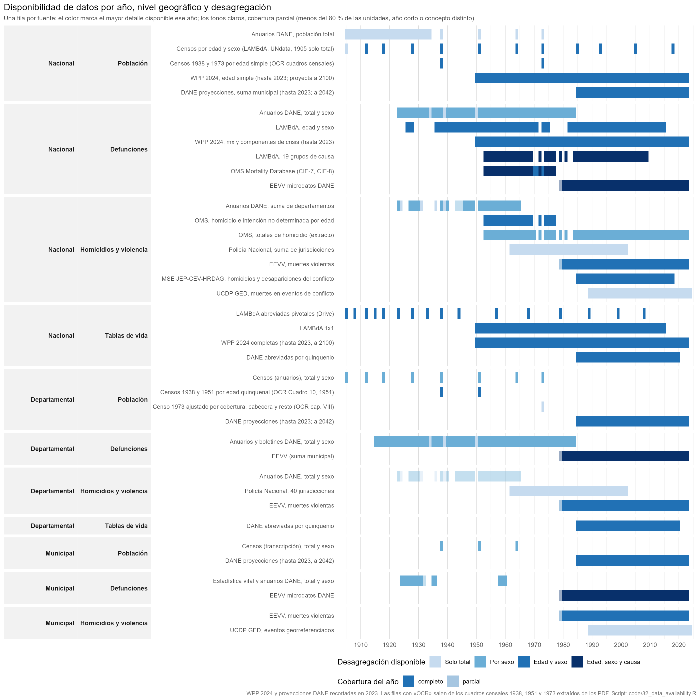

Estado al 2026-11-10. Rutas relativas a la raíz `C:\Users\kikep\gits\colombia_homicidios`.
El inventario detallado de las fuentes de mortalidad por nivel geográfico está en
`documents/inventario_datos_mortalidad.md`; este documento cubre todo el proyecto y señala
qué datos no se están usando todavía (sección 7).

## 1. Qué es el proyecto y cómo está organizado

Dos líneas de trabajo conviven en el repositorio:

1. **Módulo municipal (scripts 01-20)**: modelo de homicidios municipales 1985-2017 a partir de la
   razón de sexos de la mortalidad por todas las causas, con descomposición por causa, pruebas de
   subregistro (Caribe antes de 1998), completitud GGB/DDM por departamento y conjunto de datos
   compartido 1985-2023. Es el pipeline de `run_all.R`.
2. **Módulo nacional de mortalidad ajustada (scripts 21-30)**: censos, OMS, LAMBdA, WPP 2024 y la
   estimación MSE del conflicto (JEP-CEV-HRDAG) para construir una serie nacional de mortalidad por
   edad, sexo y causa (violenta / no violenta) 1953-2023 y extenderla hacia atrás hasta 1905. No está
   en `run_all.R`; se corre script a script. Los scripts 31-43 lo amplían: insumos WPP e inventario
   (31-32), completitud empírica y comparada (33, 36), contraste con WPP (34-35), reconstrucción
   poblacional por cohorte-componente 1950-2023 (37-39) y ajuste por componentes con mortalidad de
   menores de cinco años de UN IGME y del censo de 1973 (40-43).

Además hay un módulo histórico (`code/historical/`, series transcritas de anuarios 1915-1984) y un
script experimental (`code/experimental/model_spatial.R`).

| Carpeta | Contenido | Versionada en git |
|---|---|---|
| `code/` | 45 scripts R numerados, `historical/` (5), `experimental/` (1) | sí |
| `data_input/` | insumos originales (2,9 GB) | solo `README.md` y los csv pequeños de `historical/` y `reference/` |
| `data_inter/` | productos intermedios `.rds` (130 MB) y pruebas (`q_test/`, `model_variants/`) | no |
| `output/` | tablas finales (`tables/`, 57 csv) y datos compartidos (csv.gz, parquet, diccionario) | sí |
| `figures/` | 101 figuras en 10 subcarpetas | sí |
| `documents/` | planes, informes, inventarios, metadatos DANE | sí |
| raíz | `README.md`, `run_all.R`, `DESCRIPTION`, licencias, `Rplots.pdf` (residuo, borrar) | sí |

## 2. Insumos (`data_input/`)

Columna "Scripts": número del script que lo lee. "hist/" = `code/historical/`. **Sin uso** marca lo que ningún script lee.

### 2.1 Defunciones

| Archivo | Contenido | Años | Tamaño | Scripts |
|---|---|---|---|---|
| `micro/Defun1979.txt` … `Defun2021.txt`, `nofetal2022.csv`, `nofetal2023.csv` (45 archivos) | microdatos DANE EEVV, defunciones no fetales: municipio de ocurrencia y residencia, sexo, edad, causa (lista 105) | 1979-2023 (sin 1978) | 1,2 GB | 01 |
| `who_mdb/morticd07.zip`, `morticd08.zip` | WHO Mortality Database, CIE-7 y CIE-8, todos los países | Colombia 1953-1977 | 10 MB | 21 |
| `who_mdb/mort_pop.zip`, `mort_availability.zip`, `mort_documentation.zip`, `doc/*.pdf` | población OMS, disponibilidad, documentación | | 2 MB | **sin uso** (documentación consultada a mano) |
| `historical/lambda_Col_Deaths{m,f}.txt` | LAMBdA, defunciones registradas por edad y sexo | 1926-2015 (76 años) | 48 KB | 21 → 22, 23 |
| `historical/lambda_Col_Cause19_Deaths{m,f}.txt` | LAMBdA, defunciones por 19 grupos de causa × edad × sexo | 1953-2009 | 168 KB | **sin uso** |
| `historical/col_gap_analysis_1920_1985_national_deaths_clean_v03.csv` | totales nacionales por sexo (anuarios DANE) | 1923-1984 | 3 KB | 22 |
| `historical/col_gap_analysis_1920_1985_department_deaths_clean_v06.csv` (+ `_territories_aggregated`, `_territories_split`) | defunciones por departamento y sexo, con banderas de calidad y fuente por celda | 1915-1984 | 390 KB | hist/20, hist/21 (variante aggregated) |
| `historical/col_gap_analysis_1920_1985_municipal_deaths_clean_v03.csv` | defunciones por municipio y sexo, 850 municipios | 14 años entre 1924 y 1960 | 3 MB | hist/20, hist/21 |
| `historical/dane_vitales_1958_1960_municipal.csv` | DANE "Estadística vital 1958 a 1960": matrimonios, bautizos (H/M/T), defunciones de menores de un año (H/M/T) y defunciones totales (H/M/T) por municipio, 2.534 municipio-años (2.518 con código DIVIPOLA); 674 de 700 columnas-unidad verificadas contra las filas TOTAL y la tabla departamental | 1958-1960 | 320 KB | hist/24 (produce), 32; **sin uso** analítico aún |
| `historical/dane_vitales_1958_1960_departamental.csv` | ídem por sección del país (16 departamentos e intendencias y comisarías agrupadas), con población a mitad de año y tasas publicadas | 1958-1960 | 6 KB | hist/24 (produce), 32 |
| `historical/vitales_1958_1960_support/` (8 csv) | correcciones, adiciones y códigos de la lectura anterior; informes de verificación por columna-unidad, filas TOTAL vs tabla departamental y diferencias con `col_gap_analysis_…_municipal_deaths_v03` (5 municipio-años) | | 60 KB | hist/24 |
| `historical/LD_558_1958_1960_EJ_2.pdf` | la publicación DANE escaneada (90 pp.), fuente de lo anterior | 1958-1960 | no versionado | hist/24 |
| `historical/dane_defunciones_1970_1978_cuadro11_secciones_edad.csv`, `…cuadro10_menores5_secciones.csv` | DANE, Registro de defunciones 1970-1978: defunciones por sexo y grupo de edad (con detalle de menores de un año) para el país y 24 secciones; menores de cinco años por edad detallada | 1970-1978 | 300 KB | hist/25 (produce); **sin uso** aún |
| `historical/dane_defunciones_1970_1978_cuadro06_causas_edad_1973_1978.csv` | ídem: defunciones nacionales por 150 causas, edad y sexo; da causas para 1973 y 1978 y coincide con la OMS en homicidio e intención no determinada 1974-1977 | 1973-1978 | 1,2 MB | hist/25 (produce), 30 (muertes violentas de 1973 y 1978) |
| `historical/dane_defunciones_1970_1978_cuadro01…`, `cuadro02…`, `cuadro03…` | ídem: total nacional 1915-1984; totales por sexo y sección 1970-1984; nacional por zona, sexo y edad 1970-1978 | 1915-1984 | 45 KB | hist/25 (produce); **sin uso** aún |
| `historical/dane_defunciones_1970_1978_support/` (8 csv), `historical/LD_8789_1970_1978_EJ_3.pdf` | correcciones, erratas e inconsistencias de la fuente impresa (112 identidades no cuadran en el original) y verificación; el PDF no se versiona | | 22 MB | hist/25 |
| `historical/archive_v01_v02/*.csv` (6 archivos) | versión anterior de las transcripciones (2026-10-13) | 1923-1984 | 1,2 MB | archivados, **sin uso** |
| `conflict/mse_national_age5_1985-2018.rds` | JEP-CEV-HRDAG, homicidios y desapariciones del conflicto, edad quinquenal × sexo | 1985-2018 | 208 KB | 21 → 23, 27 |
| `ucdp/GEDEvent_v25_1.csv`, `GEDEvent_v25_01_25_12.csv` | UCDP GED, eventos georreferenciados, todos los países | 1989-2025 | 259 MB | hist/22 |
| `conflict/mse_documented_dept_1985-2018.csv`, `conflict/mse_regional_age5_1985-2018.csv` | cachés de 51: víctimas documentadas del conflicto por departamento y año (media de 10 réplicas de verdata, homicidio y desaparición forzada) y media de los sorteos MSE por región natural, año, sexo y edad quinquenal; las réplicas (1,5 GB) y los sorteos están en el repositorio `colombia_bereavement_pdr` del Drive | 1985-2018 | 2 MB | 51 |
| `251208_MortalityCrises.zip` | UN Population Division, mx por tipo de crisis, todos los países (no público) | 1950-2023 | 766 MB | 26 (extrae Colombia) |
| `reference/wpp2024_crises_colombia_mx1_conflicts.csv`, `lt1_crises_free.csv`, `events.csv`, `country.csv` | extracto Colombia de lo anterior | 1950-2023 | 5 MB | 27 |
| `reference/wpp2024_crises_colombia_mx1_crises.csv`, `mx1_disasters.csv`, `mx1_famine.csv`, `mx1_covid.csv`, `cdr.csv` | extracto Colombia: crisis total, desastres, hambruna, COVID, TBM | 1950-2023 | 1,3 MB | **sin uso** (extraídos, no analizados) |
| `reference/who_deaths_age_colombia_1953-1977.csv`, `who_violent_age_colombia_1953-1977.csv` | extractos OMS por edad: todas las causas; homicidio + intención no determinada | 1953-1977 | 16 KB | producidos por 21; copias csv de los rds |
| `reference/who/who_homicide_colombia.csv`, `who_all_cause_colombia.csv` | totales anuales OMS (origen externo, sin script productor) | 1953-2019 aprox. | 4 KB | hist/20, hist/22 |
| `historical/col_gap_analysis_1920_1985_department_homicides_clean_v02.csv` | homicidios por departamento y sexo (anuarios) | 1923-1965 | 80 KB | hist/20, hist/21 |
| `historical/Homicidio 1962-2002 por depto de Policía_v1.xlsx` | homicidios Policía Nacional, 40 jurisdicciones | 1962-2002 | 20 KB | **sin uso** |

### 2.2 Población

| Archivo | Contenido | Años | Tamaño | Scripts |
|---|---|---|---|---|
| `DANEpop/DCD-area-sexo-edad-proypoblacion-Mun-1985-1994.xlsx`, `…1995-2004.xlsx`, `…2005-2017_VP.xlsx` | retroproyecciones municipales DANE por área, sexo y edad simple | 1985-2017 | 137 MB | 03 |
| `DANEpop/PPED-AreaSexoEdadMun-2018-2042_VP.xlsx` | proyecciones municipales DANE | 2018-2042 | 129 MB | 03, 11, 11b (solo hasta 2023) |
| `reference/wpp2024_colombia_mx_pop_single_age_1950_2100.rds` | WPP 2024, mx y población por edad simple y sexo | 1950-2100 | 1,8 MB | 22, 23, 24, 25, 27, 28, 29, 30 (**sin script productor**) |
| `reference/wpp2024_colombia_pop_single_age_1950-2023.csv` | WPP 2024, población por edad simple y sexo (estimaciones) | 1950-2023 | 1 MB | 31 (produce); **sin uso** aún |
| `reference/wpp2024_colombia_fertility_age1.csv` | WPP 2024, tasas de fecundidad por edad simple (ASFR, PASFR, nacimientos) | 1950-2100 | 3 MB | 31 (produce); **sin uso** aún (insumo para una reconstrucción poblacional) |
| `census_raw/undata_t22/` (126 páginas html), `undata_t44/` (314) | caché de UNdata: censos por edad y sexo (t22) y nacidos en el extranjero (t44) | censos 1951-2018 | 36 MB | 21 (solo si falta el csv parseado) |
| `reference/undata_census_colombia.csv`, `undata_foreign_born_colombia.csv` | tablas UNdata parseadas | censos 1951-2018 | 676 KB | 21 → `census_pop_age.rds` |
| `historical/lambda_Col_Pop{m,f}.txt` | LAMBdA, población censal por edad | censos 1912-2005 | 6 KB | 21 |
| `historical/col_gap_analysis_1920_1985_national_population_clean_v02.csv` | población nacional (anuarios y censos) | 1905-1985 | 3 KB | **sin uso** |
| `historical/col_gap_analysis_1920_1985_department_population_clean_v03.csv` | población censal por departamento y sexo | censos 1905-1973 | 84 KB | hist/20, hist/21 |
| `historical/col_gap_analysis_1920_1985_municipal_population_clean_v03.csv` | población censal por municipio y sexo, 881 municipios | censos 1938, 1951, 1964 | 3 MB | hist/20, hist/21 |
| `migration/undesa_pd_2020_…xlsx`, `undesa_pd_2024_…xlsx` | UN DESA, stock de emigrantes colombianos por edad, sexo y destino | 1990-2024 | 12 MB | 21 → 22, 23 |
| `historical/census_tables/census1938_single_age_sex.csv`, `census1973_single_age_sex.csv` | población nacional por edad simple y sexo, censos 1938 (con fila indígena) y 1973 (censada, sin ajuste) | censos 1938, 1973 | 6 KB | hist/23 (produce); **sin uso** aún |
| `historical/census_tables/census1951_dept_age5_sex_1938_1951.csv` | población por edad quinquenal y sexo, 15 departamentos, 3 intendencias y 7 comisarías, censos 1938 y 1951 (Cuadro 10 de 1951) | censos 1938, 1951 | 64 KB | hist/23 (produce); **sin uso** aún |
| `historical/census_tables/census1964_dept_age5_sex_zone.csv`, `census1964_single_age_sex_zone.csv`, `census1964_birthplace_by_residence.csv` | censo de 1964: población por edad quinquenal, sexo y zona (total, cabecera, resto) para el país, 17 departamentos, Bogotá D.E., 4 intendencias y 5 comisarías (Cuadro 7); edad simple por sexo y zona, nacional (Cuadro 9); lugar de nacimiento (18 departamentos y D.E., intendencias y comisarías, exterior) por lugar de residencia (20 unidades), sexo y edad 0-14, 15-59 y 60+, la matriz de migración de toda la vida (Cuadro 14; 420 bloques validados, 50 leídos a ojo) | censo 1964 | 180 KB | hist/23 (produce); **sin uso** aún |
| `historical/census_tables/census1973_adjusted_population_units.csv` | población ajustada por cobertura 1973 por departamento, D.E., intendencia y comisaría, zona (total, cabecera, resto) y componente (hogares particulares, colectivos, áreas indígenas) | censo 1973 | 5 KB | hist/23 (produce); **sin uso** aún |
| `historical/census_tables/census1973_children_ever_born_age.csv`, `census1973_children_ever_born_units.csv` | mujeres de 15 años y más por hijos nacidos vivos y sobrevivientes (Cuadros 21 y 21A de 1973): por grupo quinquenal de edad y zona a nivel nacional, y por departamento y zona sin edad; incluye las que no informan y las sin hijos | censo 1973 | 8 KB | hist/23 (produce), 43 |
| `historical/LD_771_1938_V_1.pdf`, `LD_771_1951.pdf`, `LD_771_1964.pdf`, `LB_771_1973.pdf` | resúmenes generales de los censos 1938, 1951, 1964 y 1973; fuente de `census_tables/` (OCR + transcripción validada por sumas, hist/23). Sin extraer: lugar de nacimiento por departamento de 1964 (Cuadros 13 y 14), cabecera/resto de 1973 por edad, el ajuste de cobertura 1973 a nivel municipal, la población municipal por sexo de 1973 (Cuadro 1A), las matrices de lugar de nacimiento de 1951 y 1973 y la edad por zona y departamento de 1951 (Cuadro 11) | | 29 MB (no versionados) | hist/23 (solo si `run_ocr`) |
| `historical/LB_771_1951_V_2.pdf`, `LB_771_1964_V_2.pdf` | censos de edificios y viviendas 1951 y 1964 (no población) | | 11 MB | **sin uso** |
| `historical/LB_800_1938.pdf` (Norte de Santander), `LB_811_1951_V_1.pdf` (Huila) | tomos departamentales | | 12 MB | **sin uso** |
| `historical/LAMBdA_documentation.pdf` | documentación LAMBdA | | 17 MB | documentación |

### 2.3 Tablas de vida y referencias

| Archivo | Contenido | Años | Scripts |
|---|---|---|---|
| `lifetables/tablas_utf8.txt` | texto del PDF DANE "Tablas abreviadas de mortalidad nacionales y departamentales 1985-2020" | 1985-2020 | 13 (manual) → `reference/dane_lifetables_nmx_1985_2020.csv` |
| `reference/dane_lifetables_nmx_1985_2020.csv` | nmx abreviadas DANE, nacional y departamental | 1985-2020 | 14, 16, 18, 24, 25, 28 |
| `historical/lambda_Col_{m,f}ltper_1x1.txt` | LAMBdA, tablas de vida 1x1 | 1950-2015 | 25, 28, 29 |
| `reference/wpp2024_colombia_lt_complete_1950-2100.csv` | WPP 2024, tablas de vida completas (edad simple) por sexo y ambos sexos, estimaciones y proyección media | 1950-2100 | 31 (produce), 33-43 |
| `reference/wpp2024_colombia_pop_1jan_single_age_1950-2024.csv` | WPP 2024, población al 1 de enero por edad simple y sexo | 1950-2024 | 37 (produce), 38, 39 |
| `reference/romero_meisel_2019_violent_deaths_1945_1969.csv` | Romero-Prieto y Meisel-Roca (2019, Banco de la República, Cuadro 1): muertes violentas por sexo estimadas con censos, registro y tablas de vida, total y descontando el nivel de 1945-47 | 1945-1969 | 47 |
| `reference/unigme2024_colombia_sdmx.csv` | UN IGME 2024 (API SDMX de UNICEF): estimaciones de mortalidad infantil, de 1 a 4 y de menores de cinco años por sexo, y los puntos de cada fuente (censos, encuestas, registro) | 1954-2024 | 41, 42, 43 |
| `reference/who_causes_age_colombia_1953-1977.csv` | OMS, defunciones por grupos de causa, edad y sexo | 1953-1977 | 40 (produce) |
| `reference/trussell_child_mortality_coefficients.csv`, `coale_demeny_child_q_by_level.csv` | coeficientes de Trussell para k(i) y t(i) (ONU 1983, Manual X, tablas 47 y 48) y q(1) … q(20) por nivel de las tablas modelo Coale-Demeny, cuatro familias; tomados del paquete R `u5mr` 0.1.1 (archivado en CRAN) | | 43 |
| `I:/My Drive/gits_drive/colombia_bereavement_pdr/data_input/life_tables_lambda.csv` (fuera del repo) | LAMBdA, tablas abreviadas pivotales | 1905-2008 | 29 |
| `reference/DIVIPOLA-_Códigos_municipios_20260307.csv` | códigos y nombres de municipios | 2026 | 00, 14 |
| `documents/Lista_105_Colombia_CIE9-y-CIE10.xls` | lista DANE de 105 causas | | 00 |

## 3. Intermedios (`data_inter/`)

| Archivo | Lo produce | Lo leen | Contenido |
|---|---|---|---|
| `micro_1979_2023.rds` (40 MB) | 01 | 02, 09, 10, 11, 11b | microdatos limpios, una fila por defunción |
| `deaths_munic_1979-2023.rds` | 02 | 04, 05, 06, 10 | defunciones por municipio × año × sexo × grupo de causa |
| `deaths_munic_age_1979-2023.rds` (45 MB) | 02 | 04, 14, 18, 22, 23, 27, 30 | ídem con edad quinquenal (dx, dx_v) |
| `pop_munic_1985-2017.rds` | 03 | 04, 05, 06, 09, 10, 11, 11b, 14, 18, 23, 24 | población municipal por sexo y edad |
| `asdr_munic_1985-2017.rds` | 04 | **nadie** | tasas por edad municipales |
| `homicide_cdr_munic_1985-2017.rds`, `sex_ratios_munic_1985-2017.rds` | 05 | 07, 15 | panel municipal: tasas de homicidio y razones de sexo |
| `excess_deaths_munic.rds` | 06 | 07, 15 | exceso de mortalidad masculina |
| `homicide_estimates_1985-2017_excs.rds` (16 MB) | 07 | 08, experimental | estimaciones ZINB de homicidios |
| `sex_ratio_contrib_by_cause.rds` | 09 | **nadie** (solo figuras) | contribución de cada causa a la razón de sexos |
| `completeness_deptos.rds`, `completeness_ggb.rds` | 10 | 12, 14, 15, 18 | completitud por departamento (TBM relativa y GGB) |
| `census_pop_age.rds` | 21 | 22, 24 | censos UNdata por edad y sexo |
| `emigrant_stock_age_1990-2024.rds` | 21 | 22 | stock de emigrantes por edad |
| `lambda_deaths_age_1926-2015.rds`, `who_deaths_age_1953-1977.rds`, `who_violent_age_1953-1977.rds`, `conflict_mse_age5_1985-2018.rds` | 21 | 22, 23, 27, 30 | insumos nacionales por edad |
| `deaths_age_annual_1938-2023.rds`, `ddm_census_inputs.rds` | 22 | 23, 25, 27 | serie registrada por edad e insumos del DDM |
| `who_homicide_colombia.rds`, `who_all_cause_colombia.rds` | **sin script productor** | nadie (los csv de `reference/who/` los sustituyen) | totales OMS |
| `model_variants/oos_scores.rds` | 20 | nadie | puntajes fuera de muestra |
| `model_variants/null.rds`, `oos_scores_partial.rds` | **sin script productor** | nadie | residuos de corridas anteriores |
| `q_test/*.csv` (9) | 10, hist/21 | nadie | pruebas de calidad y sensibilidad |

## 4. Salidas

### 4.1 Datos compartidos (`output/`)

| Archivo | Script | Contenido |
|---|---|---|
| `deaths_pop_munic_1985_2023.csv.gz` | 11 | año × municipio × sexo: población y defunciones por 6 grupos de causa (87.594 filas) |
| `deaths_pop_munic_age_1985_2023.parquet` | 11b | ídem con edad quinquenal |
| `deaths_pop_munic_dictionary.md` | 11 | diccionario de variables y fuentes |
| `homicide_estimates_munic_1985_2017.csv.gz` | 07/08 (nombre no aparece en el código actual) | estimaciones municipales de homicidios |

### 4.2 Tablas (`output/tables/`, 57 csv)

| Grupo | Archivos | Scripts |
|---|---|---|
| Completitud departamental | `completeness_deptos`, `completeness_ggb`, `completeness_dane`, `completeness_ddm`, `underreg_dept_correlations`, `sex_ratio_observed_vs_dane_expected` | 10, 12, 14, 18, 19 |
| Modelo municipal | `model_completeness_*` (2), `model_improvements_*` (5), `age_placebo_*` (3), `residence_vs_occurrence_*` (2) | 15, 16, 17, 20 |
| Completitud nacional (DDM) | `completeness_ddm_census` (+ `_annual`), `completeness_ddm_conflict` (+ `_annual`), `completeness_wpp_mse_annual` | 22, 23, 27 |
| Completitud empírica (Adair y Lopez 2018) | `completeness_empirical_national_1979-2023`, `completeness_empirical_dept_1985-2023`, `completeness_empirical_validation_2014` (modelos 1 y 2, con y sin defunciones violentas; 5q0 departamental DANE escalada a WPP o anclada a la ENDS 2015) | 33 |
| Serie nacional ajustada | `deaths_expected_wpp_mse_1950-2023`, `deaths_by_cause_sex_age_1953-2023`, `mx_extended_1905-2023`, `lifetables_extended_summary` | 27, 29, 30 |
| Comparaciones | `pyramids_census_wpp_dane`, `mx_wpp_lambda_ours`, `lifetables_compared` (+ `_summary`) | 24, 25, 28 |
| Inventario | `data_availability` (nivel, dominio, serie, año, detalle, cobertura parcial, archivo; una fila por serie y año) | 32 |
| Contraste con WPP 2024 | `ours_vs_wpp_annual`, `e0_gap_decomposition` (descomposición por edad de la brecha en e0) | 34, 35 |
| Completitud comparada | `census_correction_factors`, `completeness_ddm_census_corrected`, `completeness_compared_annual` (DDM sobre censos corregidos, método empírico y lo que implica WPP) | 36 |
| Reconstrucción poblacional 1950-2023 | `wpp_net_migration_age_sex_1950-2023`, `reconstruction_scenarios_pop_1950-2024`, `reconstruction_census_check`, `reconstruction_parameters`, `reconstruction_completeness_annual`, `reconstruction_census_fit`, `reconstruction_population_1jan_1950-2024`, `reconstruction_population_totals`, `reconstruction_population_parameters`, `reconstruction_mortality_summary` | 37, 38, 39 |
| Componentes y menores de cinco años | `deaths_components_registered_1950-2023` (natural, otras externas, violenta), `igme_child_mortality_1950-2023`, `child_mortality_brass_census1973` (5q0 hacia 1959-1972 por Brass-Trussell, nacional, cabecera y resto, cuatro familias y dos variantes de paridad, con UN IGME y WPP en la fecha de referencia), `child_mortality_census1973_departments` (proporción de hijos fallecidos por departamento y zona como índice de nivel), `mortality_adjusted_components_1950-2023`, `mortality_adjusted_old_age_kannisto`, `mortality_adjusted_summary` (mortalidad ajustada componente a componente), `crisis_deaths_1950-2023` (quinta componente: pisos de la Policía y de La Violencia sobre las violentas registradas más el MSE, y Armero 1985) | 40, 41, 42, 43, 47 |
| Ajuste departamental 1985-2023 | `dept_mortality_adjusted_components_1985-2023` (tasas por componente, departamento, sexo y edad, población DANE), `dept_mortality_adjusted_summary` (e0, 5q0, 45q15, e60 por departamento: ajustada, registrada y tablas DANE por quinquenio), `dept_completeness_applied_1985-2023`, `dept_vs_national_adjusted_deaths`, `mse_departments_1985-2018` (MSE por departamento: homicidios estimados, violentas EEVV, exceso calibrado, desapariciones) | 50, 51 |

### 4.3 Figuras (`figures/`)

| Carpeta | n | Scripts |
|---|---|---|
| `01_descriptives/` | 15 | 04 |
| `02_model/` | 24 | 07, 08, 15, 20 |
| `03_cause_decomposition/` | 6 | 09 |
| `04_completeness/` | 28 | 10, 14, 18, 22-30, 33-36 |
| `05_reconstruction/` | 8 | 37, 38, 39 |
| `05_underregistration_tests/` | 6 | 12, 16, 17, 19 |
| `06_components/` | 13 (`components_shares`, `igme_child_mortality`, `natural_mortality_model`, `old_age_model`, `adjusted_vs_wpp`, `adjusted_variants`, `child_mortality_census1973`, `child_mortality_census1973_departments`, `nrc1982_comparison`, `brass1973_arbitration`, `ours_vs_wpp_lexis_ratio`, `ours_vs_wpp_rates_by_age`, `crisis_deaths`) | 40-47 |
| `07_departments/` | 5 (`dept_e0_adjusted`, `dept_completeness_applied`, `dept_components_2000`, `dept_sum_vs_national`, `dept_mse_allocation`) | 50, 51 |
| `historical/` | 6 | hist/20, hist/22 |
| `inventory/` | 1 (`data_availability.png`, tile de disponibilidad por año, nivel y desagregación) | 32 |
| `experimental/` | 0 | |

## 5. Scripts (`code/`)

| Script | Qué hace | En `run_all.R` |
|---|---|---|
| `00_setup.R` | paquetes, rutas, lista 105, DIVIPOLA | fuente común |
| `01_load_microdata.R` | lee los 45 archivos EEVV, armoniza variables | sí |
| `02_summarise_deaths.R` | agrega por municipio, sexo, edad y grupo de causa | sí |
| `03_population.R` | lee las proyecciones DANE municipales | sí |
| `04_descriptives.R` | descriptivos y tasas por edad | sí |
| `05_municipal_panel.R` | panel municipal: razones de sexo y tasas de homicidio | sí |
| `06_excess_deaths.R` | exceso de mortalidad masculina | sí |
| `07_model_zinb.R`, `08_model_validation.R` | modelo ZINB de homicidios y validación | sí |
| `09_sex_ratio_by_cause.R` | descomposición de la razón de sexos por causa | sí |
| `10_registration_completeness.R` | completitud por departamento (TBM relativa, GGB) | sí |
| `11_shared_dataset.R`, `11b_shared_dataset_age.R` | datos compartidos 1985-2023 | sí |
| `12_underregistration_test.R` | prueba de la hipótesis de subregistro | sí |
| `13_extract_dane_lifetables.R` | parsea las tablas de vida DANE del texto del PDF | manual |
| `14_completeness_dane.R` | completitud frente a las tablas DANE | sí |
| `15_model_completeness.R` | modelo con completitud como covariable | sí |
| `16_age_placebo.R`, `17_residence.R` | placebo por edad; residencia vs ocurrencia | sí |
| `18_ddm_completeness.R`, `19_completeness_vs_correlation.R` | DDM departamental; completitud vs correlación | sí |
| `20_model_improvements.R` | variantes del modelo, fuera de muestra, pandemia | no |
| `21_census_who_inputs.R` | censos UNdata, LAMBdA, OMS por edad y causa, MSE, emigrantes | no |
| `22_ddm_census_national.R` | serie registrada por edad 1938-2023 y DDM nacional | no |
| `23_ddm_conflict_adjusted.R` | DDM con numerador corregido por conflicto; referencias WPP/DANE/LAMBdA | no |
| `24_pyramids_census_wpp_dane.R`, `25_mx_wpp_lambda_ours.R` | pirámides y tasas comparadas | no |
| `26_wpp_crises_inputs.R` | extrae Colombia del zip de crisis de WPP 2024 | no |
| `27_wpp_conflict_replaced.R` | defunciones esperadas: WPP sin su conflicto + MSE (1985-2018) | no |
| `28_lifetables_compared.R`, `29_mx_extended_back_lambda.R` | tablas de vida por fuente; extensión a 1905 | no |
| `30_deaths_by_cause_series.R` | serie nacional violenta / no violenta 1953-2023 | no |
| `31_wpp_lifetables_inputs.R` | extrae Colombia de los csv completos de WPP 2024 (fuera del repo): tablas de vida completas, población y fecundidad por edad simple | no |
| `32_data_availability.R` | tile de disponibilidad de datos por año, nivel geográfico y desagregación → `figures/inventory/data_availability.png`, `output/tables/data_availability.csv` | no |
| `33_completeness_empirical.R` | completitud empírica del registro de defunciones (Adair y Lopez 2018, PLoS ONE): nacional 1979-2023 y departamental 1985-2023, modelos 1 y 2, con todas las defunciones y sin violentas; validación 2014 → `completeness_empirical_*` en `output/tables/` y `figures/04_completeness/` | no |
| `34_ours_vs_wpp.R`, `35_e0_gap_decomposition.R` | estimaciones propias de mortalidad frente a WPP 2024, 1950-2023; descomposición por edad de la brecha en e0 | no |
| `36_completeness_compared.R` | completitud: DDM sobre censos corregidos por omisión, método empírico y lo que implica WPP | no |
| `37_reconstruction_ccmpp.R`, `38_reconstruction_estimation.R`, `39_reconstruction_population.R` | reconstrucción nacional por cohorte-componente 1950-2023: motor, migración neta WPP y escenarios frente a los censos; estimación bayesiana; población dada la mortalidad propia | no |
| `40_deaths_three_components.R` | defunciones registradas en tres componentes (natural, otras externas, violenta) por sexo y edad, 1950-2023 | no |
| `41_igme_child_mortality.R` | mortalidad de menores de cinco años de UN IGME, 1950-2023, convertida a m0 y 4m1 | no |
| `42_mortality_components_adjusted.R` | mortalidad ajustada por componente, sexo y edad, 1950-2023: menores de cinco de UN IGME, natural 5-64 con completitud empírica y suavizado, 65+ con modelo relacional, otras externas y violenta con el faltante del conflicto, más la componente de crisis (47) | no |
| `43_child_mortality_census1973.R` | mortalidad en la niñez hacia 1959-1972 por Brass (variante Trussell) con los hijos nacidos vivos y sobrevivientes del censo de 1973, nacional y por zona, con corrección de El-Badry; contraste con UN IGME y WPP; índice de nivel por departamento | no |
| `44_nrc1982_lifetables.R` | tablas de vida NRC 1982 (1950-1975) frente a la serie ajustada, WPP y el registro | no |
| `45_brass1973_arbitration.R` | arbitraje de la brecha con NRC 1982: Brass del censo 1973 frente a IGME y NRC; descomposición de la brecha en e0 en menores de cinco y 5+ | no |
| `46_ours_vs_wpp_rates.R` | tasas ajustadas frente a WPP 2024: superficie de Lexis del cociente y tasas por edad en años seleccionados | no |
| `50_dept_mortality_adjusted.R` | el ajuste nacional por departamento, 1985-2023 (29 unidades, los cinco de la Amazonía agrupados): mismas cinco componentes; completitud Adair-Lopez departamental suavizada y calibrada a la serie nacional; menores de cinco con IGME por el índice departamental de DANE; MSE departamental de 51; Armero en Tolima y Caldas | no |
| `51_mse_departments.R` | muertes del conflicto (MSE JEP-CEV-HRDAG) por departamento, sexo y edad 1985-2018: media regional de los sorteos del repositorio de duelo por la participación documentada de cada departamento en su región (réplicas de verdata); exceso sobre las violentas EEVV y desapariciones calibrados a la serie nacional del 27 | no |
| `47_crisis_deaths.R` | quinta componente, crisis: pisos de los homicidios de la Policía (1962-2002) y de La Violencia (Romero-Prieto y Meisel-Roca 2019) sobre las violentas registradas más el MSE, y Armero 1985 (WPP/EM-DAT), por sexo y edad | no |
| `historical/20`, `21`, `22` | cobertura y calidad de las transcripciones; UCDP vs OMS | no |
| `historical/23_census_tables_ocr.R` | tablas censales 1938, 1951, 1964 y 1973 desde los PDF (OCR tesseract + transcripción, validadas por identidades) → `historical/census_tables/` | no |
| `historical/24_dane_vitales_1958_1960.R` | estadística vital DANE 1958-1960 por municipio y departamento desde el PDF (capa de texto + dos pasadas de tesseract + transcripción previa, celda a celda, validadas por H + M = T y filas TOTAL) → `historical/dane_vitales_1958_1960_*.csv`; primera corrida ~40 min | no |
| `historical/25_dane_defunciones_1970_1978.R` | Registro de defunciones DANE 1970-1978 desde el PDF (capa de texto, validado por identidades y cruces entre cuadros): defunciones por edad y sexo por sección del país, menores de cinco años, zona, y 150 causas por edad y sexo a nivel nacional 1973-1978 → `historical/dane_defunciones_1970_1978_*.csv` | no |
| `experimental/model_spatial.R` | modelo espacial (exploratorio) | no |

## 6. Documentos (`documents/`)

| Archivo | Fecha | Contenido |
|---|---|---|
| `report_missing_deaths_caribbean_09_2026.html` | 2026-09 | informe: subregistro en el Caribe antes de 1998 |
| `executive_report_underregistration_10_2026.html` | 2026-10 | informe ejecutivo de subregistro |
| `plan_cleanup_and_underregistration.md`, `HANDOFF_plan_A_execution.md` | 2026-10-13 | evaluación del repositorio, plan de limpieza (Plan A) y de subregistro (Plan B) |
| `datos_mortalidad_colombia_03_2026.xlsx` | 2026-03 | inventario anterior de variables y lagunas |
| `inventario_datos_mortalidad.md` (+ `.html`) | 2026-11-10 | fuentes de mortalidad por nivel geográfico, con el tile de disponibilidad y la lista de información complementaria |
| `inventario_general_proyecto.md` (+ `.html`) | 2026-11-10 | este documento |
| `Lista_105_Colombia_CIE9-y-CIE10.xls` | | lista DANE de causas |
| `metadata/` | | diccionarios EEVV 1979-2016, variables de microdatos, manual de certificación, glosario |

## 7. Datos que no se están usando ni analizando

Ordenados por lo que aportarían.

| Dato | Qué aportaría | Esfuerzo |
|---|---|---|
| **Tablas censales extraídas (`historical/census_tables/`, hist/23)** | ya extraídas y validadas, sin explotar: edades simples nacionales 1938 y 1973 (preferencia de dígitos, DDM con edad simple); edad quinquenal por departamento 1938, 1951 y 1964, el último también por zona (completitud departamental intercensal con las defunciones 1915-1984 y, desde 1970, con las defunciones por edad del Registro de defunciones 1970-1978); edad simple nacional por zona en 1964; matriz de lugar de nacimiento por lugar de residencia en 1964 (migración de toda la vida entre departamentos, por sexo y tres grupos de edad, para corregir la población departamental por migración); población ajustada por cobertura 1973 por departamento (omisión 9,8 % nacional, muy desigual por territorio) | bajo: lectura directa |
| **Hijos nacidos vivos y sobrevivientes, censo 1973: nivel departamental** | el script 43 ya estima el 5q0 nacional y por zona (111 por mil hacia 1967,6; rural 1,3 a 1,5 veces la cabecera) y reproduce la serie indirecta de UN IGME. Por departamento solo hay un índice sin edad, que en la costa Caribe queda por debajo del resto a igual mortalidad posterior. Una estimación departamental exige los hijos por edad de la madre: muestra IPUMS del censo de 1973 | bajo con IPUMS |
| **Resúmenes censales 1951, 1964 y 1973: lo que falta** | 1964: solo falta el Cuadro 13 (nacidos en el mismo departamento, en otros y en el exterior, por unidad de residencia, sexo y zona; pp. 45-48), tipográfico y con el mismo método; sirve para comprobar la diagonal del Cuadro 14, ya extraído. 1973: cabecera/resto por edad simple (Cuadro 2), ajuste de cobertura por municipio (capítulo VIII, ~1.000 filas), población por sexo y municipio (Cuadro 1A), lugar de nacimiento por lugar de empadronamiento (Cuadro 4A). 1951: lugar de nacimiento por departamento (Cuadro 15), edad quinquenal por zona y departamento (Cuadro 11), menores de un año por meses de edad (Cuadro 12) | 1973 alto: el escaneo no admite OCR, transcripción manual; 1951 medio: el OCR del Cuadro 10 ya funciona en ese formato |
| **Tablas WPP 2024 nuevas (31)**: tablas de vida completas, población y fecundidad por edad simple | insumos para una reconstrucción poblacional 1938-2023 (cohorte-componente bayesiano) y para comparar la mortalidad propia con la tabla completa de WPP | bajo |
| **LAMBdA, 19 grupos de causa 1953-2009** | mortalidad por causa con edad y sexo para 1978 (año sin EEVV) y cotejo independiente de la serie violenta de OMS y EEVV 1953-2009 | bajo: lectura directa |
| **Homicidios Policía Nacional 1962-2002 por departamento** | única fuente departamental de homicidios 1966-1978; calibración del concepto policial frente a anuarios (1962-65) y EEVV (1979-2002) | bajo |
| **Estadística vital DANE 1958-1960 por municipio (hist/24)** | defunciones municipales por sexo verificadas para tres años, mortalidad infantil municipal (única antes de 1979) y bautizos como aproximación a los nacimientos; corrige cinco municipio-años de la transcripción anterior | bajo: lectura directa |
| **Transcripciones nuevas sin explotar analíticamente**: defunciones departamentales 1915-1984, municipales 1924-1960, homicidios departamentales 1923-1965 | solo se usan para figuras de cobertura y pruebas de calidad (hist/20-21) y para el total nacional de 22; permitirían completitud departamental antes de 1979 (con los censos 1938-1973) y tasas municipales de los años 20-50 | medio: requiere población interpolada y armonización territorial |
| **Población nacional anuarios 1905-1985** | contraste con WPP y censos para 1905-1950 | bajo |
| **Componentes de crisis WPP distintos del conflicto** (desastres, hambruna, COVID, TBM) | ya extraídos; la COVID importa para 2020-2023 si se quiere separar exceso pandémico de la serie no violenta | bajo |
| **UCDP GED** | solo comparado con OMS a nivel nacional; tiene geolocalización por evento (municipio) 1989-2024 que no se ha cruzado con el panel municipal | medio |
| **Proyecciones DANE 2024-2042** | fuera del alcance actual | ninguno |
| **Población OMS (`mort_pop.zip`)** | redundante con WPP | ninguno |
| **Tomos departamentales 1938 (Norte de Santander) y 1951 (Huila)** | edad por municipio en dos departamentos; sin interés salvo como prueba de método | bajo |
| **Censos de vivienda 1951 y 1964** | no contienen población por edad | ninguno |

Productos intermedios que nadie lee: `asdr_munic_1985-2017.rds` (tasas por edad municipales, 5 MB),
`sex_ratio_contrib_by_cause.rds`, `model_variants/oos_scores.rds` y todo `q_test/`. No es un
problema, pero `model_variants/null.rds`, `oos_scores_partial.rds` y los rds `who_*_colombia.rds`
no tienen script productor y conviene borrarlos o documentar su origen.

## 8. Lagunas de cobertura que ningún dato disponible cierra

- Defunciones municipales 1961-1978, y por edad a nivel subnacional antes de 1970 (1970-1978 ya está por departamento en `dane_defunciones_1970_1978_*`).
- Población por departamento y edad en 1973 (solo quedó en los bancos de datos del DANE; la muestra IPUMS la daría); para 1938, 1951 y 1964 ya está en `historical/census_tables/`.
- Causa de muerte en 1970 y 1971 a nivel nacional (interpolada en el script 30); desde 1973 y 1978 el script 30 usa el Cuadro 6 del Registro de defunciones 1970-1978 para las muertes violentas; el script 40 aún interpola 1971, 1973 y 1978 en sus tres componentes.
- Omisión censal por edad y sexo en 1985-2018: solo se conocen los totales de las conciliaciones DANE.
