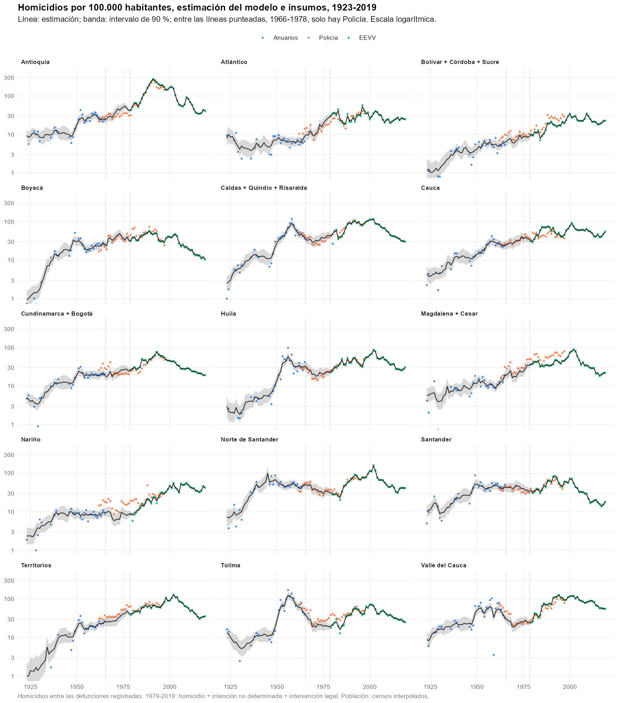
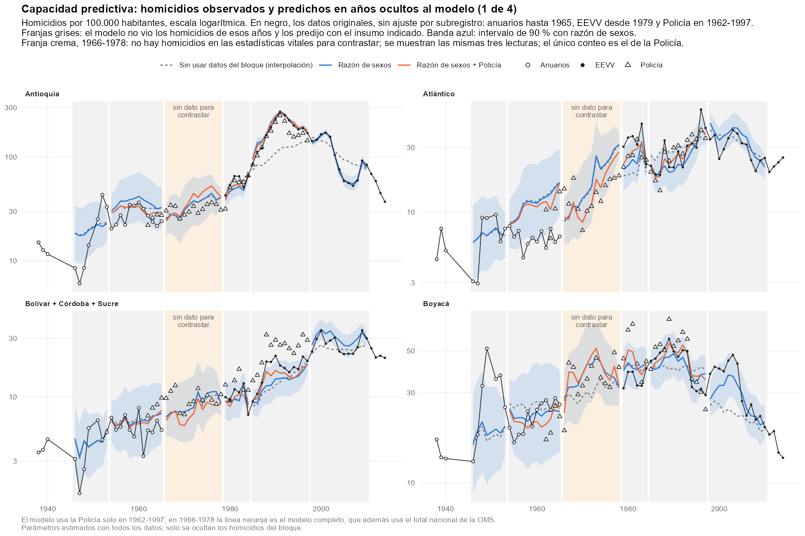
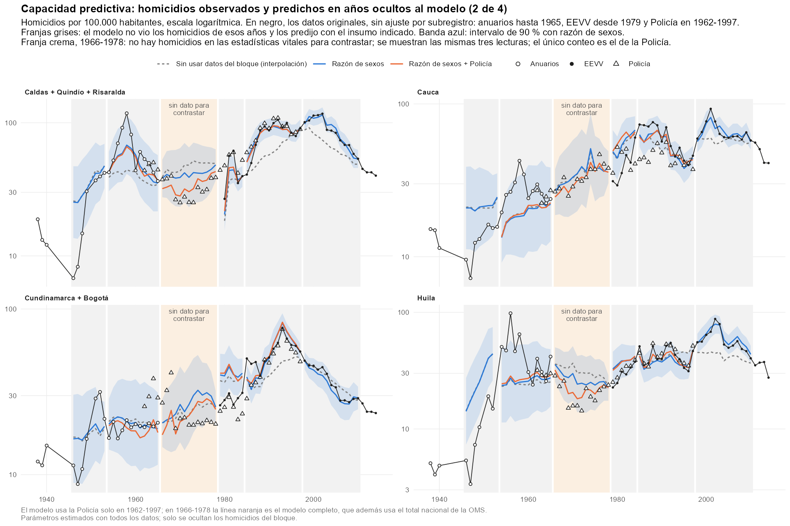
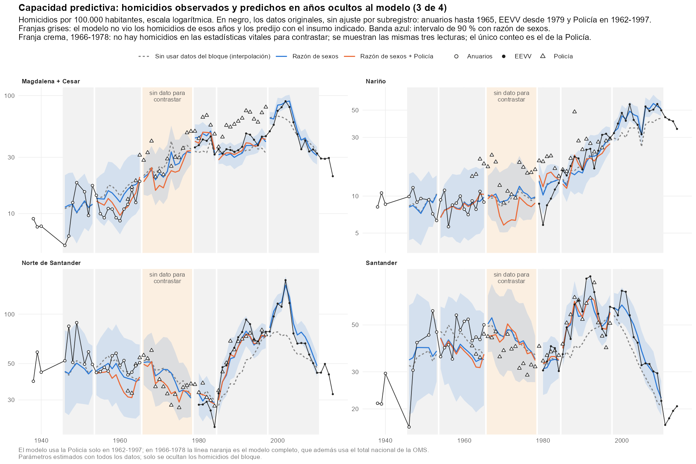
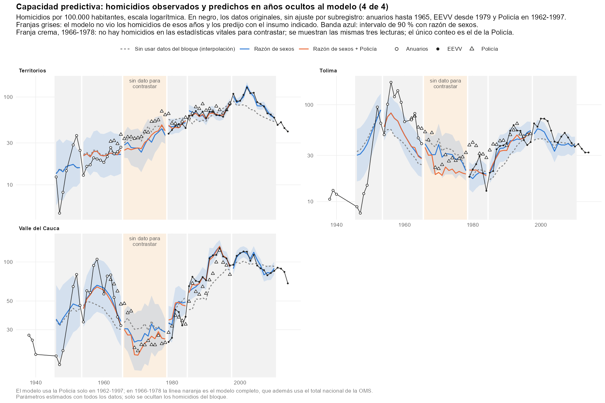
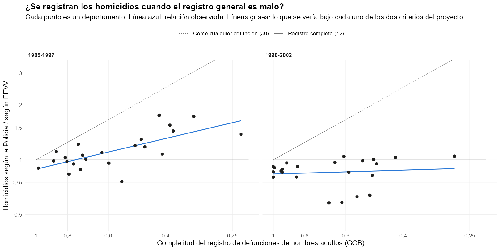
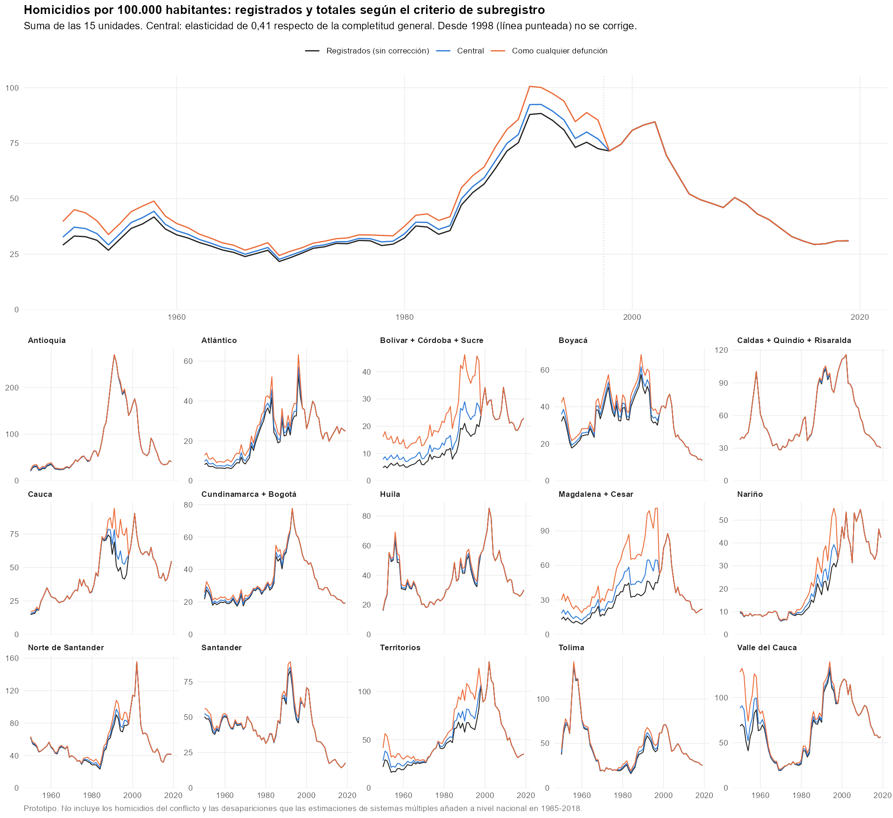

Estado: prototipo. Describe el modelo tal como está en `code/45_homicide_backcast_dept.R` y los dos pasos que
se apoyan en él: `code/47_homicide_underregistration.R` (de homicidios registrados a totales) y
`code/46_homicide_munic_1958_1960.R` (reparto municipal de 1958-1960). Las cifras son las de las tablas de
`output/tables/` a la fecha del documento.

# 1. Qué hace, en pocas líneas

- Estima cuántos homicidios se registraron cada año, de 1915 a 2019, en cada una de 15 unidades territoriales
  (departamentos, algunos agrupados).
- Lo hace combinando cuatro fuentes que por separado son incompletas: los anuarios estadísticos, la Policía,
  las estadísticas vitales (EEVV) y la razón de sexos de las defunciones.
- La pregunta de origen era si la razón de sexos de las defunciones por todas las causas permite predecir
  homicidios donde no hay causa de muerte. La respuesta del modelo es: **desde 1985, sí; antes de 1966, casi
  nada**. La serie histórica se sostiene en los anuarios y en la Policía.
- El modelo estima homicidios **registrados**. Un segundo paso los convierte en homicidios totales bajo tres
  supuestos de subregistro.

# 2. La idea de partida: por qué la razón de sexos habla de homicidios

Cerca de nueve de cada diez víctimas de homicidio son hombres. Las demás causas de muerte se reparten entre
hombres y mujeres de forma mucho más pareja. Por eso, cuando en un lugar aumentan los homicidios, las
defunciones masculinas crecen más que las femeninas y la razón entre unas y otras sube, aunque nadie haya
anotado la causa de muerte.

Esto se puede escribir como una identidad contable. Las defunciones de cada sexo son la suma de las no
violentas y las violentas:

$$D_M = N_M + \pi H \qquad\qquad D_F = N_F + (1-\pi)\,H$$

| Símbolo | Significado |
|---|---|
| $D_M$, $D_F$ | defunciones registradas de hombres (masculinas) y de mujeres (femeninas), por todas las causas |
| $N_M$, $N_F$ | defunciones no violentas de hombres y de mujeres |
| $H$ | homicidios |
| $\pi$ | proporción de los homicidios cuyas víctimas son hombres. Se fija en 0,90; en los datos va de 0,87 a 0,92 |

La razón de sexos de las defunciones es $R = D_M / D_F$. Para ver cómo depende de los homicidios conviene
definir dos cantidades:

- $\rho = N_M / N_F$, la **razón de sexos no violenta**: la que habría si no hubiera homicidios.
- $h = H / (D_M + D_F)$, la **proporción de homicidios** dentro de todas las defunciones.

Con ellas, la identidad de arriba se convierte en:

$$R \;=\; \frac{(1-h)\,\rho \;+\; h\,\pi\,(1+\rho)}{(1-h) \;+\; h\,(1-\pi)\,(1+\rho)}$$

Esta fórmula no es un supuesto estadístico: es aritmética. Dice cuánto vale la razón de sexos observada si se
conocen la razón no violenta y la proporción de homicidios. El modelo la usa al revés: observa $R$ y trata de
deducir $h$.

**Ejemplo.** Con una razón no violenta de 1,05:

| Homicidios como % de las defunciones | Razón de sexos resultante |
|---|---|
| 0 % | 1,05 |
| 1 % | 1,07 |
| 3 % | 1,10 |
| 15 % | 1,33 |

El ejemplo muestra el límite de la idea. En la Colombia de 1985-1997 los homicidios eran cerca del 15 % de las
defunciones y movían la razón de sexos de 1,05 a 1,33: una señal enorme. En 1923-1965 eran entre 0,4 % y 3 %, y
la movían de 1,05 a 1,10 como mucho. La razón de sexos de un departamento cambia de un año a otro entre 2 % y
5 % por motivos que nada tienen que ver con la violencia, así que una señal de ese tamaño queda tapada por el
ruido.

# 3. Unidades y datos

## Las 15 unidades

Varios departamentos se crearon después de 1950 a partir de otros. Para que las series no se rompan, se
agrupan con su departamento de origen:

- Antioquia, Atlántico, Boyacá, Cauca, Huila, Nariño, Norte de Santander, Santander, Tolima y Valle del Cauca
  quedan solos.
- Bolívar + Córdoba + Sucre.
- Caldas + Quindío + Risaralda.
- Cundinamarca + Bogotá.
- Magdalena + Cesar.
- Territorios: las antiguas intendencias y comisarías, más Chocó, Meta, Caquetá y La Guajira, que aparecen
  dentro de ese renglón de los anuarios antes de ser departamentos.

## Las fuentes

| Fuente | Años | Qué aporta | Celdas unidad-año |
|---|---|---|---|
| Defunciones por sexo: anuarios hasta 1978, EEVV desde 1979 | 1915-2019 | la razón de sexos | 1.525 |
| Homicidios de los anuarios estadísticos | 1923-1965, con huecos | conteo de homicidios en las estadísticas vitales | 417 |
| Homicidios de la Policía Nacional | 1962-1997 | conteo independiente del registro de defunciones | 540 |
| Muertes violentas de EEVV (microdatos) | 1979-2019 | conteo de homicidios en las estadísticas vitales | 612 |
| Muertes violentas de la OMS | 1966-1977 | solo el total nacional | 9 años |

Tres precisiones:

- **"Homicidio" en EEVV** incluye homicidio, lesiones de intención no determinada e intervención legal. Es la
  convención del resto del proyecto.
- **La Policía cuenta otra cosa.** No depende del certificado de defunción, y su relación con las estadísticas
  vitales cambia de un departamento a otro. Por eso entra al modelo con un sesgo propio, no como una medición
  directa.
- **1966-1978 no tiene homicidios por departamento en las estadísticas vitales.** Los anuarios dejan de
  publicarlos en 1965 y los microdatos empiezan en 1979. En esos años solo hay Policía, el total nacional de la
  OMS y la razón de sexos.

# 4. El modelo

## 4.1 Qué tipo de modelo es

Es un **modelo de espacio de estados**, también llamado modelo de estados latentes. La idea es sencilla:

1. Hay cantidades que interesan pero no se observan directamente. Se llaman **estados**. Aquí la principal es
   la proporción de homicidios en las defunciones de cada unidad y año.
2. Los estados cambian poco a poco de un año al siguiente. Esa regla de cambio lento es lo que permite
   estimar un año sin datos a partir de sus vecinos.
3. Cada fuente es una **medición imperfecta** de los estados, con su propio margen de error.
4. El modelo combina todas las mediciones y la regla de cambio lento, y da para cada año la estimación más
   compatible con todo, junto con su incertidumbre.

Es la misma familia de modelos que se usa para seguir la posición de un vehículo con un GPS impreciso: se sabe
que el vehículo no salta de un sitio a otro, y cada lectura del GPS corrige un poco la posición estimada.

## 4.2 Las tres cantidades ocultas

Para cada unidad $d$ y cada año $t$ el modelo lleva tres estados:

| Estado | Qué es |
|---|---|
| $\eta_{d,t}$ | logaritmo de la proporción de homicidios en las defunciones registradas: $\eta = \log h$. Es lo que se quiere estimar |
| $u_{d,t}$ | cuánto se aparta la razón de sexos no violenta de la unidad de la nacional, en logaritmos |
| $\beta_{d,t}$ | sesgo de la Policía: logaritmo de la razón entre lo que cuenta la Policía y lo que cuentan las estadísticas vitales |

Se trabaja en logaritmos porque así un cambio de 0,10 significa siempre "cerca de 10 %", sea cual sea el
nivel, y porque la proporción nunca puede resultar negativa.

Los tres evolucionan como una **caminata aleatoria**: el valor de un año es el del año anterior más un cambio
pequeño e impredecible.

$$\eta_{d,t} = \eta_{d,t-1} + \varepsilon^{\eta}_{d,t} \qquad
u_{d,t} = u_{d,t-1} + \varepsilon^{u}_{d,t} \qquad
\beta_{d,t} = \beta_{d,t-1} + \varepsilon^{\beta}_{d,t}$$

Cada $\varepsilon$ es un número al azar con media cero y una desviación estándar propia: $\sigma_\eta$,
$\sigma_u$ y $\sigma_\beta$. Esas desviaciones dicen cuánto puede moverse cada estado en un año. Por ejemplo,
$\sigma_\eta = 0{,}17$ significa que la proporción de homicidios cambia típicamente un 17 % de un año al
siguiente. El modelo las estima a partir de los datos.

La razón de sexos no violenta de la unidad se arma con dos piezas:

$$\log \rho_{d,t} = \rho^{\text{nac}}_t + u_{d,t}$$

$\rho^{\text{nac}}_t$ es el logaritmo de la razón de sexos no violenta del país en el año $t$. No es un estado:
se calcula antes, a partir de las defunciones nacionales por sexo y de la proporción nacional de muertes
violentas (anuarios, OMS y EEVV según el año). Recoge la tendencia común a todo el país, que es fuerte: la
razón de sexos de las defunciones pasa de 1,04 en los años veinte a 1,29 en los ochenta por razones ajenas a la
violencia. Al estado $u$ le queda solo lo propio de cada unidad.

## 4.3 Cómo se relaciona cada fuente con lo oculto

En lo que sigue, $D_{d,t}$ son las defunciones registradas de la unidad en el año, y cada $e$ es el error de
medición de esa fuente.

**Anuarios.** Si $A_{d,t}$ es el número de homicidios que publica el anuario:

$$\log\!\left(\frac{A_{d,t}}{D_{d,t}}\right) = \eta_{d,t} + e^{A}_{d,t}$$

El anuario mide directamente la proporción de homicidios, con un error de desviación estándar $\sigma_A$.

**EEVV.** Igual, con las muertes violentas $E_{d,t}$ de los microdatos:

$$\log\!\left(\frac{E_{d,t}}{D_{d,t}}\right) = \eta_{d,t} + e^{E}_{d,t}$$

Aquí el error se fija en un valor muy pequeño (0,03): las EEVV *son* la definición de lo que se quiere medir,
así que la estimación en esos años coincide casi exactamente con el dato.

**Policía.** Con $P_{d,t}$ homicidios de la Policía:

$$\log\!\left(\frac{P_{d,t}}{D_{d,t}}\right) = \eta_{d,t} + \beta_{d,t} + e^{P}_{d,t}$$

La Policía mide la misma proporción, desplazada por su sesgo $\beta$. El sesgo se aprende en los años en que
la Policía coincide con los anuarios (1962-1965) o con EEVV (1979-1997), y se proyecta a los años intermedios.

**Razón de sexos.** Es la identidad contable de la sección 2, escrita con los estados:

$$\log\!\left(\frac{D_{M,d,t}}{D_{F,d,t}}\right) = g\!\left(\rho^{\text{nac}}_t + u_{d,t},\; \eta_{d,t}\right) + e^{R}_{d,t}$$

$g$ es el logaritmo de la fórmula de $R$ de la sección 2, con $\rho = \exp(\rho^{\text{nac}}_t + u_{d,t})$ y
$h = \exp(\eta_{d,t})$. Es la única relación del modelo que no es una simple suma.

**Total nacional de la OMS.** Si $V_t$ son las muertes violentas del país según la OMS y $D_t$ las defunciones
nacionales:

$$\log\!\left(\frac{V_t}{D_t}\right) = \log\!\left(\sum_{d} w_{d,t}\, \exp(\eta_{d,t})\right) + e^{V}_t$$

$w_{d,t}$ es el peso de la unidad en las defunciones del país. La ecuación dice que la proporción nacional es
el promedio ponderado de las proporciones de las unidades. Es lo único que liga unas unidades con otras, y solo
se usa en 1966-1977: en 1953-1965 la serie de la OMS es la suma de los mismos anuarios que ya están en el
modelo.

**El tamaño de los errores.** Cada error tiene dos partes. Una es propia de la fuente ($\sigma_A$ para los
anuarios, $\sigma_P$ para la Policía, $\sigma_R$ para la razón de sexos) y el modelo la estima. La otra es el
azar de contar pocos casos: con 20 homicidios, uno más o uno menos cambia el resultado un 5 %; con 2.000, no se
nota. Esa segunda parte se calcula con el propio conteo (vale $1/A$ para un conteo $A$, y
$1/D_M + 1/D_F$ para la razón de sexos), de modo que las unidades pequeñas pesan menos.

## 4.4 Celdas erróneas en los anuarios

Algunas celdas de los anuarios están mal. Valle del Cauca en 1959 aparece con 52 homicidios, entre 1.479 el
año anterior y 855 el siguiente; Antioquia en 1923, con 3. Si el modelo tratara todas las celdas igual, esas
pocas lo obligarían a suponer que *todos* los anuarios son muy imprecisos, y entonces suavizaría los picos de
La Violencia como si fueran ruido. Eso ocurría en la primera versión.

Para evitarlo, cada celda de anuario puede ser de tres tipos:

| Tipo | Qué supone el modelo | Probabilidad estimada |
|---|---|---|
| Regular | la celda mide bien, con el error normal $\sigma_A$ | 95,7 % |
| Error grosero | la celda está mal: su error es mucho mayor (desviación estándar adicional de 1,5 en logaritmos) | 3,2 % |
| Salto | la celda está bien y fue el nivel de homicidios el que cambió bruscamente respecto del año anterior | 1,1 % |

El modelo no decide a mano cuál es cuál. Para cada celda calcula qué tan compatible es con cada tipo, dado lo
que ya sabe de ese año por las demás fuentes y por los años vecinos, y pondera las tres lecturas. De las 417
celdas, nueve quedan leídas como error grosero con probabilidad mayor de 50 %:

| Unidad | Año | Anuario | Estimación del modelo |
|---|---|---|---|
| Antioquia | 1923 | 3 | 86 |
| Valle del Cauca | 1959 | 52 | 922 |
| Santander | 1949 | 643 | 371 |
| Valle del Cauca | 1949 | 670 | 611 |
| Tolima | 1951 | 365 | 437 |
| Huila | 1953 | 182 | 171 |
| Huila | 1959 | 77 | 112 |
| Nariño | 1930 | 26 | 17 |
| Territorios | 1940 | 36 | 25 |

Las dos primeras son errores evidentes. Santander y Valle en 1949 probablemente no lo son: es el arranque de
La Violencia, y el modelo lo confunde con un error porque en 1950 no hay dato que lo confirme.

## 4.5 Cómo se estima

El procedimiento se llama **filtro de Kalman** y tiene dos pasadas:

1. **Hacia adelante.** Recorre los años de 1915 a 2019. En cada año parte de lo que estimó el año anterior,
   lo deja evolucionar según la caminata aleatoria (con lo que la incertidumbre crece un poco) y luego lo
   corrige con cada dato disponible de ese año. Una fuente precisa corrige mucho; una imprecisa, poco.
2. **Hacia atrás.** Recorre los años de 2019 a 1915 y revisa cada estimación con lo que se supo después. Así
   un año sin datos queda informado por los años anteriores y por los posteriores.

Se le dice filtro de Kalman *extendido* porque la relación de la razón de sexos ($g$) no es una suma simple y
hay que aproximarla en cada paso por una recta.

Las 15 unidades se estiman a la vez, porque el total de la OMS las liga. Son 45 estados por año (tres por
unidad).

Las desviaciones estándar y las dos probabilidades se eligen por **máxima verosimilitud**: se toman los valores
con los que los datos observados resultan más probables. Con esos valores fijos se hacen las dos pasadas.

## 4.6 Los parámetros estimados

Las desviaciones de $\eta$, de $u$ y de la razón de sexos tienen un valor antes de 1979 y otro desde 1979,
porque con los microdatos de EEVV el comportamiento cambia.

| Parámetro | Valor | Lectura |
|---|---|---|
| $\sigma_\eta$, antes de 1979 | 0,168 | la proporción de homicidios cambia típicamente 17 % por año |
| $\sigma_\eta$, desde 1979 | 0,140 | 14 % por año |
| $\sigma_u$, antes de 1979 | 0,011 | la razón de sexos no violenta de una unidad deriva cerca de 1 % por año respecto de la nacional |
| $\sigma_u$, desde 1979 | 0,008 | algo menos |
| $\sigma_R$, antes de 1979 | 0,021 | la razón de sexos tiene un ruido propio de 2 % que la violencia no explica |
| $\sigma_R$, desde 1979 | 0,0003 | prácticamente ninguno: con buenos datos la identidad contable se cumple casi exacta |
| $\sigma_A$ | 0,133 | una celda regular de anuario se aparta 13 % del valor estimado |
| $\sigma_P$ | 0,056 | ruido de la Policía de un año a otro, una vez descontado su sesgo |
| $\sigma_\beta$ | 0,111 | el sesgo de la Policía cambia hasta 11 % por año: es inestable |
| Probabilidad de error grosero | 0,032 | una de cada 31 celdas de anuario |
| Probabilidad de salto | 0,011 | una de cada 95 |

Valores fijados, no estimados: $\pi = 0{,}90$; error de EEVV 0,03; error del total de la OMS 0,05; desviación
adicional de un error grosero 1,5 y de un salto 1,0.

Dos de estos números resumen el resultado. El ruido de la razón de sexos antes de 1979 (0,021) es del mismo
tamaño que la señal que producen homicidios de 1 % a 3 % de las defunciones, y por eso la razón de sexos
informa poco en ese periodo. Y la inestabilidad del sesgo de la Policía (0,111 por año) es la razón de que el
tramo 1966-1978 tenga intervalos anchos aunque haya dato policial todos los años.

Tratar las celdas de anuario como posibles errores mejora mucho el ajuste: la log-verosimilitud pasa de
3.081,8 a 3.140,1 con dos parámetros más.

## 4.7 Qué produce

Para cada unidad y año:

- la proporción estimada de homicidios, $\exp(\eta_{d,t})$, con su intervalo de 90 %;
- el número de homicidios registrados, que es esa proporción por las defunciones registradas;
- la tasa por 100.000 habitantes, con la población de los censos interpolada.

La incertidumbre depende de qué fuentes hay cada año:

| Periodo | Fuentes de homicidio | Desviación estándar típica de $\eta$ |
|---|---|---|
| 1915-1922 | ninguna | 0,47 |
| 1923-1945 | anuarios, con huecos | 0,24 |
| 1946-1965 | anuarios (y Policía desde 1962) | 0,13 |
| 1966-1978 | Policía y total de la OMS | 0,16 |
| 1979-1984 | EEVV y Policía | 0,05 |
| 1985-2019 | EEVV | 0,04 |

Una desviación de 0,16 equivale a un intervalo de 90 % de más o menos 26 %.

# 5. Qué tan bien predice

Que el modelo siga los datos que ve no prueba nada. La prueba es ocultarle los homicidios de un bloque de años
y pedirle que los prediga con lo que le queda. Se hizo con cinco bloques y tres conjuntos de insumos dentro del
bloque: ninguno (el modelo solo interpola entre los años vecinos), la razón de sexos, y la razón de sexos más
la Policía.

Error absoluto mediano de la predicción, en las 15 unidades:

| Bloque oculto | Sin insumos | Razón de sexos | Razón de sexos + Policía |
|---|---|---|---|
| 1946-1953 | 41 % | 40 % | no hay Policía |
| 1954-1965 | 23 % | 22 % | 21 % |
| 1979-1984 | 20 % | 20 % | 18 % |
| 1985-1997 | 20 % | 9 % | 7 % |
| 1998-2010 | 16 % | 7 % | no se usa Policía |

- **Desde 1985 la razón de sexos reduce el error a menos de la mitad.** Sigue la subida de los ochenta y el
  pico de 1991 sin ver un solo homicidio de esos años.
- **Antes de 1966 no mejora la interpolación.** Es lo que anticipaba el ejemplo de la sección 2.
- **En 1979-1984 ninguna fuente le gana a interpolar**, y con Policía los intervalos resultan demasiado
  estrechos: solo 61 % de los valores observados cae dentro del intervalo de 90 %.
- **El arranque de La Violencia no es predecible desde los años anteriores.** En el bloque 1946-1953 la
  cobertura del intervalo de 90 % es de 68 %.

## 5.1 Resumen por unidad

La tabla repite la prueba unidad por unidad. Cada celda de error trae dos números: el error absoluto mediano
sin insumos en el bloque y con la razón de sexos. La cobertura es el porcentaje de valores observados que cae
dentro del intervalo de 90 % de la predicción con razón de sexos, en los cinco bloques; lo esperable es 90 %.

| Unidad | Homicidios como % de las defunciones, 1946-1965 | Error 1946-1965: sin insumos / razón de sexos | Error 1979-1984: sin insumos / razón de sexos | Homicidios como % de las defunciones, 1985-2010 | Error 1985-2010: sin insumos / razón de sexos | Cobertura del intervalo de 90 % |
|---|---|---|---|---|---|---|
| Antioquia | 1,9 % | 36 % / 42 % | 13 % / 10 % | 23,2 % | 30 % / 3 % | 82 % |
| Atlántico | 0,7 % | 85 % / 81 % | 40 % / 30 % | 7,0 % | 14 % / 11 % | 75 % |
| Bolívar + Córdoba + Sucre | 0,9 % | 21 % / 23 % | 12 % / 11 % | 8,2 % | 15 % / 16 % | 94 % |
| Boyacá | 2,0 % | 24 % / 21 % | 14 % / 17 % | 7,0 % | 20 % / 13 % | 88 % |
| Caldas + Quindío + Risaralda | 3,3 % | 31 % / 22 % | 31 % / 22 % | 14,4 % | 22 % / 5 % | 86 % |
| Cauca | 1,5 % | 34 % / 35 % | 47 % / 52 % | 15,5 % | 12 % / 8 % | 84 % |
| Cundinamarca + Bogotá | 1,7 % | 10 % / 7 % | 28 % / 43 % | 9,6 % | 14 % / 6 % | 82 % |
| Huila | 2,4 % | 54 % / 54 % | 27 % / 27 % | 10,2 % | 19 % / 9 % | 84 % |
| Magdalena + Cesar | 1,8 % | 45 % / 34 % | 10 % / 12 % | 15,8 % | 10 % / 10 % | 94 % |
| Nariño | 0,6 % | 17 % / 18 % | 43 % / 41 % | 9,5 % | 16 % / 11 % | 96 % |
| Norte de Santander | 3,6 % | 11 % / 12 % | 21 % / 13 % | 15,3 % | 20 % / 9 % | 94 % |
| Santander | 3,1 % | 18 % / 19 % | 12 % / 12 % | 9,4 % | 20 % / 7 % | 90 % |
| Territorios | 2,5 % | 23 % / 19 % | 19 % / 7 % | 23,4 % | 15 % / 4 % | 94 % |
| Tolima | 4,9 % | 60 % / 49 % | 14 % / 21 % | 9,2 % | 26 % / 18 % | 57 % |
| Valle del Cauca | 4,3 % | 38 % / 27 % | 34 % / 29 % | 17,1 % | 17 % / 3 % | 86 % |
| **Las 15 unidades** | | **29 % / 26 %** | **20 % / 20 %** | | **18 % / 8 %** | |

Qué se lee en la tabla:

- **En 1985-2010 la razón de sexos mejora la predicción en 13 de las 15 unidades.** Las mejoras mayores están
  donde los homicidios pesan más: Antioquia (de 30 % a 3 %), Valle (de 17 % a 3 %), Territorios (de 15 % a 4 %)
  y Caldas (de 22 % a 5 %). No mejora en Bolívar + Córdoba + Sucre ni en Magdalena + Cesar, las dos unidades
  con peor registro de defunciones.
- **En 1946-1965 solo ayuda donde la violencia fue alta.** Tolima (de 60 % a 49 %), Valle (de 38 % a 27 %),
  Caldas (de 31 % a 22 %) y Magdalena (de 45 % a 34 %). En el resto no cambia o empeora un poco, y los errores
  siguen siendo grandes en casi todas partes.
- **Tolima es la unidad peor cubierta**: solo 57 % de sus valores observados cae dentro del intervalo. Es
  donde los cambios fueron más bruscos (el pico de 1956-1958 y la caída posterior).
- **Atlántico tiene el error más alto de 1946-1965** (más de 80 %) porque sus conteos son muy pequeños: los
  homicidios eran 0,7 % de las defunciones.

La tabla se calcula con `output/tables/homicide_backcast_validation_predictions.csv`, que trae cada predicción
por bloque, insumo, unidad y año.

## 5.2 Observado y predicho en todas las unidades

Las cuatro figuras siguientes muestran la prueba para las 15 unidades. En cada panel:

- **Negro:** los datos originales, sin ajuste por subregistro. Círculos huecos para los anuarios, puntos
  llenos para EEVV y triángulos para la Policía.
- **Franjas grises:** los cinco bloques ocultos. Dentro de cada uno, la línea gris punteada es la predicción
  sin usar datos del bloque (interpolación), la azul la que usa la razón de sexos y la naranja la que usa
  además la Policía. La banda azul es el intervalo de 90 % de la predicción con razón de sexos.
- **Franja crema, 1966-1978:** no hay homicidios en las estadísticas vitales para contrastar. Se muestran las
  mismas tres lecturas, pero ahí no se puede decir cuál acierta; el único conteo es el de la Policía. En ese
  tramo la línea naranja es el modelo completo, que además usa el total nacional de la OMS.

## 5.3 Otras comprobaciones

Tres más:

- **Picos.** En 1958 la suma de las unidades es 86 % del conteo de los anuarios, y en 1949, 84 %. Antes de
  tratar las celdas erróneas eran 76 % y 74 %.
- **Tramo 1966-1978 frente a la OMS.** La suma queda 10 % a 13 % por encima de la OMS en 1966-1968 y entre
  0 % y 4 % por debajo en 1972-1977. La Policía tiene una caída de 37 % en 1969 que la OMS no muestra, y el
  modelo solo la corrige en parte.
- **Reparto en 1966-1978.** No hay dato para contrastarlo. La incertidumbre de cada unidad baja de 0,30 sin
  insumos a 0,175 con Policía; añadir la razón de sexos y la OMS la deja en 0,164.

# 6. De homicidios registrados a totales

El modelo estima homicidios entre las defunciones registradas. Cuántos no se registraron lo aborda
`code/47_homicide_underregistration.R`.

## La prueba

La Policía cuenta homicidios sin depender del registro de defunciones. Si los homicidios se registraran
siempre, la razón Policía/EEVV no dependería de qué tan bueno es el registro general de un departamento. Si se
perdieran como cualquier otra muerte, se movería uno a uno con él. Entre departamentos:

- **1985-1997:** la razón sube con el subregistro general a un 41 % del ritmo uno a uno (pendientes de 0,38 a
  0,42 con tres medidas de completitud; error estándar cerca de 0,1).
- **1998-2002:** la pendiente cae a entre 0,05 y 0,26. Con el certificado de defunción de 1998, el registro de
  homicidios deja de depender de la completitud general.

## La corrección

$$T_{d,t} = H_{d,t} \times C_{d,t}^{-\theta}$$

| Símbolo | Significado |
|---|---|
| $T_{d,t}$ | homicidios totales de la unidad en el año |
| $H_{d,t}$ | homicidios registrados, estimados por el modelo de la sección 4 |
| $C_{d,t}$ | completitud del registro de defunciones no violentas de la unidad: fracción de esas muertes que llega a registrarse (entre 0 y 1) |
| $\theta$ | elasticidad: qué tanto del subregistro general afecta también a los homicidios |

Con $\theta = 0$ los homicidios no se corrigen; con $\theta = 1$ se corrigen igual que las demás muertes. Hay
tres escenarios:

| Escenario | $\theta$ | Factor nacional, 1950-1997 | Bolívar + Córdoba + Sucre | Magdalena + Cesar |
|---|---|---|---|---|
| Sin corrección (criterio del script 42) | 0 | 1,00 | 1,00 | 1,00 |
| Central | 0,41 | 1,03 a 1,12 | 1,40 | 1,38 |
| Como cualquier defunción (criterio del script 30) | 1 | 1,08 a 1,35 | 2,27 | 2,22 |

Desde 1998 los tres escenarios son el conteo registrado.

La completitud $C$ por departamento no existía antes de 1985. Se construyó un índice para 1950-1997 comparando
las defunciones no violentas registradas en cada unidad con las que cabría esperar dadas las tasas nacionales
ajustadas (script 42), la estructura por edad de los censos de 1938, 1951 y 1964, y el nivel de mortalidad de
cada unidad según las tablas de vida de DANE de 1985-1990.

Dos señales respaldan el escenario central:

- La pendiente de la prueba es parecida en otros periodos: 0,37 en 1962-1965 y 0,46 en 1979-1984, aunque con
  errores estándar grandes (0,21 a 0,23).
- En las cinco unidades con completitud menor de 0,7, los homicidios registrados saltan 52 % entre 1995-1997 y
  1998-2000. Con el escenario central el salto es de 10 %, parecido al del resto del país; con el escenario
  alto la serie cae 29 %.

## Por qué se entrena con registrados y se corrige al final

La razón de sexos de las defunciones registradas solo informa sobre los homicidios que están dentro de esas
mismas defunciones. Se comprobó qué pasa si se ajusta todo antes de estimar: el total nacional de 1950-1997
cambia 0,1 %, y cada unidad menos de 1 %. Los dos caminos son equivalentes; el actual es más simple.

# 7. Reparto municipal, 1958-1960

No hay homicidios por municipio antes de 1979. `code/46_homicide_munic_1958_1960.R` reparte los homicidios de
cada unidad entre sus municipios para 1958-1960, los únicos años de ese periodo con defunciones municipales por
sexo, con los tres años juntos.

Para cada municipio $i$ se calcula el exceso de muertes masculinas sobre lo que daría la razón de sexos no
violenta:

$$\text{exceso}_i = \frac{A_{M,i} - \rho_i\, A_{F,i}}{\pi - \rho_i\,(1-\pi)}$$

$A_{M,i}$ y $A_{F,i}$ son las defunciones de hombres y mujeres de un año de edad o más (las de menores de un
año se descuentan porque no llevan señal de homicidio). $\rho_i$ es la razón de sexos no violenta esperada en
el municipio. Es la misma identidad contable de la sección 2, despejada para los homicidios.

Ese exceso es muy ruidoso en municipios pequeños, así que se combina con un reparto simple por población:

$$\text{estimación}_i = \text{reparto}_i + w_i \times (\text{exceso}_i - \text{reparto}_i)$$

El peso $w_i$ va de 0 a 1 y es mayor cuanto más grande es el municipio y más violenta su unidad. En promedio
es 0,42 en Tolima, 0,28 en Caldas, 0,18 en Valle y menos de 0,15 en el resto.

Como no hay dato de la época para validarlo, el método se calibró en EEVV, reduciendo artificialmente los
homicidios modernos al nivel de 1958-1960. En esas condiciones, la proporción de homicidios asignada al
municipio equivocado baja de 20,5 % a 18,6 %.

# 8. Límites

- **1915-1922 no se debe usar.** No hay ningún dato de homicidios y la estimación descansa solo en la razón de
  sexos. Dos formas equivalentes de calcularla difieren por un factor de 2,5.
- **Antes de 1946 la serie depende de anuarios con huecos**, y la incertidumbre es alta (0,24).
- **Los picos de La Violencia quedan algo aplanados**: 13 % a 17 % por debajo del anuario en Tolima, Caldas y
  Valle en 1958.
- **1966-1978 descansa en la Policía**, cuyo sesgo es inestable. Los intervalos de ese tramo probablemente
  son demasiado estrechos.
- **Las tasas usan población de censos sin corregir por omisión**, que va de 4 % a 12 % según el censo.
- **La serie de totales empieza en 1950** y no incluye los homicidios del conflicto ni las desapariciones que
  las estimaciones de sistemas múltiples añaden a nivel nacional en 1985-2018.
- **El índice de completitud anterior a 1985 es una aproximación.** Ordena bien las unidades frente al método
  de balance de crecimiento de 1985-1995 (correlación 0,87), pero da valores más altos (0,79 frente a 0,71 en
  promedio).
- **Hay dos criterios en el proyecto para el subregistro de muertes violentas.** El script 42 no las corrige;
  el script 47 usa $\theta = 0{,}41$ antes de 1998. Las dos series nacionales difieren entre 3 % y 12 %.

# 9. Dónde está cada cosa

| Qué | Archivo |
|---|---|
| Modelo departamental | `code/45_homicide_backcast_dept.R` |
| Reparto municipal 1958-1960 | `code/46_homicide_munic_1958_1960.R` |
| De registrados a totales | `code/47_homicide_underregistration.R` |
| Estimaciones por unidad y año | `output/tables/homicide_backcast_dept_1915-2019.csv` |
| Parámetros | `output/tables/homicide_backcast_parameters.csv` |
| Validación por bloques | `output/tables/homicide_backcast_validation.csv` y `homicide_backcast_validation_predictions.csv` |
| Homicidios totales por escenario | `output/tables/homicide_total_dept_1950-2019.csv` |
| Índice de completitud | `output/tables/homicide_underreg_completeness_index.csv` |
| Reparto municipal | `output/tables/homicide_munic_1958-1960.csv` |
| Figuras | `figures/07_backcast/` |

# Glosario de símbolos

| Símbolo | Significado |
|---|---|
| $d$, $t$ | unidad territorial y año |
| $D$, $D_M$, $D_F$ | defunciones registradas: total, de hombres y de mujeres |
| $N_M$, $N_F$ | defunciones no violentas de hombres y de mujeres |
| $H$ | homicidios registrados |
| $h$ | proporción de homicidios en las defunciones, $H / D$ |
| $\pi$ | proporción de víctimas de homicidio que son hombres (0,90) |
| $R$ | razón de sexos de las defunciones, $D_M / D_F$ |
| $\rho$ | razón de sexos no violenta, $N_M / N_F$ |
| $\rho^{\text{nac}}_t$ | logaritmo de la razón de sexos no violenta del país |
| $\eta$ | estado: $\log h$ |
| $u$ | estado: desvío de la unidad respecto de $\rho^{\text{nac}}_t$ |
| $\beta$ | estado: sesgo de la Policía, en logaritmos |
| $g$ | función que da el logaritmo de $R$ a partir de $\log \rho$ y $\eta$ |
| $A$, $E$, $P$ | homicidios según los anuarios, EEVV y la Policía |
| $V_t$ | muertes violentas del país según la OMS |
| $w_{d,t}$ | peso de la unidad en las defunciones del país |
| $\sigma$ | desviación estándar de un cambio anual o de un error de medición |
| $C$ | completitud del registro de defunciones no violentas |
| $\theta$ | elasticidad del subregistro de homicidios respecto del general |
| $T$ | homicidios totales |
