Versión 1, para la reunión del 12 de noviembre de 2026. El detalle de cada parte está en el inventario de
datos de mortalidad (`inventario_datos_mortalidad.html`) y en el documento del modelo
(`report_modelo_homicidios_11_2026.html`).

# 1. Qué información de mortalidad tenemos

- **Desde 1979 hay todo:** defunciones por edad, sexo y causa hasta el municipio (microdatos EEVV), y
  población por edad y sexo desde 1985.
- **Antes de 1979, a nivel nacional,** hay defunciones por edad y sexo casi continuas desde 1936 y homicidios
  por edad desde 1953 (OMS).
- **Antes de 1979, por departamento,** hay defunciones totales y por sexo desde 1915, y por edad solo en
  1970-1978. Los homicidios vienen de los anuarios (1923-1965, incompletos) y de la Policía (1962-2002, solo
  total).
- **Antes de 1979, por municipio,** solo hay defunciones por sexo en 14 años (entre 1924 y 1936, y 1958-1960), sin
  homicidios.

## Información disponible

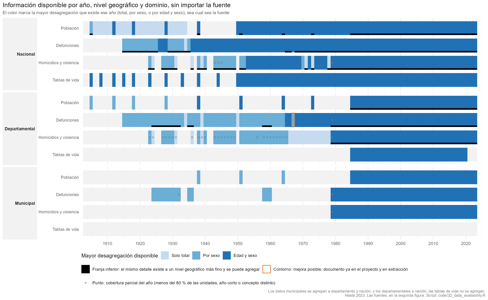

## Fuentes

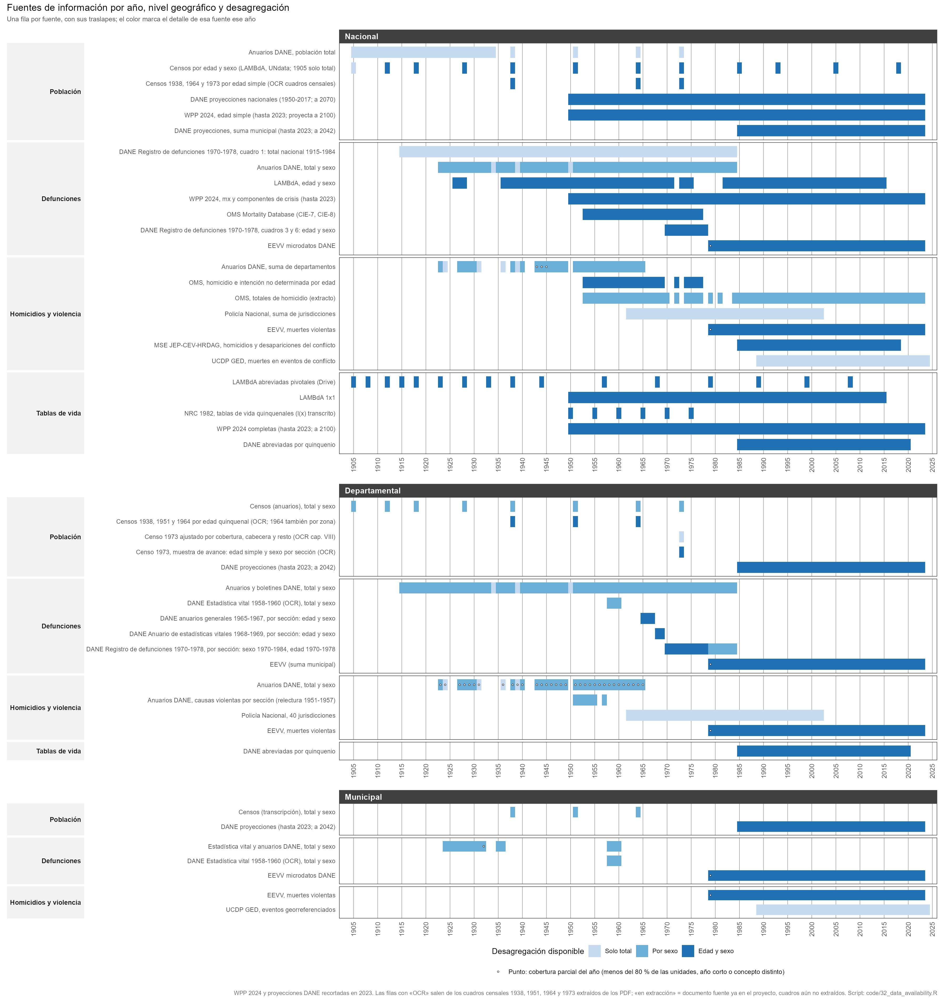

## Datos nuevos desde el 9 de noviembre

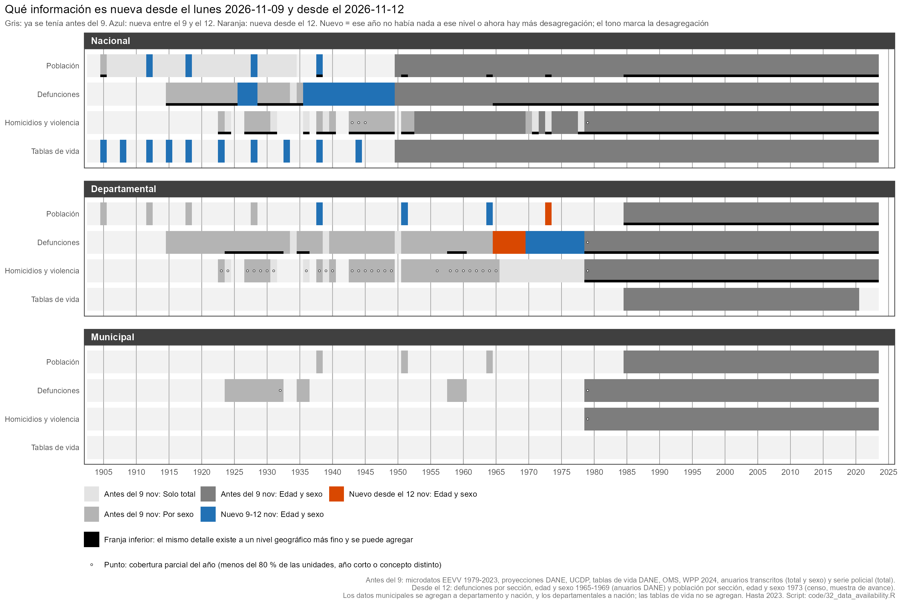

Lo nuevo es información con edad que no había: defunciones departamentales por edad y sexo de 1970-1978,
población departamental por edad de los censos de 1938, 1951 y 1964, y defunciones, población y tablas de
vida nacionales anteriores a 1950 (LAMBdA).

## Dónde se podrían predecir los homicidios

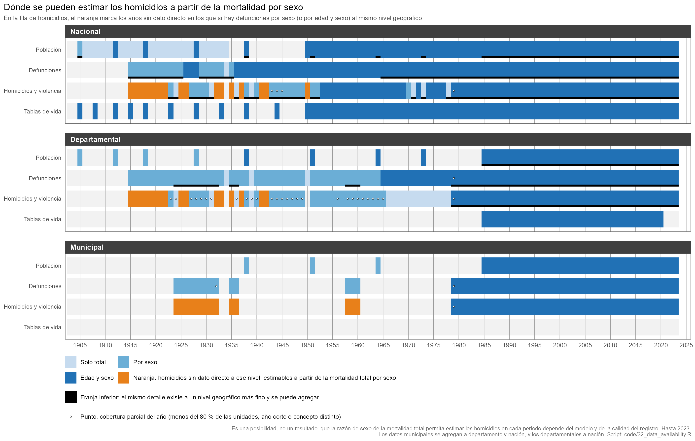

La figura marca dónde hay insumos para predecir, no dónde la predicción es buena. Eso lo responde la
parte 2.

# 2. El modelo de homicidios con la razón de sexos

## Qué es

- **Idea:** nueve de cada diez víctimas de homicidio son hombres, así que más homicidios suben la razón
  entre defunciones de hombres y de mujeres.
- **Qué estima:** los homicidios registrados cada año, de 1915 a 2019, en 15 unidades (departamentos, algunos
  agrupados para que sean comparables en todo el periodo).
- **Tipo de modelo:** un modelo de espacio de estados (*state-space model*), estimado con un filtro de Kalman.
  No es un análisis de clases latentes: lo oculto aquí no es una categoría a la que pertenece cada caso, sino
  una cantidad continua que cambia en el tiempo.
- **Fuentes que combina:** anuarios (1923-1965), Policía (1962-1997), EEVV (1979-2019) y la razón de sexos de
  las defunciones (todo el periodo). En 1966-1977 la suma de las unidades se ata al total nacional de la OMS.
- **Estado:** prototipo que corre completo. Además hay un reparto municipal para 1958-1960 y un paso de
  homicidios registrados a totales.

## Cómo funciona

**En general.** Un modelo de espacio de estados supone que hay una cantidad que interesa y no se ve
directamente (el estado), que cambia poco de un año al siguiente, y que cada fuente es una medición imperfecta
de ella. El modelo combina las mediciones, dándole más peso a la más precisa, y donde no hay ninguna se apoya
en los años vecinos. Para cada año da una estimación y su margen de error. Es la misma familia de modelos con
la que un GPS sigue un vehículo: cada lectura es imprecisa, pero se sabe que el vehículo no salta de un sitio a
otro.

**En este caso.** La cantidad oculta es la proporción de homicidios dentro de las defunciones de cada unidad y
año. Los anuarios y las EEVV la miden directamente, con error. La Policía la mide con un sesgo propio de cada
unidad, que el modelo estima. La razón de sexos la mide de forma indirecta, y solo sirve si se sabe cuánto
valdría sin violencia; el modelo estima ese valor a partir de la tendencia nacional y de lo propio de cada
unidad. La única pieza parecida a las clases latentes es menor: cada cifra de los anuarios se clasifica como
buena, errónea o salto real.

**Ejemplo.** En un departamento mueren 1.000 personas por causas no violentas: 512 hombres y 488 mujeres.

| Situación | Defunciones de hombres | Defunciones de mujeres | Razón de sexos |
|---|---|---|---|
| Sin homicidios | 512 | 488 | 1,05 |
| Con 30 homicidios (27 hombres y 3 mujeres): 3 % de las defunciones | 539 | 491 | 1,10 |
| Con 180 homicidios (162 hombres y 18 mujeres): 15 % de las defunciones | 674 | 506 | 1,33 |

El modelo hace la cuenta al revés. Si ve una razón de 1,33 y sabe que sin violencia sería cerca de 1,05, deduce
unos 180 homicidios, aunque nadie haya anotado la causa de muerte. Si ese año hay además un conteo de la
Policía, combina las dos lecturas. El ejemplo muestra también el límite: con 30 homicidios la razón apenas pasa
de 1,05 a 1,10, y la razón de sexos de un departamento ya cambia entre 2 % y 5 % de un año a otro por motivos
ajenos a la violencia. La segunda fila se parece a la Colombia anterior a 1966 y la tercera a la de 1985-1997.

## Qué tan bien predice

La prueba consiste en ocultarle al modelo los homicidios de un bloque de años y pedirle que los prediga.
La tabla da el error absoluto mediano en las 15 unidades, según lo que el modelo puede usar dentro del
bloque.

| Bloque oculto | Sin insumos (interpola) | Razón de sexos | Razón de sexos + Policía |
|---|---|---|---|
| 1946-1953 | 40 % | 40 % | no hay Policía |
| 1954-1965 | 23 % | 21 % | 21 % |
| 1979-1984 | 20 % | 20 % | 18 % |
| 1985-1997 | 20 % | 9 % | 7 % |
| 1998-2010 | 16 % | 7 % | no se usa Policía |

- **Desde 1985 predice bien.** La razón de sexos baja el error a menos de la mitad, porque los homicidios son
  entre 7 % y 23 % de las defunciones.
- **Antes de 1966 la razón de sexos casi no aporta.** Los homicidios eran 2 % a 3 % de las defunciones y la
  señal se pierde en el ruido. Solo ayuda donde la violencia fue alta: Tolima, Valle y Caldas.
- **1966-1978 no se puede validar.** No hay homicidios en las estadísticas vitales; el modelo depende de la
  Policía, cuya serie tiene un quiebre en 1969.
- **El arranque de La Violencia no es predecible** desde los años anteriores: el modelo lo sigue solo donde
  hay dato de los anuarios.

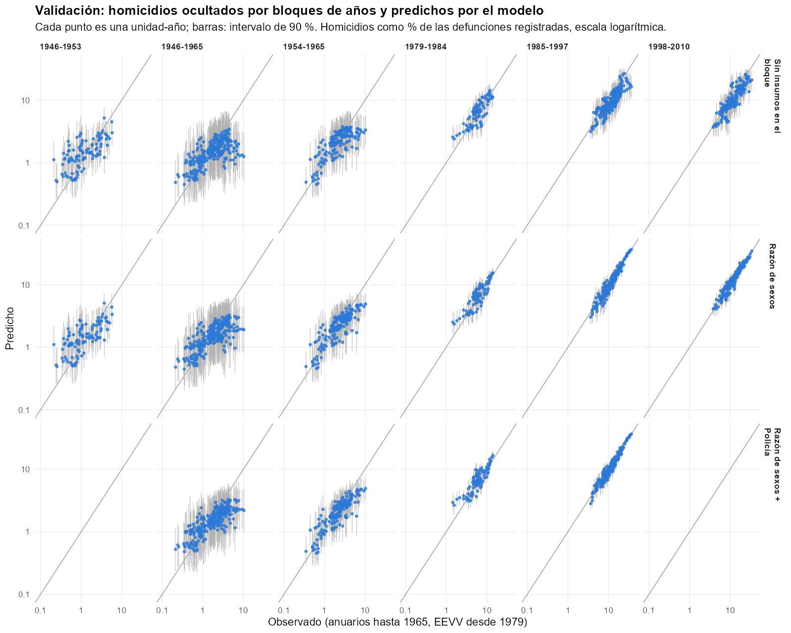

## Observado y predicho

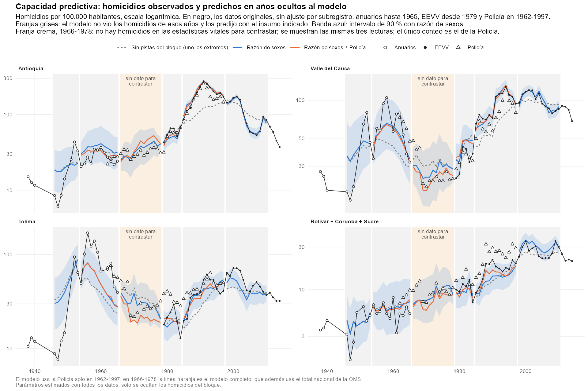

Las 15 unidades están en el anexo.

## Comparación con un modelo más simple

Para saber cuánto aporta la complejidad del modelo, se comparó con uno simple: una regresión multinivel
(binomial negativa) que reparte el total nacional de homicidios entre las unidades según la razón de sexos de
cada una. Es el modelo municipal que se usaba antes, llevado a departamentos. En la prueba los dos reciben lo
mismo dentro del bloque oculto: la razón de sexos de cada unidad y el total nacional de homicidios del año.

Error absoluto mediano en las 15 unidades:

| Bloque oculto | Simple, entrenado con anuarios y EEVV | Simple, entrenado solo con EEVV (1979 en adelante) | Modelo actual |
|---|---|---|---|
| 1946-1953 | 41 % | 53 % | 38 % |
| 1954-1965 | 40 % | 45 % | 23 % |
| 1979-1984 | 22 % | 18 % | 14 % |
| 1985-1997 | 16 % | 10 % | 9 % |
| 1998-2010 | 11 % | 7 % | 6 % |

- **Desde 1985 los dos predicen casi igual**, siempre que el simple se entrene solo con EEVV.
- **Antes de 1966 el modelo actual es claramente mejor.** En 1954-1965 su error es cerca de la mitad. El simple
  supone que cada unidad conserva su nivel relativo de violencia, y eso no se cumple: con datos recientes
  aprende que Antioquia es violenta y Tolima no, lo contrario de los años cincuenta.
- **En 1946-1953 ninguno predice bien.**
- **El exceso de mortalidad no cambia nada** en el modelo simple: los errores son los mismos con y sin él.

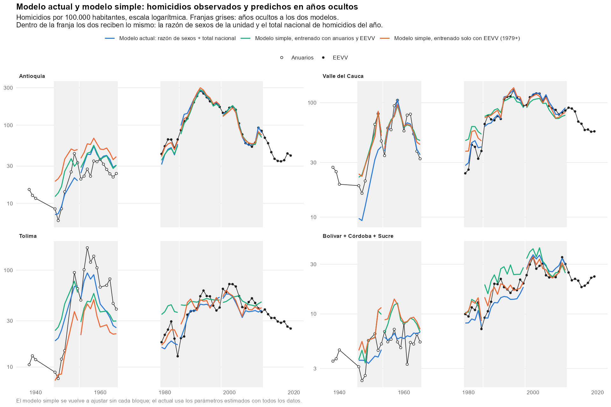

La comparación favorece un poco al modelo actual: sus parámetros se estiman con todos los datos, mientras que
el simple se vuelve a ajustar sin cada bloque.

# 3. Nuestros ajustes de mortalidad y su posible uso

**Estado**

- **Nacional, 1950-2023:** hay una serie ajustada por sexo y edad, corregida componente por componente
  (niñez, natural, otras externas, violenta y crisis). Queda cerca de WPP 2024: la esperanza de vida de los
  hombres en 1985 es 66,5 años con las defunciones registradas, 62,2 con la serie ajustada y 62,4 en WPP.
- **Departamental, 1985-2023:** el mismo ajuste en 29 unidades, calibrado a la serie nacional. Las
  defunciones ajustadas superan a las registradas en 27 % en 1990 y en 9 % en 2015.
- **Antes de 1985 no hay ajuste departamental.** Solo existe un índice de completitud por unidad para
  1950-1997, hecho para el modelo de homicidios, todavía en prototipo.

**El producto al que apuntan las dos partes**

Uniendo el modelo de homicidios con los ajustes de mortalidad se obtendría una serie departamental de
homicidios de 1923 a 2023, con el subregistro corregido y los huecos estimados. Hasta donde sabemos, esa serie
no existe para Colombia. El modelo aportaría los años y departamentos sin dato. Los ajustes aportarían el paso
de homicidios registrados a totales: las muertes del conflicto por departamento en 1985-2018 como referencia
externa para calibrar, la completitud por sexo para corregir la razón de sexos, y la Policía como piso en
1962-2002. La precisión no sería pareja: buena desde 1985, y antes de 1966 dependería de los anuarios más que
de la razón de sexos (parte 2).

**Ventajas de usarlos en el modelo de homicidios**

- El resultado serían homicidios totales y no solo registrados, con una sola convención en todo el proyecto.
- La razón de sexos se calcularía sobre defunciones corregidas. Podría mejorar la predicción en las unidades
  con peor registro (Bolívar, Córdoba, Sucre, Magdalena y Cesar), donde hoy la razón de sexos no ayuda.
- Permitiría calcular tasas y tablas de vida coherentes por departamento.

**Complicaciones hoy**

- **El ajuste falta justo donde se necesita.** La predicción es para antes de 1979 y el ajuste departamental
  empieza en 1985; antes casi no hay defunciones por edad por departamento.
- **Hay dos criterios para las muertes violentas.** El ajuste de mortalidad no les aplica factor de
  subregistro (añade las muertes del conflicto y usa a la Policía como piso). El análisis de homicidios
  encuentra que hasta 1997 sí se pierden, aunque menos que las demás defunciones. Hay que escoger uno.
- **La ganancia en el modelo es pequeña.** Al entrenarlo con insumos ajustados, el total nacional de
  1950-1997 cambió 0,1 %. El ajuste cambia el nivel final, no la predicción.
- **Las piezas no coinciden todavía:** 29 unidades en el ajuste y 15 en el modelo, población DANE en uno y
  WPP en otro, y censos sin corregir por omisión.

# Anexo: observado y predicho en las 15 unidades

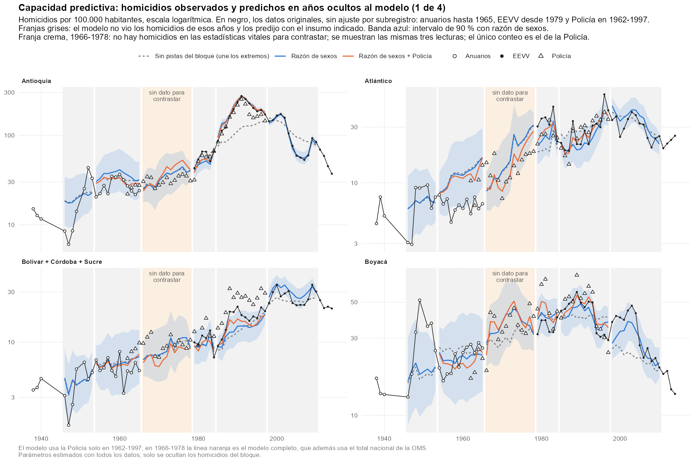

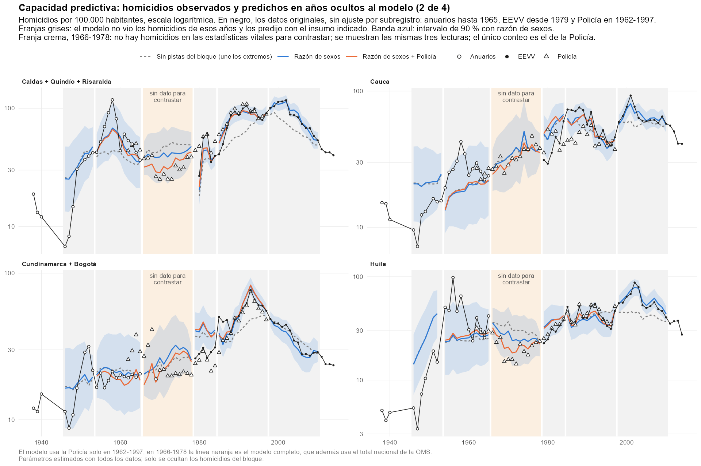

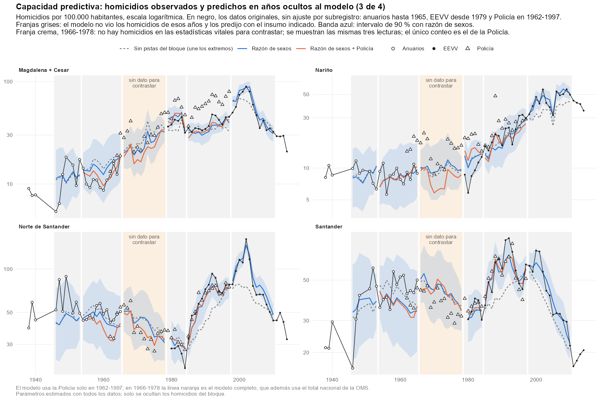

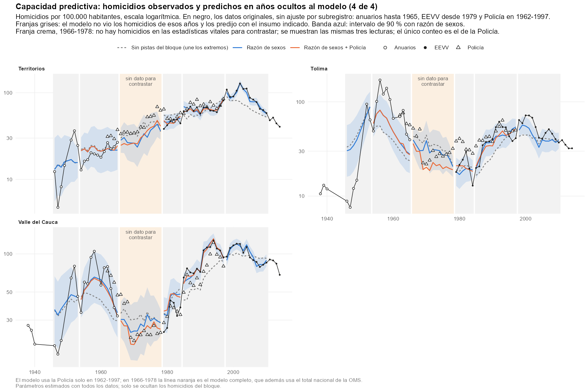
