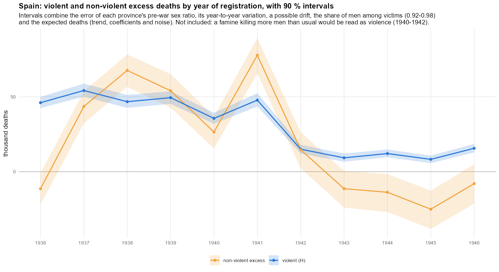
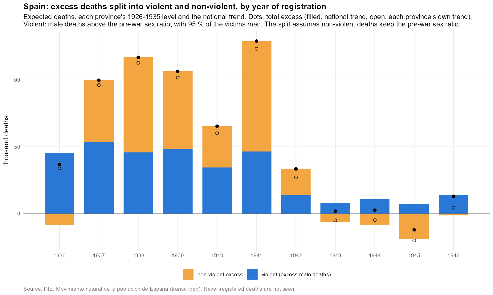
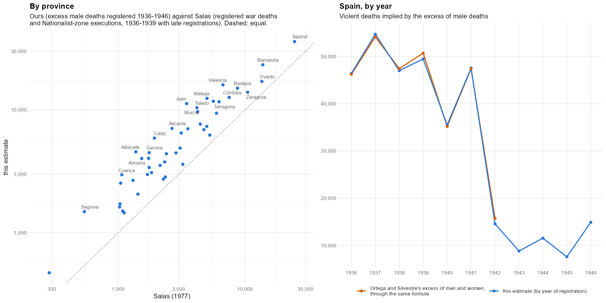
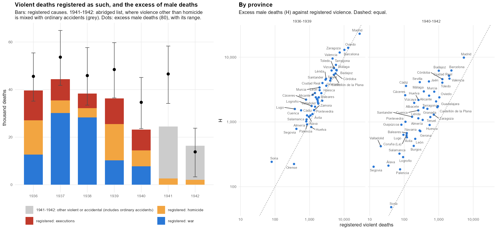

# España 1936–1946: muertes violentas y no violentas estimadas con la razón de sexos, y prueba ciega del método

*24 de noviembre de 2026 · scripts `code/80` a `84` (`intl_*`)*

## Resumen

- Con solo las muertes registradas por provincia, sexo y año (INE, 1926–1946), el exceso de muertes de 1936–1942 suma **unas 590.000**. De ellas, **unas 290.000 son violentas** (exceso de muertes de hombres) y **unas 300.000 no violentas** (hambre, enfermedad, refugiados).
- Las cifras coinciden con la literatura: el exceso total con Salas, Díez Nicolás y Ortega y Silvestre, y la violencia registrada por provincia con Salas (correlación 0,93–0,94).
- Las causas de muerte registradas por el INE en 1936–42 confirman el supuesto clave: los hombres son el 93–97 % de las víctimas, frente a π = 0,95. En 1936–39 la estimación supera a la violencia registrada como tal en un 22 % y coincide con ella provincia por provincia (correlación 0,94). En 1940–42 solo entre un tercio y dos tercios del exceso de hombres figura como violento.
- En una prueba ciega en cinco países con causa de muerte conocida, el método acierta cuando la violencia sube de golpe a pocos años de la base. Falla cuando la mortalidad no violenta cambia su composición por sexo, como con el COVID o con el envejecimiento a lo largo de muchos años. Por eso 1936–39 es más confiable que 1940–42.

## 1. España: datos y método

- **Datos:** defunciones registradas por provincia y sexo, 1926–1946. Las transcribí de los anuarios del INE con dos verificaciones: hombres + mujeres = total, y suma de provincias = total impreso. Son defunciones por año de registro.
- **Muertes esperadas:** el nivel de 1926–35 de cada provincia proyectado con la tendencia nacional (−1,16 % anual). El exceso es registradas − esperadas.
- **Muertes violentas (H):** con ρ, la razón de sexos de 1926–35 de cada provincia, y π = 0,95, la proporción de hombres entre las víctimas:
  - H = (hombres − ρ·mujeres) / (π − ρ(1−π))
  - Los hombres que mueren por encima de lo que "corresponde" según las mujeres se atribuyen a la violencia.
- **Exceso no violento:** lo que queda, exceso − H. H no depende de las muertes esperadas; la parte no violenta sí.

## 2. Estimaciones

| Período | Exceso total | Violentas (H), π = 0,95 | Rango de H | H con π = 0,90 | No violentas |
|---|---|---|---|---|---|
| 1936–39 | 360.000 | 193.000 | 147.000–238.000 | 219.000 | 166.000 (151.000*) |
| 1940–42 | 228.000 | 95.000 | 61.000–127.000 | 107.000 | 133.000 (116.000*) |
| 1943–46 | 6.000 | 40.000 | 3.000–76.000 | 45.000 | −35.000 |

*Con la tendencia propia de cada provincia en lugar de la nacional.

- El rango de esta tabla refleja solo cuánto varía la razón de sexos entre años de paz, y es demasiado amplio, porque suma las provincias como si sus errores fueran el mismo. La incertidumbre combinada está en el siguiente apartado.

**Incertidumbre combinada (script 84).** Simulé 2.000 veces el cálculo completo, combinando todas las fuentes de error que se pueden medir:
- el error de la razón de sexos de preguerra de cada provincia;
- su variación de un año a otro, con choques comunes a todas las provincias y choques propios de cada una;
- una posible deriva de esa razón, entre cero y la tendencia de preguerra (−0,1 % anual);
- π entre 0,92 y 0,98, el rango de las causas registradas;
- las muertes esperadas: tendencia nacional o propia de cada provincia, error de los coeficientes y ruido anual.

| Período | Violentas (H) | Exceso total | No violentas |
|---|---|---|---|
| 1936–39 | 196.000 (183.000–210.000) | 350.000 (325.000–375.000) | 154.000 (124.000–181.000) |
| 1940–42 | 98.000 (90.000–107.000) | 217.000 (191.000–242.000) | 119.000 (90.000–145.000) |
| 1943–46 | 45.000 (38.000–53.000) | −12.000 (−54.000 a +24.000) | −57.000 (−100.000 a −20.000) |

*Mediana e intervalo del 90 %.*

- **El error estadístico de H es chico:** ±7 % a nivel nacional y ±7–11 % en las provincias con más violencia (por ejemplo, Madrid 23.200, entre 21.500 y 25.000). El exceso total y la parte no violenta son más inciertos (±7–20 %), porque dependen de la tendencia esperada.
- **Lo que pesa más es lo que la simulación no puede incluir:** errores de estructura como el hambre que mata más hombres, la movilización o las muertes nunca registradas. La prueba ciega (sección 5) da su orden de magnitud, alrededor de ±25 %, y las causas registradas (sección 4) dan el piso de 1940–42.

- **La línea base pasa la prueba:** estimada solo con años de paz, deja el exceso de 1943–46 prácticamente en cero sin forzarlo.

**Por provincia:**
- **1936–39:**
  - Mayormente violento: Oviedo, Zaragoza, Vizcaya, Málaga y Badajoz (70–92 % del exceso).
  - Mayormente no violento: Jaén, Almería, Murcia y Alicante (10–26 % violento). Coincide con la retaguardia republicana, los refugiados y la escasez.
- **1940–42:** el mayor exceso está en Badajoz, Sevilla, Madrid, Córdoba y Jaén. Es mayormente no violento, salvo en Madrid y Barcelona.

## 3. Comparación con otras estimaciones

| Medida | Otra estimación | Método de esa estimación | Nuestra cifra |
|---|---|---|---|
| Exceso total 1936–39 | Ortega y Silvestre (2005): ~346.000; Salas (1977): 343.500; Díez Nicolás (1985): 345.000 | Ortega y Silvestre: tendencia 1926–35 por provincia y sexo; Salas: muertes registradas frente a un nivel de preguerra; Díez Nicolás: citado por Ortega y Silvestre | 360.000 |
| Exceso total 1936–42 | Ortega y Silvestre: ~540.000; Salas: 567.000; Díez Nicolás: 559.000 | ídem | 588.000 |
| Violencia registrada por provincia, 1936–39 | Salas: muertes en operaciones militares + ejecuciones en zona nacional, 194.700 | causa de muerte registrada, con las inscripciones tardías reasignadas a la guerra | 193.500; correlación entre provincias 0,93 (0,94 sumando hasta 1946) |
| Violencia registrada total | Salas: 296.944 (incluye 72.344 ejecuciones en zona republicana, maquis y 25.500 extranjeros) | ídem | 288.500 (registradas hasta 1942); 328.700 (hasta 1946) |
| Represión documentada | Espinosa (2008), 20 provincias con estudio completo; Espinosa y Ledesma (2012): 130.199 franquista + 49.272 republicana | víctimas con nombre, desde archivos | correlación entre provincias 0,81 (H es más amplia: incluye el frente) |
| No violentas 1936–42 | Implícito en Salas: 567.000 − ~271.000 violentas de españoles ≈ 296.000 | resta | 299.000 |
| Hambre 1939–42 | Del Arco Blanco: ~200.000 | citado en entrevista; método no revisado | 133.000 en 1940–42, más parte de 58.000 en 1939 |
| Exceso de hombres y mujeres por año | Ortega y Silvestre, pasado por nuestra fórmula | — | coincide año a año (mismos datos del INE, no es una prueba independiente) |

En las provincias donde quedamos por encima de Salas (Albacete, Cáceres, Cuenca, Lugo, Jaén), probablemente pesan las ejecuciones de la zona republicana, cuya tabla provincial de Salas no se consiguió, y el año de registro.

## 4. Contraste con las causas de muerte registradas, 1936–1942

Transcribí del INE, por provincia y sexo, las causas violentas registradas en cada año, con la verificación de que las provincias suman el total impreso de cada columna (120 columnas, todas cuadran):

- **1936–40, lista detallada:** homicidio (por arma de fuego, por arma blanca y otros), heridas de guerra, ejecución de civiles por los ejércitos beligerantes y ejecución judicial. También muerte violenta de naturaleza desconocida, muerte repentina y causas mal definidas.
- **1941–42, lista abreviada:** homicidios, y "otras muertes violentas o accidentales", un rubro que mezcla la violencia con los accidentes comunes.

| Año | H (exceso de hombres) | Violencia registrada | Homicidio | Guerra | Ejecuciones | Hombres entre las víctimas (π) |
|---|---|---|---|---|---|---|
| 1936 | 45.600 | 39.600 | 14.500 | 12.600 | 12.500 | 0,93 |
| 1937 | 53.600 | 44.400 | 5.300 | 30.200 | 9.000 | 0,94 |
| 1938 | 45.900 | 38.300 | 4.000 | 28.300 | 6.100 | 0,94 |
| 1939 | 48.400 | 36.300 | 15.300 | 10.300 | 10.800 | 0,97 |
| 1940 | 34.600 | 23.200 | 6.700 | 7.700 | 8.800 | 0,97 |
| 1941 | 46.600 | 2.700 homicidio + hasta 21.900 "otras violentas o accidentales" | | | | 0,94 |
| 1942 | 13.800 | 2.100 homicidio + hasta 14.300 "otras violentas o accidentales" | | | | 0,95 |

**Lo que muestra:**

1. **π = 0,95 queda validado.** Entre las muertes violentas registradas, los hombres son el 93–97 %. Usar el π registrado de cada año en vez de 0,95 cambia H entre −5 % y +5 %.
2. **1936–39 es sólido:**
   - Se registraron como violentas 158.700 muertes: 81.300 de guerra, 39.000 homicidios y 38.400 ejecuciones. H da 193.500, un 22 % más.
   - Por provincia, las dos series coinciden: correlación 0,94.
   - La diferencia, ~35.000, es lo esperable por muertes violentas que nunca se registraron como tales. Además, las "muertes violentas de naturaleza desconocida" suman 7.900 en esos años. H es coherente con la violencia registrada y algo mayor, como debe ser.
3. **1940–42 queda acotado, pero no resuelto:**
   - La violencia registrada como tal está entre ~28.000 (solo homicidios en 1941–42) y ~64.000 (si se cuenta todo el rubro "otras violentas o accidentales"). H da 95.000.
   - Es decir, entre 31.000 y 67.000 muertes de hombres de más en 1940–42 no figuran como violentas. Pueden ser dos cosas que estos datos no permiten separar:
     - el hambre y el tifus matando más hombres, que sería un artefacto del método;
     - la represión registrada bajo otras causas, como las muertes en prisión por hambre o enfermedad.
   - Las causas mal definidas subieron en 1941 en ambos sexos por igual (hombres 7.300 → 10.600, mujeres 5.100 → 7.000), así que no muestran una violencia masculina escondida en ese rubro.

## 5. Prueba ciega del método donde se conoce la causa

Apliqué el estimador igual que en España: periodo base para ρ y la tendencia, π = 0,95 y solo el sexo de los muertos. Luego lo comparé con las muertes violentas observadas por encima de la proporción del periodo base.

| Caso | Periodo | Edades | Estimado (miles) | Observado (miles) | Error total | Correlación entre unidades |
|---|---|---|---|---|---|---|
| Ecuador (base 2015–19) | 2022–24, salto de violencia | todas | 15,5 | 15,5 | 0 % | 1,00 |
| | | 15–44 | 15,1 | 13,2 | +14 % | 1,00 |
| | 2020–21, COVID | todas | 16,4 | 0,3 | **falla** | 0,65 |
| | | 15–44 | 1,3 | 1,1 | +20 % | 0,96 |
| México (base 2000–06) | 2008–12, guerra contra el narco | todas | 41,4 | 54,9 | −25 % | 0,94 |
| | | 15–44 | 48,6 | 48,5 | 0 % | 0,96 |
| | 2020–21, COVID | todas | 148,1 | 22,9 | **falla** | 0,02 |
| | | 15–44 | 21,9 | 27,0 | −19 % | 0,60 |
| Colombia (base 1979–83) | 1985–93 | todas | 132,1 | 121,0 | +9 % | 1,00 |
| | | 15–44 | 126,4 | 104,0 | +22 % | 1,00 |
| | 1998–2002 | todas | 97,9 | 98,6 | −1 % | 0,99 |
| | | 15–44 | 98,9 | 82,9 | +19 % | 0,99 |
| Brasil (base 1996–2000) | 2010–17 | todas | −523 | −5 | **falla** | 0,95 |
| | | 15–44 | 111,4 | 114,9 | −3 % | 0,97 |
| EE. UU. (base 1999–2004) | 2015–19 | todas / 15–44 | 592 / 16 | −7 / 3 | **falla** | — |

**Qué aprendimos:**

1. **Acierta cuando la violencia cambia de golpe y el horizonte es corto.** Ecuador 2022–24, México 2008–12 en 15–44 y Colombia en todas las edades dan errores de 0–9 %, con las unidades bien ordenadas. Donde se pudo evaluar, la división del exceso también acierta.
2. **Falla cuando la mortalidad no violenta cambia su composición por sexo.** Esos hombres de más se leen como violencia:
   - el COVID mató más hombres;
   - en horizontes de 15–20 años pesan el envejecimiento (Brasil) y los opioides (EE. UU.);
   - en EE. UU., además, la violencia pesa demasiado poco.
3. **Las edades 15–44 suelen resistir mejor,** como con el COVID y en Brasil, pero no siempre. En Colombia 15–44 sobreestima un 20 %, porque la razón de sexos de las muertes no violentas de 15–44 subió un 20–30 % entre 1985 y 2019. Mi hipótesis es que se debe a la caída de la mortalidad de mujeres jóvenes (materna) y a los accidentes de hombres, pero no lo he verificado.
4. **El π observado es 0,87–0,93, no 0,95.** Usar 0,95 cuando el valor real es ~0,89 subestima H en ~12 %. En una guerra, con frente y represión, π debería ser más alto que en la violencia criminal, pero no lo hemos medido para España.
5. **En Colombia no se pudo evaluar la parte no violenta,** porque el registro creció muy rápido en 1979–83, el periodo base.

**Qué implica para España:**
- **1936–39** se parece a los casos donde el método funciona: un salto brusco de violencia a 1–4 años de la base. Ahí la estimación es confiable, dentro del rango de π.
- **1940–42** es el punto débil. Si el hambre y el tifus mataron proporcionalmente más hombres, como el COVID, parte de ese exceso se estaría contando como violencia. Las provincias lejos del frente (Galicia, Canarias) sugieren que el efecto fue pequeño, pero no es concluyente.

## 6. Qué faltaría para mejorar

1. **Separar hambre de represión oculta en 1940–42.** Es lo único que queda abierto. Dos vías:
   - **Edades 15–44 por provincia.** El lector de dígitos verifica sin ayuda el 58–92 % de las columnas, según el año. El hambre mata sobre todo a niños y viejos, y la represión a hombres de 20–50. Con la cautela que deja Colombia: hay que revisar que la razón de sexos de 15–44 no se mueva por otras causas.
   - **Las causas detalladas de 1940** (enfermedades por sexo) y la mortalidad en prisiones documentada en la literatura.
2. **Modelo de espacio de estados en su versión logit (CoDA) con las causas registradas como anclas.** Ya es posible con los datos del punto 4, y estimaría la deriva de la razón de sexos no violenta en vez de suponerla fija.
3. **Bombardeos:** cifras publicadas de muertos por provincia y año (por ejemplo, Solé i Sabaté y Villarroya para Cataluña). Matan a ambos sexos, así que hoy quedan en el exceso no violento; con esas cifras se podrían pasar a la parte violenta.
4. **Desplazados y refugiados por provincia, y exilio de 1939.** Hoy inflan el exceso no violento de las provincias que reciben gente (Jaén, Almería, Murcia, Alicante) y lo bajan en las de origen.
5. **Año de defunción frente a año de registro:** estimar las inscripciones tardías (1939–41, 1943–44) para comparar con Salas en la misma base.
6. **Búsqueda bibliográfica** sobre si este estimador ya se propuso: demografía de conflictos, demografía histórica y métodos con la razón de sexos.

## 7. Conclusión: ¿funciona?

**Sí funciona, con condiciones, y las condiciones de España en 1936–39 son las favorables.**

**Cuándo funciona:** la violencia sube de golpe, pesa mucho en el total de muertes y el periodo está a pocos años de la base. Ahí el error total es de 0 a 25 %, y las unidades quedan bien ordenadas (correlación 0,94–1,00):

| Caso | Error |
|---|---|
| Ecuador 2022–24 | 0 % |
| México 2008–12, 15–44 | 0 % |
| Colombia, todas las edades | −1 % y +9 % |
| México 2008–12, todas las edades | −25 % |

El −25 % de México se debe en buena parte a usar π = 0,95 cuando el valor real era ~0,89. En una guerra π debería estar más cerca de 0,95.

**Cuándo no funciona:**
- cuando la mortalidad no violenta cambia su composición por sexo, como con el COVID;
- en horizontes de 15 años o más (envejecimiento, opioides);
- cuando la violencia pesa muy poco (EE. UU.).

En esos casos el error puede ser de varias veces el valor real.

**Qué tan lejos podemos estar en España:**

- **π:** las causas registradas confirman π = 0,95 (registrado: 0,93–0,97).
- **1936–39:** se parece a los casos donde funciona, y las causas registradas lo confirman. Las ~193.000 muertes violentas estimadas superan en 22 % a las 158.700 registradas como violentas, y coinciden con ellas provincia por provincia (correlación 0,94). Ese 22 % es lo esperable por violencia nunca registrada como tal. También coinciden con Salas (194.700 en la suma comparable). El error estadístico es de solo ±7 % (183.000–210.000). Sumando el error de estructura que muestra la prueba ciega, el rango razonable es **160.000–240.000**: el piso es lo registrado como violento y el techo, el error de la prueba ciega.
- **1940–42:** las ~95.000 de H son un **techo**. Lo registrado como violento da entre 28.000 y 64.000. Las restantes 31.000–67.000 muertes de hombres de más son hambre que el método cuenta como violencia, o represión registrada bajo otras causas (muertes en prisión). Con estos datos no se pueden separar. Por analogía con el COVID, el sesgo por hambre podría explicar entre 40.000 y 65.000. Los dos caminos llevan a una violencia directa de **30.000–65.000** en esos años.
- **El total del exceso,** violento más no violento, no depende de este supuesto. Es sólido: ~590.000 en 1936–42.

**En resumen:**
- El método funciona para España en la guerra: π validado, coincidencia con las causas registradas y con Salas, y un error de ±20 %.
- Para la posguerra, 1940–42, H es un límite superior. La violencia registrada como tal da el límite inferior, y la diferencia es hambre o represión oculta.
- Separar esas dos cosas, con las edades 15–44 o con las causas por sexo y edad, es lo único que queda abierto.
