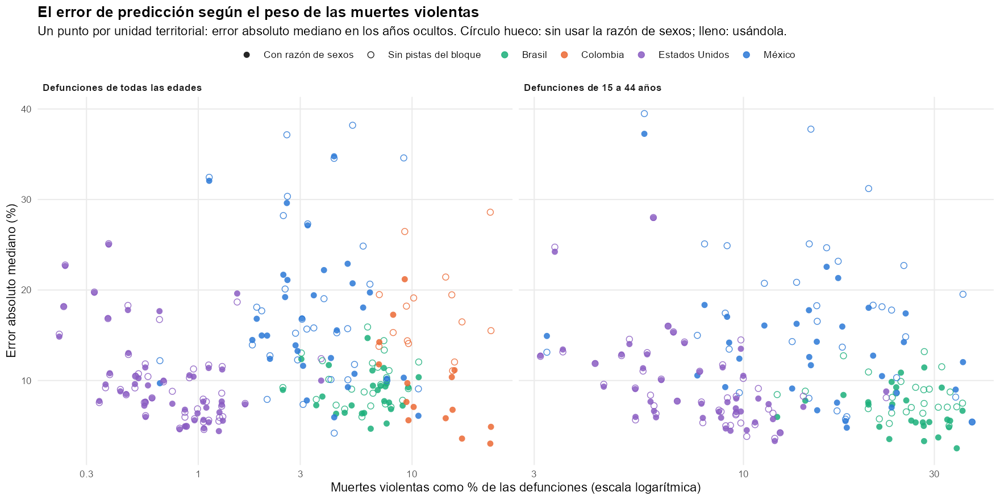
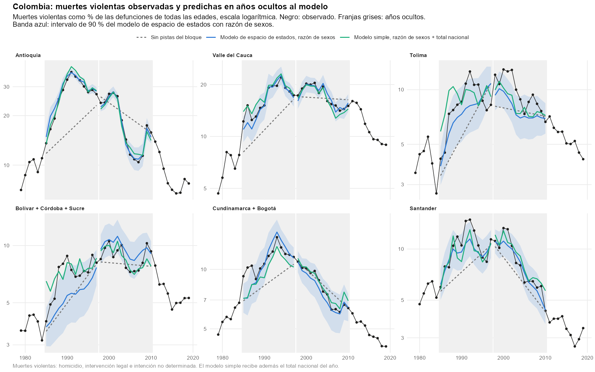
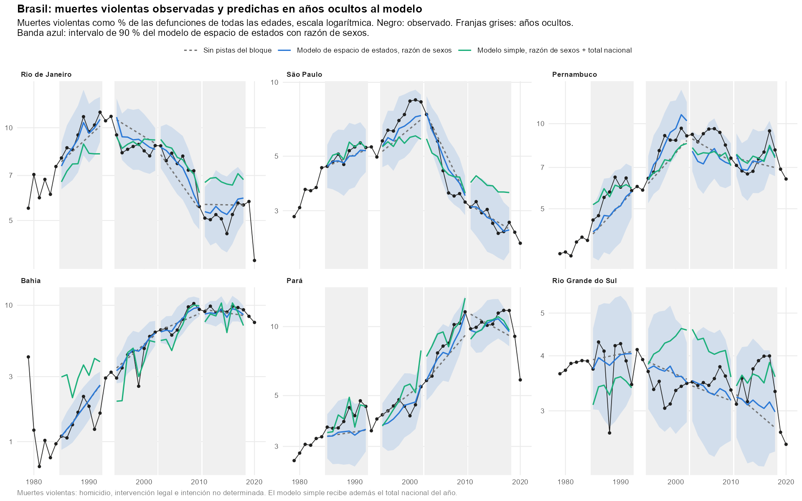
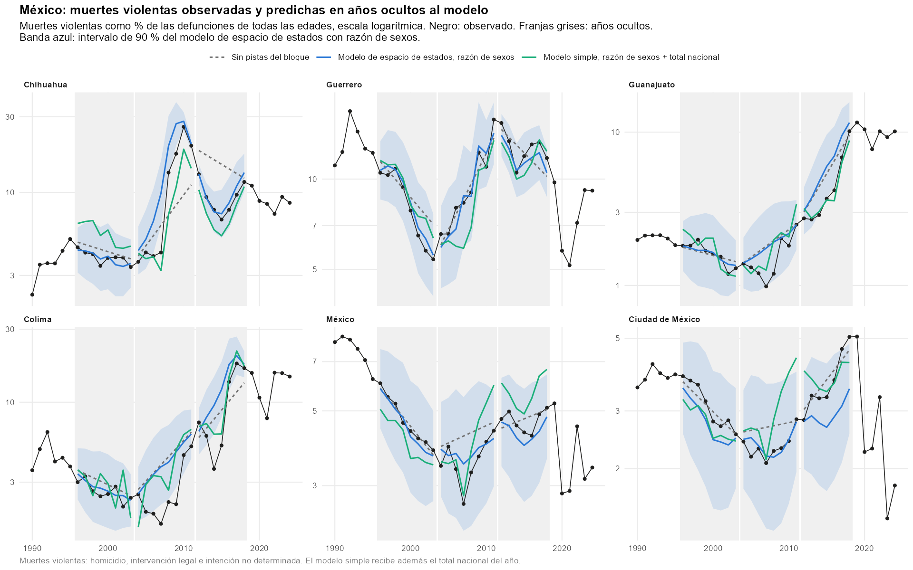
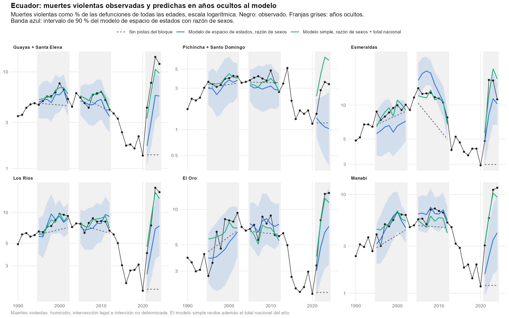
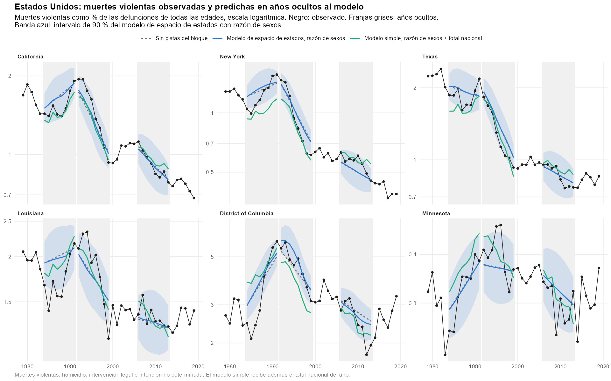
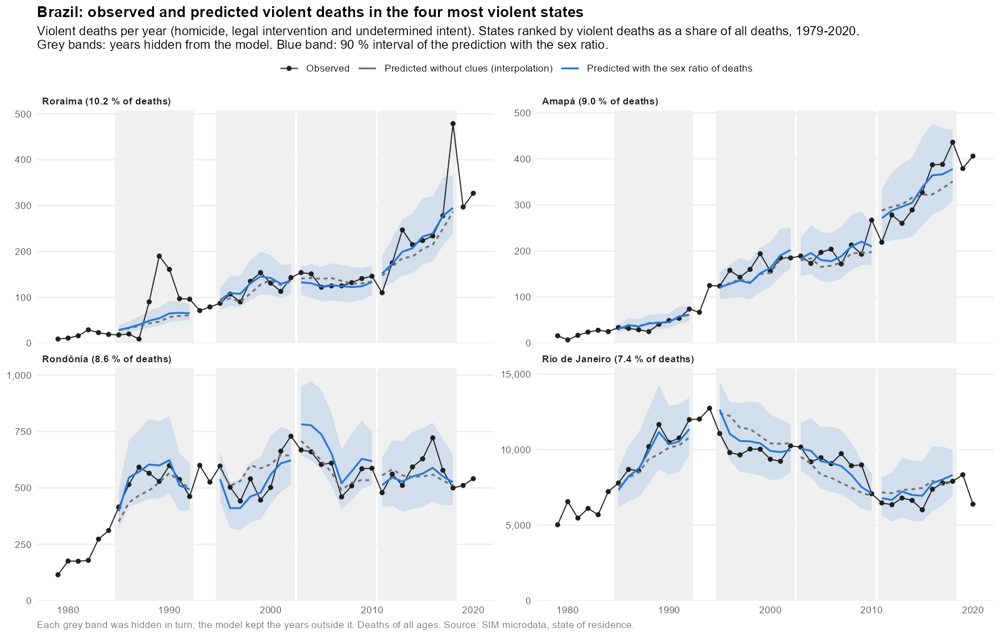
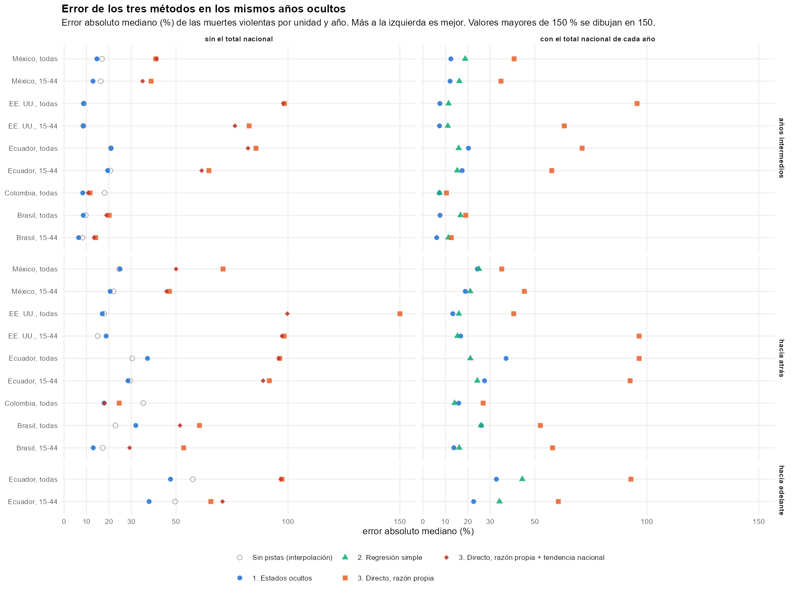

# Validación internacional del modelo de homicidios con la razón de sexos

*25 de noviembre de 2026 · scripts `code/70` a `78` y `86` (`intl_*`)*

## Resumen

- **La pregunta:** ¿cuánto ayuda la razón de sexos de todas las muertes a reconstruir las muertes violentas de un departamento o estado en años en que no se conocen? En Colombia el modelo se usa así antes de 1966. Aquí lo probé donde la respuesta se conoce: Brasil, México, Estados Unidos, Ecuador y Colombia 1979–2019. Se ocultan bloques de años, el modelo los estima y se compara con lo registrado.
- **Ayuda mucho cuando la violencia pesa mucho en el total de muertes.** En Colombia (12–14 % de las muertes) el error baja a la mitad: de 18 % a 8 % en años intermedios y de 35 % a 18 % hacia atrás. En las edades 15–44 de Brasil y México, donde la violencia es el 18–25 % de las muertes, el error baja un 20–25 %.
- **Ayuda poco o nada donde la violencia pesa poco** (EE. UU., 1 % de las muertes; México, Brasil y Ecuador con todas las edades, 4–5 %).
- **Hacia atrás, con 15 años sin datos, puede empeorar.** Pasa en Brasil y Ecuador con todas las edades y en EE. UU. con 15–44. La razón de sexos de las muertes no violentas cambia por otras causas, como el envejecimiento, y el modelo lo lee como violencia.
- **Los intervalos del 90 % son confiables en años intermedios, pero no hacia atrás.** En años intermedios contienen el valor real el 90–96 % de las veces. Hacia atrás, solo el 64–88 %.
- **La versión logit (CoDA) da el mismo error que la logarítmica, con mejor cobertura hacia atrás.** Dejar libre la proporción de hombres entre las víctimas no añade nada.
- **De los tres métodos, el de estados ocultos es el mejor o empata en casi todo.** El estimador directo de España iguala al de estados ocultos en Colombia, sobre totales de periodo por unidad, y en el resto queda lejos. Donde la violencia pesa poco falla por completo: muchas estimaciones dan negativas.

## 1. Los modelos y cómo usan la razón de sexos

### La idea

Las muertes violentas son casi todas de hombres (78–92 % según el país). Las demás muertes se reparten entre hombres y mujeres de forma estable. Si en un año la razón hombres/mujeres de todas las muertes sube más de lo esperable, lo más probable es que haya subido la violencia.

La relación exacta es una identidad contable. Llamemos:
- *v* a la proporción de muertes violentas en el total;
- *π* a la proporción de hombres entre las víctimas violentas;
- *r* a la razón hombres/mujeres de las muertes no violentas.

Entonces, la razón observada de todas las muertes es:

> hombres / mujeres = [ (1−v)·r/(1+r) + v·π ] / [ (1−v)/(1+r) + v·(1−π) ]

Si se conoce *r*, de la razón observada se puede despejar *v*. El problema es que *r* no se observa directamente en los años sin causas. Cada modelo resuelve eso de una manera distinta.

### Modelo principal: espacio de estados (scripts 60 y 70)

Es el mismo núcleo del modelo de Colombia (script 60), sin lo específico de las fuentes colombianas: anuarios con errores, Policía, la restricción de la OMS. Por unidad y año sigue dos cantidades ocultas, que cambian lentamente (caminatas aleatorias):

| Estado | Qué es |
|---|---|
| η | log de la proporción de muertes violentas en el total |
| u | cuánto se aparta la razón de sexos no violenta de la unidad de la nacional (ρ_t) |

Y usa dos observaciones:
1. **Las muertes violentas registradas,** cuando se conocen: miden η directamente.
2. **La razón de sexos de todas las muertes:** se relaciona con η y con ρ_t + u a través de la identidad de arriba, con el π medido en cada país.

**Cómo se usa la razón de sexos.** En los años ocultos solo queda la segunda observación. El modelo tiene que decidir si un cambio en la razón de sexos viene de la violencia (η) o de la mortalidad no violenta (u). Lo resuelve con la velocidad de cambio que estimó en los años conocidos: u cambia muy despacio (desviación anual de 0,7–3 %) y η mucho más rápido (7–31 %). Por eso un salto de la razón de sexos se atribuye sobre todo a la violencia, y una deriva lenta a la mortalidad no violenta.

Se estima por máxima verosimilitud con un filtro de Kalman extendido y su suavizador, unidad por unidad.

Se comparan tres variantes en los años ocultos:

| Variante | Qué ve el modelo en los años ocultos |
|---|---|
| **N**, sin pistas | Nada: interpola entre los años vecinos. Es la referencia. |
| **S**, razón de sexos | La razón de sexos de todas las muertes de cada unidad. |
| **ST**, razón de sexos + total nacional | Lo mismo, y después ajusta las unidades para que sumen el total nacional de violentas de ese año. Sirve cuando se conoce el total nacional, como en Colombia en 1966–77 con la OMS. |

### Modelo simple de referencia (script 64)

Una regresión binomial negativa con efectos por unidad:

> violentas ~ proporción violenta nacional + log razón de sexos (pendiente propia de cada unidad) + log(muertes totales)

Se reestima sin cada bloque y se ajusta al total nacional. Tiene dos versiones: **B1**, con la razón de sexos, y **B0**, sin ella. Usa la razón de sexos como un predictor más, sin la identidad. Como ve el total nacional, se compara con ST y no con S.

### Versiones composicionales (script 78)

Las muertes de una unidad y un año son una composición de cuatro partes: hombres y mujeres, violentas y no violentas. Probé dos cambios en esa línea:

- **logit:** la proporción violenta en escala logit (violentas/no violentas) en vez de log. Así queda siempre entre 0 y 1, lo que importa cuando la proporción es alta, como en 15–44.
- **logit + π:** además, la proporción de hombres entre las víctimas es un tercer estado por unidad, en vez de un valor fijo por país.

### Relación con el estimador de España

El estimador directo de España (script 80) usa la misma identidad, despejada sin dinámica. Fija *r* en la razón de preguerra de cada provincia y π en 0,95, y despeja las violentas año por año. Es el caso particular sin estados ocultos ni años con causas conocidas. Su prueba está en el [reporte de España](reporte_prueba_ciega_estimador_espana.html), sección 5.

## 2. Datos

| País | Unidades | Años | Fuente | Violentas, % de las muertes (todas / 15–44) | Hombres entre las víctimas, π (todas / 15–44) |
|---|---|---|---|---|---|
| Colombia | 15 departamentos estables | 1979–2019 | EEVV (DANE) | 12 / — | 0,90 (fijo, como en 60) |
| Brasil | 26 estados | 1979–2020 | SIM | 5 / 24 | 0,89 / 0,92 |
| México | 32 estados | 1990–2024 | INEGI | 4 / 19 | 0,88 / 0,90 |
| Estados Unidos | 48 (44 en 15–44) | 1968–2019 | NCHS hasta 2004; CDC WONDER desde 2005 | 1 / 9 | 0,78 / 0,81 |
| Ecuador | 21 provincias | 1990–2024 | INEC | 4 / 18 | 0,88 / 0,91 |

- **Muertes violentas:** homicidio, intervención legal e intención no determinada, como en Colombia. En EE. UU. se usa la definición estrecha, sin intención no determinada.
- **CDC WONDER** suprime los conteos menores de 10. Por eso EE. UU. usa totales estatales de violentas sin sexo y la proporción nacional de hombres, sin derivar ningún conteo suprimido.
- **Edades 15–44:** solo existen donde hay microdatos, así que Colombia entra solo con todas las edades. En Colombia histórica solo hay todas las edades.

## 3. La prueba

- **Años intermedios:** se ocultan bloques de 7–8 años con datos a ambos lados (13 años en Colombia), por ejemplo Brasil 1985–92, 1995–2002, 2003–10 y 2011–18. En cada bloque se ocultan las violentas de todas las unidades a la vez. Cada bloque se prueba por separado: los demás años siguen visibles.
- **Hacia atrás:** se ocultan los primeros 15 años de la serie, y el modelo solo tiene datos posteriores. Es la prueba más parecida al uso del modelo en la Colombia histórica.
- **Hacia adelante (solo Ecuador):** se ocultan 2021–24, cuando la violencia se duplicó. Es la prueba más dura: un salto de violencia sin años posteriores que ayuden.

**La medida de error.** En cada celda (unidad × año oculto):

> error = | estimado − observado | / observado

y luego se toma la **mediana** de las celdas. Un 8 % quiere decir que en la mitad de las celdas el error es menor que 8 %. Las tablas dan el promedio de las medianas de cada bloque, ponderado por el número de celdas. También se guardan el percentil 90 del error (los peores casos) y la **cobertura**: la proporción de celdas cuyo valor real cae dentro del intervalo del 90 %. Lo ideal es 0,90.

Esta medida evalúa el nivel de las muertes violentas en cada celda. No mide por separado si el modelo acierta la dirección o el tamaño de los cambios de un año a otro.

Los parámetros vienen del ajuste con todos los datos, como en el modelo de Colombia. Hay una pequeña filtración: ρ_t, la razón de sexos nacional no violenta, se calcula con la proporción violenta nacional, que en los años ocultos sí se conoce.

## 4. Resultados

### Error por país, prueba y variante

Error mediano (%), sin la razón de sexos (N) → con ella (S) → con ella y el total nacional (ST). Más bajo es mejor.

**Todas las edades**

| País | Violentas, % | Años intermedios | Hacia atrás | Hacia adelante |
|---|---|---|---|---|
| Colombia | 12–14 | 18 → **8** → 7 | 35 → **18** → 16 | |
| Brasil | 5 | 10 → 9 → 8 | 23 → **32** → 26 | |
| México | 4 | 17 → 15 → 13 | 25 → 25 → 24 | |
| Ecuador | 4–6 | 21 → 21 → 20 | 30 → **37** → 37 | 58 → **48** → 33 |
| EE. UU. | 1 | 9 → 9 → 8 | 18 → 17 → 13 | |

**Edades 15–44**

| País | Violentas, % | Años intermedios | Hacia atrás | Hacia adelante |
|---|---|---|---|---|
| Brasil | 19–25 | 8 → **7** → 6 | 17 → **13** → 14 | |
| México | 15–18 | 16 → **13** → 12 | 22 → 21 → 19 | |
| Ecuador | 15–30 | 21 → 20 → 18 | 30 → 29 → 28 | 50 → **38** → 23 |
| EE. UU. | 9 | 9 → 9 → 7 | 15 → **19** → 17 | |

**Lo que muestran:**

1. **Donde la violencia pesa mucho, la razón de sexos funciona bien.** El caso más claro es Colombia: el error baja a la mitad tanto en años intermedios como hacia atrás. En 15–44, Brasil y México mejoran un 20–25 % en años intermedios, y Brasil también hacia atrás.
2. **Donde pesa poco, no aporta.** En EE. UU. con todas las edades las violentas son el 1 % de las muertes: la señal es demasiado pequeña frente a las demás variaciones de la razón de sexos.
3. **Hacia atrás puede empeorar.** Brasil con todas las edades pasa de 23 % a 32 %, Ecuador de 30 % a 37 % y EE. UU. en 15–44 de 15 % a 19 %. En 15 años la razón de sexos no violenta cambia por el envejecimiento y otras causas. El modelo no tiene años anteriores para aprender esa tendencia y la atribuye en parte a la violencia.
4. **Ante un salto brusco, la razón de sexos ayuda pero no alcanza.** En Ecuador 2021–24 el modelo sin pistas subestima mucho, porque no sabe que la violencia se duplicó. Con la razón de sexos el error baja de 58 % a 48 % (de 50 % a 38 % en 15–44). Con el total nacional baja a 33 % (23 %).
5. **El total nacional ayuda siempre** (ST frente a S): fija el nivel, y la razón de sexos solo tiene que repartirlo entre las unidades.

*Cada punto es una unidad territorial. Círculo hueco: sin la razón de sexos. Lleno: con ella. A la derecha del gráfico, donde la violencia pesa más, los puntos llenos quedan por debajo de los huecos.*

### Error por bloque

| País y edades | Bloque | Violentas, % | N | S | ST |
|---|---|---|---|---|---|
| Colombia, todas | 1985–97 | 15 | 20 | 10 | 9 |
| | 1998–2010 | 14 | 16 | 6 | 6 |
| | 1979–93, hacia atrás | 12 | 35 | 18 | 16 |
| Brasil, todas | 1985–92 | 5 | 11 | 11 | 10 |
| | 2011–18 | 6 | 12 | 8 | 6 |
| | 1979–93, hacia atrás | 4 | 23 | 32 | 26 |
| Brasil, 15–44 | 2011–18 | 30 | 10 | 7 | 5 |
| | 1979–93, hacia atrás | 19 | 17 | 13 | 14 |
| México, todas | 2004–11, guerra contra el narco | 4 | 22 | 19 | 14 |
| México, 15–44 | 2004–11 | 17 | 22 | 16 | 14 |
| | 2012–18 | 23 | 18 | 12 | 12 |
| EE. UU., todas | 1968–82, hacia atrás | 1 | 18 | 17 | 13 |
| Ecuador, todas | 2021–24, hacia adelante | 6 | 58 | 48 | 33 |

El patrón se repite dentro de cada país: la razón de sexos ayuda más en los bloques donde la violencia pesa más y cambia más, como Brasil 2011–18 o México 2004–11.

### Observado y estimado por unidad

### Frente al modelo simple

Con el total nacional, la versión de espacio de estados (ST) es mejor que la regresión simple (B1) en casi todos los casos:

| | ST | B1 |
|---|---|---|
| Brasil 15–44, años intermedios | 6 | 11 |
| México todas, años intermedios | 13 | 19 |
| EE. UU. todas, años intermedios | 8 | 11 |
| Ecuador 15–44, hacia adelante | 23 | 34 |
| Colombia, años intermedios | 7 | 7 |
| Colombia, hacia atrás | 16 | 14 |
| Ecuador todas, hacia atrás | 37 | 21 |

La regresión simple gana en Ecuador (salvo hacia adelante) y en Colombia hacia atrás. Una explicación posible, que no verifiqué: su pendiente por unidad, aprendida con todos los años, resiste mejor la deriva de la razón de sexos que el estado u del modelo dinámico.

### Los tres métodos en los mismos años ocultos (script 86)

El estimador directo de España (método 3) se había probado en otros periodos y contra otra verdad (script 82). Aquí lo corrí en los mismos bloques y celdas que los métodos 1 y 2, con la misma información.

**Cómo se aplica el estimador directo en un bloque oculto.** Para cada unidad, la razón de sexos no violenta sale de los 5 años conocidos más cercanos a cada lado del bloque. Se interpola a través de un bloque intermedio y se mantiene fija hacia atrás o hacia adelante. Con ella y con π se despejan las violentas de cada año oculto, como en España. Hay tres variantes:
- **D:** solo la razón propia de la unidad. Es el estimador de España tal cual.
- **DN:** la desviación de la unidad respecto de la razón nacional, sumada a la razón nacional de cada año oculto. Usa la misma información nacional que el método 1.
- **DT:** D ajustado al total nacional de cada año, comparable a ST y B1.

**Error por unidad y año.** Es la medida de todo el informe. Error mediano en %:

| País y edades | Prueba | Violentas, % | Sin pistas | 1. Estados ocultos | 3. Directo (D / DN) | Con total: 1 (ST) | 2 (B1) | 3 (DT) |
|---|---|---|---|---|---|---|---|---|
| Colombia, todas | intermedios | 14 | 18 | **8** | 12 / 11 | 7 | 7 | 10 |
| | hacia atrás | 12 | 35 | **18** | 25 / **18** | 16 | 14 | 27 |
| Brasil, 15–44 | intermedios | 25 | 8 | **6** | 14 / 13 | 6 | 11 | 13 |
| | hacia atrás | 19 | 17 | **13** | 53 / 29 | 14 | 16 | 58 |
| Brasil, todas | intermedios | 6 | 10 | **9** | 20 / 19 | 8 | 17 | 19 |
| México, 15–44 | intermedios | 18 | 16 | **13** | 39 / 35 | 12 | 16 | 35 |
| México, todas | intermedios | 4 | 17 | **15** | 41 / 41 | 12 | 19 | 41 |
| Ecuador, 15–44 | intermedios | 18 | 21 | **19** | 65 / 61 | 18 | 15 | 58 |
| Ecuador, todas | hacia adelante | 6 | 58 | **48** | 97 / 97 | 33 | 44 | 93 |
| EE. UU., todas | intermedios | 1 | 9 | **9** | 98 / 98 | 8 | 11 | 96 |

**Error en el total del bloque por unidad.** Así se usa el estimador en España: totales de un periodo por provincia, donde el ruido de un año a otro se compensa en parte.

| País y edades | Prueba | Sin pistas | 1. Estados ocultos | 3. Directo (D / DN) | 2 con total (B1) |
|---|---|---|---|---|---|
| Colombia, todas | intermedios | 20 | 7 | **6** / 8 | 4 |
| | hacia atrás | 36 | 15 | 15 / **10** | 9 |
| Brasil, 15–44 | intermedios | 8 | 5 | 10 / 8 | 10 |
| | hacia atrás | 13 | 6 | 36 / 16 | 10 |
| México, 15–44 | intermedios | 11 | 9 | 23 / 20 | 13 |
| Ecuador, 15–44 | intermedios | 13 | 14 | 48 / 49 | 10 |
| EE. UU., todas | intermedios | 6 | 6 | 54 / 57 | 8 |

**Lo que muestran:**

1. **El modelo de estados ocultos es el mejor o empata en casi todos los casos.** Nunca empeora mucho respecto de la interpolación, porque combina la razón de sexos con lo que sabe de los años vecinos y pondera cada fuente según su ruido.
2. **El estimador directo solo funciona donde la violencia pesa mucho.**
   - En Colombia queda cerca del método 1 año por año (12 % frente a 8 %). En los totales por unidad es igual o mejor: 6 % frente a 7 % en años intermedios, y con la tendencia nacional 10 % frente a 15 % hacia atrás.
   - En Brasil 15–44, con 19–25 % de muertes violentas, queda cerca: 8–10 % frente a 5 %.
3. **Donde la violencia pesa poco, el estimador directo falla.**
   - El error es de 40–100 %.
   - Entre el 10 % y el 44 % de las celdas dan negativas: más mujeres de lo esperado, lo que la fórmula lee como violencia negativa.
   - La razón de sexos de un año tiene un ruido del mismo tamaño que la señal cuando la violencia es menos del 5 % de las muertes. El estimador directo toma cada año por separado y no tiene cómo filtrar ese ruido.
4. **Ajustar al total nacional (DT) no lo arregla.** El problema no es el nivel nacional sino el reparto entre unidades, que es justo lo ruidoso.
5. **Para España, la conclusión se sostiene.** En 1936–39 las violentas estimadas son el 10,5 % de las muertes del país, con 20–27 % en las provincias del frente y 9 % en la provincia mediana. El estimador se usa sobre totales de cuatro años y provincias con unas 7.400 muertes al año. Son condiciones parecidas a las de Colombia (12–14 %), donde funciona tan bien como el modelo de estados ocultos. Las provincias con poca violencia son las menos confiables. En contextos de poca violencia hay que usar el modelo de estados ocultos.

## 5. Los intervalos

Cobertura de los intervalos del 90 % con la razón de sexos (S). Lo ideal es 0,90.

| | Años intermedios | Hacia atrás | Hacia adelante |
|---|---|---|---|
| Colombia | 0,91 | **0,65** | |
| Brasil, todas / 15–44 | 0,94 / 0,94 | **0,64** / 0,81 | |
| México, todas / 15–44 | 0,90 / 0,91 | 0,85 / 0,84 | |
| EE. UU., todas / 15–44 | 0,93 / 0,92 | 0,88 / **0,71** | |
| Ecuador, todas / 15–44 | 0,96 / 0,96 | 0,81 / 0,82 | **0,65** / **0,68** |

- **En años intermedios los intervalos están bien calibrados.**
- **Hacia atrás y hacia adelante son demasiado estrechos.** Donde la razón de sexos empeora el error (Brasil, EE. UU. en 15–44) o donde hay un salto (Ecuador 2021–24), el modelo confía demasiado en ella. Para la Colombia histórica habría que ampliar el intervalo del modelo; cuánto, se puede estimar con estas mismas pruebas.

## 6. Versión composicional

Error mediano y cobertura con la razón de sexos (S), en las tres versiones:

| | log (actual) | logit | logit + π |
|---|---|---|---|
| México 15–44, hacia atrás | 21 % · 0,84 | **19 %** · **0,91** | 19 % · 0,90 |
| Ecuador 15–44, hacia atrás | 29 % · 0,82 | **27 %** · **0,88** | 28 % · 0,90 |
| EE. UU. 15–44, hacia atrás | 19 % · 0,71 | 18 % · **0,77** | 18 % · 0,76 |
| Colombia, hacia atrás | 18 % · 0,65 | 18 % · 0,68 | — |
| Resto de casos | igual | igual | igual |

- **logit:** el mismo error y mejor cobertura hacia atrás, sobre todo en 15–44, donde la proporción violenta es alta y la escala log la recorta.
- **logit + π:** no añade nada. La proporción de hombres entre las víctimas es estable dentro de cada país, y fijarla basta.

## 7. Qué implica para el modelo de Colombia

1. **El uso histórico de Colombia está en la zona donde el método funciona:** la violencia pesa 12–15 % del total de muertes, y en la prueba hacia atrás el error baja de 35 % a 18 %.
2. **Antes de 1966 la violencia pesa menos,** el 2–3 % de las muertes. Ahí el método se parece a México o Brasil con todas las edades: la razón de sexos aporta poco, y el modelo depende de los anuarios. Es consistente con lo que muestra la validación por departamento en Colombia: en 1946–65 el error es casi igual con y sin la razón de sexos.
3. **Los intervalos de la reconstrucción hacia atrás son demasiado estrechos** y habría que ampliarlos.
4. **Tener el total nacional ayuda mucho,** como la OMS en 1966–77. Donde existe, conviene usarlo.

## 8. Qué falta

1. **Calibrar los intervalos hacia atrás:** estimar el factor de ampliación en estas pruebas y aplicarlo a la reconstrucción de Colombia.
2. ~~Pasar Colombia a la versión logit.~~ Hecho el 25 de noviembre de 2026 en el script 60. Las estimaciones cambiaron menos de 1 % y la cobertura en 1979–84 subió de 0,71 a 0,77.
3. **Medir los cambios, no solo el nivel:** si el modelo acierta la dirección y el tamaño de los cambios de un año a otro, que es lo que interesa para periodos como La Violencia.
4. **Darle al modelo una tendencia de la razón de sexos no violenta,** por ejemplo con la estructura por edad, para que no la confunda con violencia hacia atrás. Es la falla de Brasil y EE. UU.
5. **Cerrar la filtración de ρ_t,** que usa la proporción violenta nacional de los años ocultos, y medir cuánto cambia el error.

## Dónde está cada cosa

| Qué | Dónde |
|---|---|
| Núcleo del modelo y la regresión simple | `code/70_intl_model_functions.R` |
| Paneles por país | `code/71` (Brasil), `73` (México), `74` + `76` (EE. UU.), `77` (Ecuador) |
| Validación | `code/72_intl_validation.R` → `output/tables/intl_validation_scores.csv`, `_scores_units.csv`, `_predictions.csv`, `_parameters.csv` |
| Versión composicional | `code/78_intl_compositional_test.R` → `output/tables/intl_compositional_scores.csv` |
| Brasil, cuatro estados | `code/75_intl_brazil_top4_figure.R` |
| Los tres métodos en los mismos bloques | `code/86_intl_three_methods.R` → `output/tables/intl_three_methods_scores.csv`, `_scores_unit_totals.csv`, `_predictions.csv` |
| Figuras | `figures/09_international/` |
