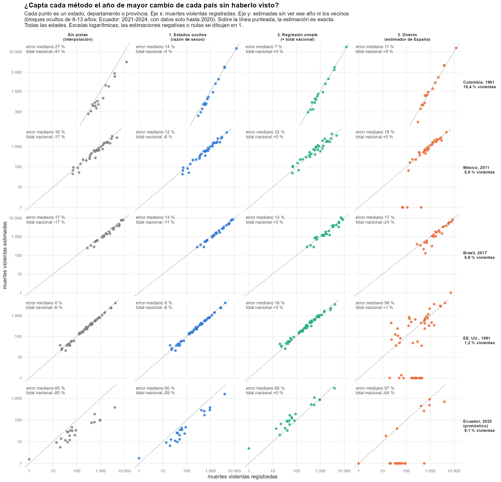
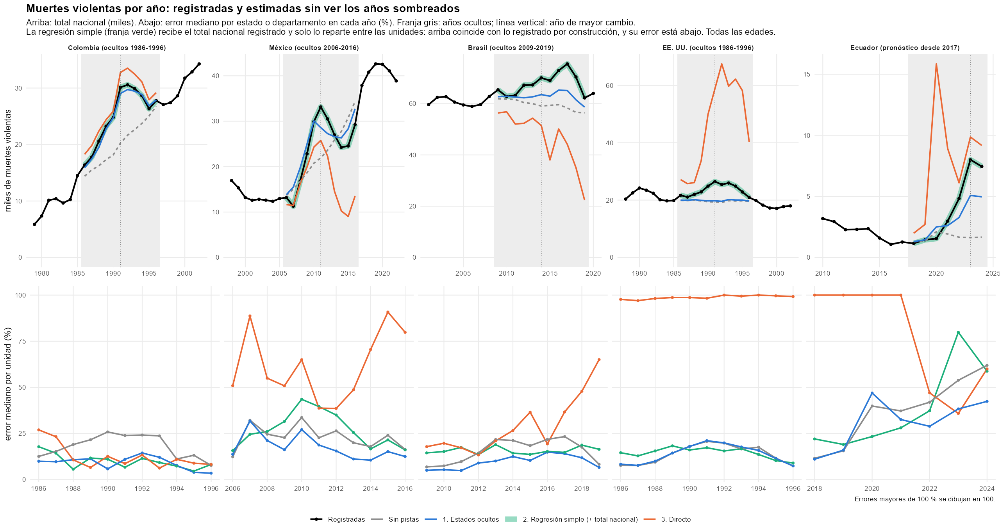
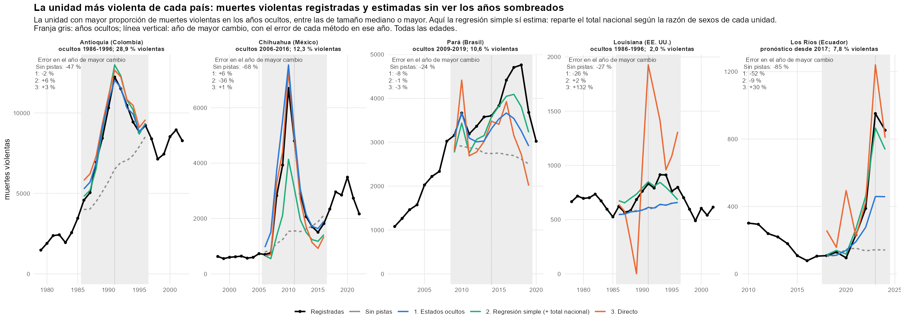
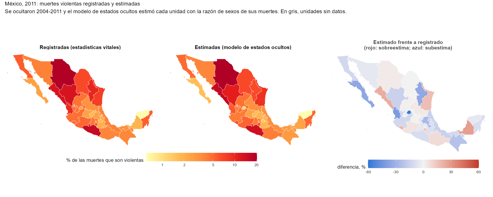
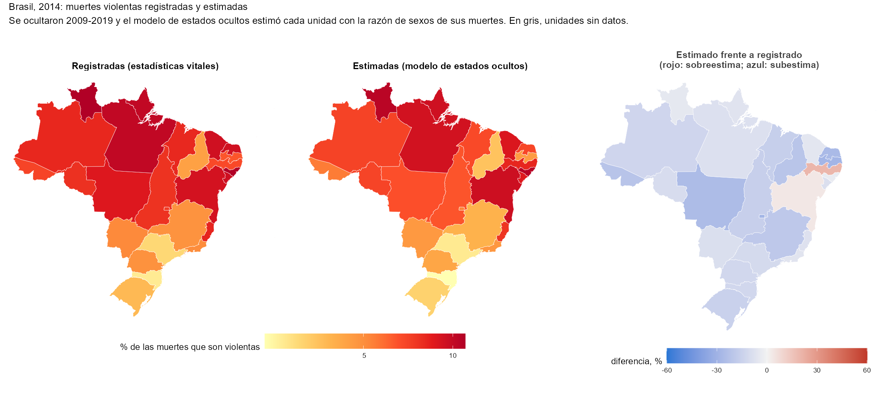
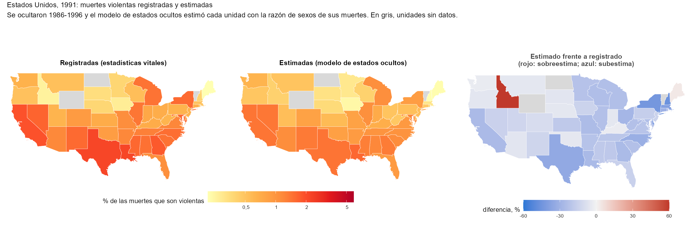
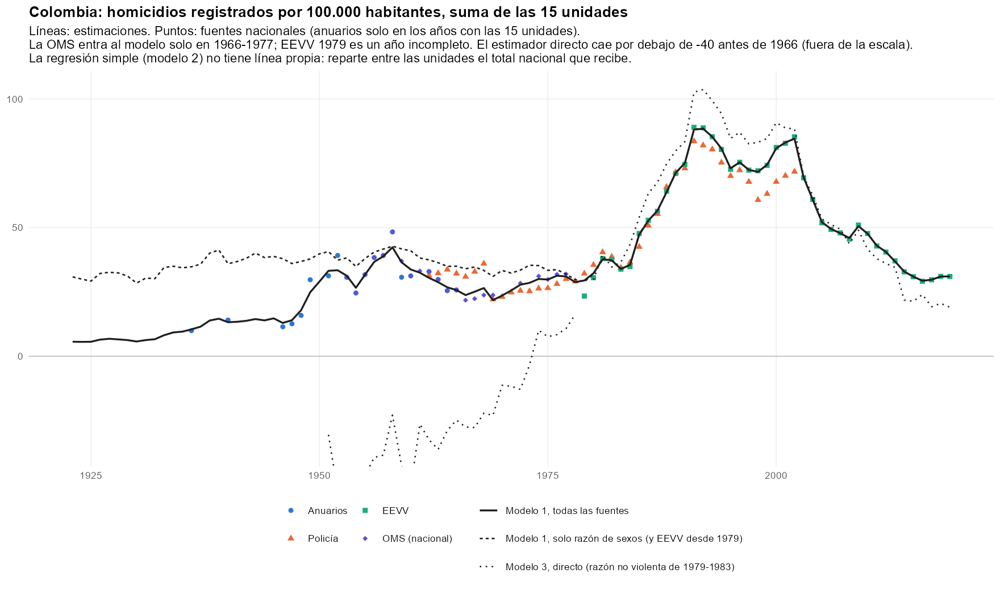
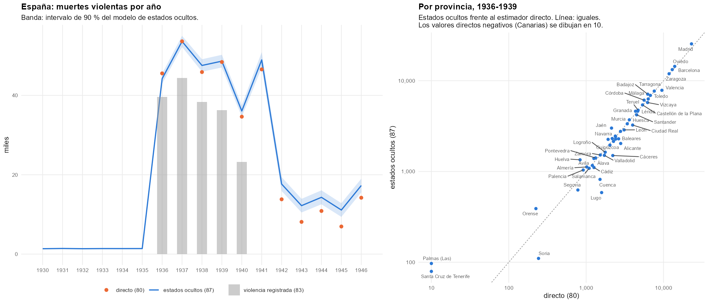
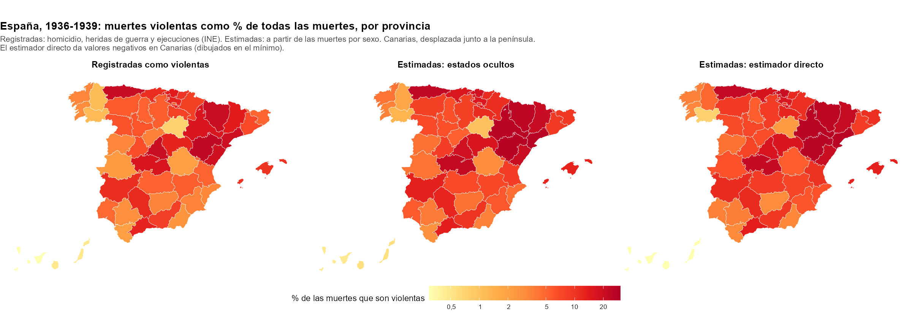
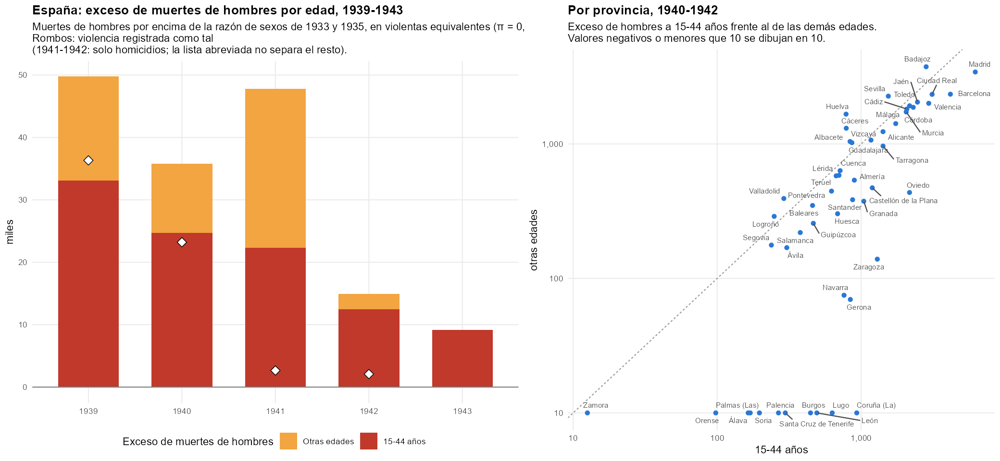

# Homicidios a partir de la razón de sexos de las muertes: resumen y conclusiones

*25 de noviembre de 2026 · resumen para la reunión. El detalle está en los tres informes: [modelo de Colombia](modelo_homicidios_departamental.html), [validación internacional](reporte_validacion_internacional.html) y [España](reporte_prueba_ciega_estimador_espana.html).*

## La idea en una frase

Las víctimas de muertes violentas son casi todas hombres (78–95 %), y las demás muertes se reparten entre hombres y mujeres de forma estable. Si en un lugar y un año mueren más hombres de lo esperable, lo más probable es que haya habido violencia. Con eso se puede estimar la violencia donde no hay causas de muerte, como en la Colombia de antes de 1979 o en España durante la guerra civil, usando solo las muertes por sexo.

## Los tres métodos

| | Qué hace | Qué necesita en los años que estima | Qué necesita en otros años, para aprender |
|---|---|---|---|
| **1. Estados ocultos** (el principal) | Sigue año a año dos cantidades que no se ven: la proporción de muertes violentas y la razón de sexos de las muertes no violentas. Las une con la razón de sexos observada mediante una identidad contable, y combina todas las fuentes disponibles según su ruido. | Muertes por sexo de cada unidad. El total nacional de homicidios es opcional y mejora la estimación. | Homicidios **por unidad** en algunos años (anuarios, Policía, estadísticas vitales), para fijar el nivel y saber cuánto se mueve cada cosa |
| **2. Regresión simple** | Regresión de las muertes violentas de cada unidad sobre la razón de sexos y el total nacional. Sirve de referencia. | Muertes por sexo y totales de cada unidad, y el **total nacional** de homicidios de ese año | Homicidios **por unidad** en otros años, para estimar los coeficientes |
| **3. Estimador directo** | Despeja las muertes violentas de cada año con la misma identidad, fijando la razón de sexos no violenta en la de un periodo de paz. Es el que se usó en España. | Muertes por sexo de cada unidad | **Ningún homicidio**: solo un periodo base de paz y la proporción de hombres entre las víctimas (~0,95) |

**Lo que esto implica:**
- **El estimador directo es el único que funciona donde no hay ningún dato de homicidios por unidad,** como en España en la guerra. Los otros dos necesitan algunos años con homicidios por unidad para aprender.
- **En la Colombia histórica sí hay de dónde aprender:** los anuarios de 1923–65 y las estadísticas vitales desde 1979.
- **En España,** para usar el modelo de estados ocultos hubo que tomar como dato por provincia las causas violentas registradas.

Ninguno usa la población, así que los errores de los censos no entran en la estimación.

## 1. ¿Qué tan bien funciona? El año de mayor cambio de cada país

En cinco países con causas de muerte conocidas, cada método estimó las muertes violentas de años que no vio. Para cada país se evalúa el año de su **mayor cambio**, que es donde se ve si un método capta la dinámica. Ese año se ocultó junto con los **5 años anteriores y los 5 posteriores**, para que quede igual de lejos de los datos conocidos por ambos lados. Si se ocultara solo hasta ese año, el año siguiente conocido le daría al modelo casi el mismo nivel y la interpolación parecería mejor de lo que es.

| País | Año evaluado | Qué pasó | Años ocultos |
|---|---|---|---|
| Colombia | 1991 | Pico de violencia, de 14.500 muertes violentas en 1985 a 30.100 | 1986–1996 |
| México | 2011 | Guerra contra el narco, de 11.300 en 2007 a 33.100 | 2006–2016 |
| Brasil | 2014 | Subida hasta el máximo de 2017 (75.500) y caída posterior. Los datos terminan en 2020, así que el bloque no puede centrarse en 2017 | 2009–2019 |
| EE. UU. | 1991 | Pico de comienzos de los noventa | 1986–1996 |
| Ecuador | 2023 | Explosión, de 1.153 en 2018 a 7.999 | 2018–2024: cinco años antes, como en los demás países, y desde antes de que empezara la subida. No hay datos posteriores, así que es un pronóstico |

La figura compara, unidad por unidad, lo registrado en las estadísticas vitales (eje x) con lo estimado (eje y). Si un punto cae sobre la línea punteada, la estimación es exacta. En cada panel van el error mediano por unidad y el error del total nacional.

*Los puntos pegados al borde inferior (valor 1) son estimaciones negativas o nulas, casi todas del estimador directo.*

**Error mediano por departamento o estado (%)** y, entre paréntesis, error del total nacional:

| País y año | Violentas, % de las muertes | Sin pistas (interpolar) | 1. Estados ocultos | 2. Regresión simple | 3. Directo |
|---|---|---|---|---|---|
| Colombia, 1991 | 18,4 | 24 (−33 %) | 11 (−4 %) | **7** (dado) | 9 (+9 %) |
| México, 2011 | 5,6 | 23 (−34 %) | **19** (−14 %) | 40 (dado) | 39 (−22 %) |
| Brasil, 2014 | 5,7 | 21 (−16 %) | **13** (−9 %) | 14 (dado) | 27 (−27 %) |
| EE. UU., 1991 | 1,2 | 21 (−27 %) | 21 (−25 %) | **17** (dado) | 98 (+122 %) |
| Ecuador, 2023 | 9,1 | 54 (−80 %) | 38 (−37 %) | 80 (dado) | **36** (+23 %) |

*Todas las edades. "Sin pistas" es un modelo ingenuo: traza una línea recta entre el último año conocido antes del bloque y el primero después, o, en el pronóstico de Ecuador, repite el nivel de 2017. No extrapola tendencias. La regresión simple conoce además el total nacional de cada año ("dado"), así que solo reparte ese total entre las unidades.*

**Cómo se lee:**
- **La razón de sexos capta los saltos.** En Colombia 1991, interpolar se queda corto un 33 % en el total nacional, y el modelo de estados ocultos, solo un 4 %. Unidad por unidad, el error baja de 24 % a 11 %. En México 2011 el total pasa de −34 % a −14 %, y en Brasil, de −16 % a −9 %.
- **Donde la violencia pesa muy poco (EE. UU., 1,2 %), la razón de sexos no añade nada:** 21 % de error con y sin ella. Ahí solo ayuda conocer el total nacional (17 %).
- **Un pronóstico de un salto como el de Ecuador es más difícil, pero la razón de sexos lo detecta.** Sin pistas, el modelo repite el nivel de 2017 y se queda corto un 80 %. Con la razón de sexos capta buena parte de la subida, aunque sin ningún año posterior que lo corrija: queda corto un 37 %.
- **El estimador directo funciona donde la violencia pesa mucho.** En Colombia 1991 tiene 9 % de error por unidad, y en Ecuador 2023, 36 %: tan bien o mejor que el modelo de estados ocultos, aunque en Ecuador sobreestima el total un 23 %. Donde la violencia pesa poco falla, con muchas estimaciones negativas (México, EE. UU.).

**Cómo evoluciona la estimación en el tiempo.** La figura siguiente muestra todos los años ocultos, no solo el de mayor cambio. Arriba está el total nacional registrado (negro) y el estimado por cada método. Abajo, el error mediano por estado o departamento en cada año. La regresión simple aparece arriba como una franja verde que coincide con lo registrado: recibe el total nacional y solo lo reparte entre las unidades. Su error está en el panel de abajo.

- **Colombia:** el modelo de estados ocultos sigue la subida y la caída de 1986–96 casi exactamente, y el error por departamento queda en 5–15 % todos los años. Interpolar se queda muy por debajo del pico, con 20–25 % de error.
- **México:** capta la subida de 2008–11 sin verla. Después de 2011 sobreestima, porque la violencia bajó más rápido de lo que la razón de sexos indica, y aun así queda más cerca que interpolar.
- **Brasil:** sigue el nivel con menos de 15 % de error por estado. La subida de 2015–17 la capta solo en parte.
- **EE. UU.:** la violencia es el ~1 % de las muertes y el modelo es casi igual a interpolar. No capta el pico de 1991.
- **Ecuador:** el pronóstico desde 2017 capta más de la mitad de la subida de 2021–23 (unas 5.000 muertes violentas estimadas en 2023, frente a 8.000 registradas) y después se aplana.
- **El estimador directo** acierta el nivel en Colombia, pero en el resto oscila mucho de un año a otro y se aleja del registrado.

**La unidad más violenta de cada país.** A nivel de un solo estado o departamento, la regresión simple (modelo 2) sí produce una estimación propia, porque reparte el total nacional según la razón de sexos de cada unidad. Se eligió la unidad con mayor proporción de muertes violentas en los años ocultos, entre las de tamaño mediano o mayor.

| Unidad | Violentas, % | Sin pistas | 1. Estados ocultos | 2. Regresión simple | 3. Directo |
|---|---|---|---|---|---|
| Antioquia, 1991 | 28,9 | −47 % | **−2 %** | +6 % | +3 % |
| Chihuahua, 2011 | 12,3 | −68 % | +6 % | −36 % | **+1 %** |
| Pará, 2014 | 10,6 | −24 % | −8 % | **−1 %** | −3 % |
| Louisiana, 1991 | 2,0 | −27 % | −26 % | **+2 %** | +132 % |
| Los Ríos, 2023 (pronóstico) | 7,8 | −85 % | −52 % | **−9 %** | +30 % |

*Error de cada método en el año de mayor cambio.*

- **En las unidades muy violentas, los tres métodos siguen la subida, y no interpolar es lo que más importa.** Antioquia y Chihuahua son los dos casos más claros: interpolar se queda 47 % y 68 % corto.
- **La regresión simple acierta cuando el total nacional ya trae la información** (Louisiana, Pará y Los Ríos). Pero subestima los picos concentrados en una unidad: en Chihuahua 2010–11, el epicentro de la guerra contra el narco, se queda 36 % corta. Reparte el total con una relación entre razón de sexos y violencia aprendida en años normales, y no concentra la violencia lo suficiente.
- **El modelo de estados ocultos sigue bien los picos** (Antioquia, Chihuahua), pero sin el total nacional no ve lo que la razón de sexos no muestra (Louisiana, con 2 % de muertes violentas) ni un salto en un pronóstico (Los Ríos).
- **El estimador directo acierta en las unidades muy violentas** (Antioquia, Chihuahua, Pará) y oscila mucho donde la violencia pesa poco (Louisiana).

**Lo mismo en mapas.** Para cada país, la proporción de las muertes de ese año que fueron violentas: a la izquierda la registrada, en el centro la estimada por el modelo de estados ocultos sin ver esos años, y a la derecha la diferencia. Rojo quiere decir que sobreestima y azul que subestima. Se usa el porcentaje de las muertes, no la tasa por habitante, porque los modelos no usan población.

*En Colombia, los departamentos se agrupan en las 15 unidades estables del modelo (Territorios reúne los antiguos territorios nacionales). Límites: Natural Earth.*

**Un año común para todos (2015, con 2011–2018 ocultos)** da el mismo orden. El modelo de estados ocultos tiene el menor error mediano en 4 de 5 países: Colombia 8 %, Brasil 9 %, Ecuador 21 % y EE. UU. 7 %. En México gana la regresión simple con el total nacional, 17 % frente a 21 %. El estimador directo solo se acerca en Colombia, con 18 %. La figura está en `figures/09_international/intl_holdout_2015.png`.

**La validación completa** repite esto en 20 combinaciones de país, edad y tipo de prueba (bloques intermedios, 15 años hacia atrás y 4 años hacia adelante), y el patrón es el mismo:
- **Sin el total nacional,** el modelo de estados ocultos es el mejor o empata en 17 de las 20.
- **Hacia atrás, a 15 años,** la razón de sexos puede empeorar el resultado donde la violencia pesa poco (Brasil, Ecuador), porque el envejecimiento también mueve la razón de sexos.
- **Los intervalos del 90 % del modelo** son confiables en años intermedios, pero demasiado estrechos hacia atrás: contienen el valor real solo el 64–88 % de las veces.

## 2. Colombia: homicidios por departamento, 1915–2019

El modelo de estados ocultos combina para 15 unidades (departamentos o grupos de departamentos estables) cuatro fuentes:
- los anuarios (1923–65);
- la Policía (1962–97);
- las estadísticas vitales (desde 1979);
- la serie nacional de la OMS (1966–77).

Además trata las celdas de los anuarios que parecen errores de transcripción.

| Periodo | Homicidios registrados estimados | Por año | Tasa por 100.000 |
|---|---|---|---|
| 1915–45 | 22.500 | 700 | 9 |
| 1946–65 (La Violencia) | 81.400 | 4.100 | 29 |
| 1966–78 | 73.800 | 5.700 | 27 |
| 1979–97 | 373.900 | 19.700 | 60 |
| 1998–2019 | 475.500 | 21.600 | 51 |

**Cómo leer la figura:**
- **La línea negra continua es la estimación principal.** Es la suma de los 15 departamentos (o grupos de departamentos) según el modelo de estados ocultos con todas las fuentes: la razón de sexos todos los años, los anuarios en 1923–65, la Policía en 1962–97, las EEVV desde 1979 y el total de la OMS en 1966–77.
- **Los puntos son las fuentes originales,** sumadas a nivel nacional. Donde hay datos, la línea los reproduce: no es una prueba de predicción, que es la de la sección 1.
- **La línea a rayas es el mismo modelo con solo la razón de sexos,** sin anuarios, Policía ni OMS (solo ve las EEVV desde 1979). Antes de 1966 queda plana en 30–40 por 100.000, muy por encima de los anuarios. Confirma que en esos años la razón de sexos casi no informa.
- **La línea punteada es el estimador directo,** con la razón de sexos no violenta de 1979–83 fija hacia atrás. Desde 1985 sigue la forma de la serie, aunque sobreestima el pico. Antes cae a valores negativos, porque la razón de sexos no violenta cambió mucho en 60 años (de 1,04 a 1,29). Por eso el directo solo sirve cerca de su periodo base.
- **La regresión simple no tiene línea propia,** porque reparte entre los departamentos el total nacional que recibe.

**Lo principal:**
- **La razón de sexos ayuda mucho desde 1985,** cuando los homicidios son el 10–15 % de las muertes: el error en años ocultos baja de 20 % a 9 % (1985–97) y de 16 % a 7 % (1998–2010).
- **Antes de 1966 aporta poco,** porque los homicidios eran solo el 2–3 % de las muertes. Ahí la serie se apoya en los anuarios, y el modelo sirve sobre todo para limpiarlos y llenar sus huecos.
- **El hueco de 1966–78 depende de la Policía,** que es inestable, ajustada al total nacional de la OMS: la suma queda a menos del 3 % de la OMS en 1972–77.
- **Subregistro:** corregido por el registro incompleto de defunciones, el total sube 3–12 % antes de 1998 (escenario central), con correcciones mayores en Bolívar–Córdoba–Sucre y Magdalena–Cesar (+38–40 %).
- **Ajuste reciente:** el modelo pasó a escala logit, que es lo composicional. Las estimaciones cambiaron menos de 1 % y los intervalos cubren algo mejor.

## 3. España, 1936–1946

Es una aplicación a un contexto sin causas de muerte confiables. Se usaron las muertes por provincia y sexo de 1926–1946, transcritas de los anuarios del INE, y se contrastaron con las causas violentas registradas en 1936–42, también transcritas.

| | 1936–39 (guerra) | 1940–42 (posguerra) |
|---|---|---|
| Exceso total de muertes | ~350.000 | ~217.000 |
| Muertes violentas, estimador directo | 193.500 | 95.000 |
| Muertes violentas, estados ocultos | 194.000 | 102.700 |
| Registradas como violentas | 158.700 | 28.000–64.000 |
| Incertidumbre estadística | ±7 % (183.000–210.000) | |
| Rango razonable, con los sesgos | **160.000–240.000** | **techo: ~95.000–103.000** |
| Según la prueba por edad (datos provisionales) | | **violencia ~60.000–73.000; hambre ~25.000–39.000** |

*El mapa muestra lo mismo que la tabla: las dos estimaciones siguen a lo registrado, con más violencia en el frente de Aragón, Madrid y el norte. El estimador directo falla donde hubo poca violencia (Canarias, Galicia).*

**Lo principal:**
- **1936–39 es sólido.** Dos métodos con supuestos distintos dan lo mismo (194.000). Las estimaciones coinciden con la literatura (Salas, Ortega y Silvestre) y con la violencia registrada provincia por provincia (correlación 0,94). Las propias causas registradas confirman que el 93–97 % de las víctimas eran hombres.
- **El registro contiene cerca del 80 % de la violencia en 1936–39 y del 65 % en 1940.** Es la primera estimación con incertidumbre de lo que faltó en el registro.
- **1940–42: la edad separa el hambre de la represión.** El exceso de muertes de hombres (~100.000) es un techo, y lo registrado como violento (28.000–64.000) un piso. Con las muertes de 15–44 años, recién digitalizadas y aún provisionales, se ve que en 1940 y 1942 el exceso está sobre todo en hombres jóvenes, el perfil de la represión. Solo en 1941, el año del hambre y del tifus, la mitad cae en otras edades.
  - **Violencia, incluida la represión registrada bajo otras causas:** ~60.000–73.000.
  - **Hambre:** ~25.000–39.000.
  - **Faltan** la segunda lectura de los datos por edad y separar las muertes de guerra inscritas tarde.

- **Los bombardeos casi no cambian el total** (+1,7 %), pero sí algunas provincias: Oviedo +15 %, Barcelona +9 %.
- **En curso:** la digitalización de las muertes por provincia, sexo y edad simple de 1933–46. Ya están completas las edades 15–44 de 1933, 1935 y 1939–43. No existe en formato abierto y sería una contribución publicable.

## Conclusiones

1. **La razón de sexos de las muertes es un indicador útil de violencia letal donde la violencia pesa en el total de muertes** (más de ~5–10 %). Ahí reduce el error a la mitad. Donde pesa poco, no aporta.
2. **El modelo de estados ocultos es el método recomendado.** Gana o empata en casi todas las pruebas y nunca empeora mucho respecto de interpolar. El estimador directo, más simple, solo sirve con violencia alta y sumando varios años, como en la España de la guerra.
3. **Para la Colombia histórica,** la reconstrucción es buena desde 1985 y razonable en 1946–65 gracias a los anuarios. La razón de sexos añade poco antes de 1966.
4. **Los intervalos son demasiado estrechos al reconstruir hacia atrás,** y hay que ampliarlos antes de publicar.
5. **España muestra que el método funciona en una guerra.** Da cifras coherentes con décadas de investigación histórica, y además estima cuánto faltó en el registro.

### Qué existe y qué aporta este trabajo

**Lo que ya existe.** La idea de usar el exceso de muertes de hombres para estimar muertes de guerra está publicada, pero en una versión simple:
- **Kobak y otros (2025, *Demography*):** muertes de guerra de Rusia en 2022–23, con la razón de sexos de las muertes. Suponen que todas las víctimas son hombres, trabajan solo a nivel nacional y no validan el método.
- **Hacker (2011) y Barceló y otros (2024, *PNAS*):** muertes de la Guerra Civil de EE. UU. con censos, también solo a nivel nacional.
- **Heuveline (Camboya):** separa el exceso en violento y no violento, pero reconstruyendo la población, no con las muertes registradas.
- **Correcciones de homicidios mal clasificados:** existen, como los "homicidios ocultos" de Brasil o la redistribución de causas mal definidas, pero todas parten de las causas de muerte.
- **Para España,** Ortega y Silvestre (2006) estiman el exceso de hombres y de mujeres por provincia, pero no lo separan en violento y no violento. Salas (1977) suma y corrige las causas registradas.

**Lo que aportaría en general:**
- Un método que estima la violencia letal **sin usar las causas de muerte**, por unidad subnacional y año, admitiendo víctimas mujeres.
- Un modelo de estados ocultos que combina la razón de sexos con las fuentes incompletas que haya.
- **Validación a ciegas en cinco países:** se sabe cuándo funciona (violencia por encima del ~5–10 % de las muertes) y cuándo no.
- **Una forma de corregir la mala clasificación y el subregistro** de la violencia en las estadísticas vitales. No hay precedente que lo haga con la composición por sexo de las muertes.

**Lo que aportaría a España:**
- La primera **separación del exceso de 1936–42 en violento y no violento** por provincia y año, sin depender de cómo se registró la causa.
- La primera **medida nacional de cuánta violencia llegó al registro como tal:** ~80 % en 1936–39 y ~65 % en 1940. Hasta ahora solo había estudios locales; en Sevilla, por ejemplo, solo el 17 % de las víctimas documentadas está inscrito.
- Un **dataset abierto** de muertes por provincia, sexo y edad de 1933–46, que hoy no existe.

*Basado en una revisión rápida de la literatura; antes de publicar conviene una búsqueda más exhaustiva.*

## Próximos pasos

- Calibrar los intervalos hacia atrás con estas mismas pruebas.
- Terminar la digitalización por edad en España, hacer la segunda lectura y confirmar la separación de hambre y represión en 1940–42.
- Explorar un modelo con más categorías (homicidios, accidentes y resto) donde haya datos de accidentes, porque los accidentes también matan sobre todo hombres.
- Decidir qué se publica primero: el método y su validación, o la aplicación a España junto con el dataset abierto.
